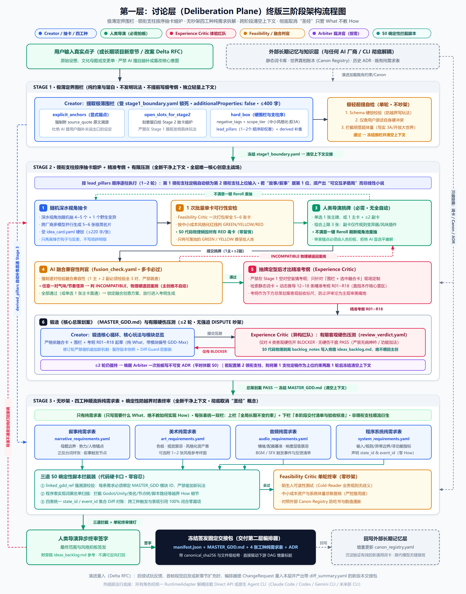

# 2D / 轻 2.5D 风格化游戏多 Agent 工作流（v5.0 架构重构）

> **当前阶段**：v5.0 全链路架构重构中 —— **第一层（讨论层 / Deliberation Plane）终版设计与面向第二层编排器的固定输出契约已彻底定稿并锁定**（Tag：`deliberation/v1.0-contract-locked`）。

> [!TIP]
> **⭐ 历史代码与文档回溯指南（重要）**
> 本仓库已清理早期原型代码与旧版草案，以轻装推进 v5.0 分层解耦架构。
> 所有历史基线——包括 **v1.0 CLI 静态分解**、**v3.0 动态编排可视化平台（`app.py` / `backend/` / `frontend/`）**、**《丝烬幽窟》2D 银河城可玩切片（`hollow_grapple/`）** 以及 **v4.0–v4.3 架构设计文档与评审意见**——均已永久完整归档在 Git 注解标签 **`archive/v4.3-pre-reset`**，随时可一键检出查阅或回滚：
>
> ```bash
> # 切换到重构前完整历史基线（只读查阅）
> git checkout archive/v4.3-pre-reset
>
> # 或按需提取单个历史文件（例如查看旧版 v4.3 架构文档）
> git show archive/v4.3-pre-reset:docs/总体架构设计-九阶段双编排器全链路架构-v4.3.md
> ```

---

## ⭐ 给第二层（编排器）开发者的快速对接入口

* **固定输出接口契约（必读）**：**[docs/layer1_to_orchestrator_contract.md](docs/layer1_to_orchestrator_contract.md)**
  * 第一层输出已完全锁死为：`manifest.json` + `MASTER_GDD.md`（附 `gdd_index.yaml`）+ **4 张工种纯需求表**（叙事 / 美术 / 音频 / 程序系统）+ 外部长期记忆（`canon_registry.yaml` / `ADR`）；
  * 彻底取消长篇“圣经”概念，保证 **100% 纯 What、零引擎/How 污染、跨表 `state_id / event_id` 全闭合**，并内置 `canonical_sha256` 与 `diff_summary.yaml` 协议，直接支持编排器自动建图、断点续跑与 DAG 增量标脏重排。

---

## 第一层：讨论层（Deliberation Plane）设计总览

* **完整工程规范**：**[docs/deliberation_layer_spec.md](docs/deliberation_layer_spec.md)**
  * **Stage 1 · 极薄定界围栏**：受 `stage1_boundary.yaml`（`additionalProperties: false`，≤400 字）硬锁，强制 `source_quote` 原文溯源，刻意留白不提前发明玩法，指定 `lead_pillars`（1~2 个，顺序即权重）与自动补集 `derived_pillars`。
  * **Stage 2 · 领衔支柱按序抽卡熔炉 + 精准考纲 + 有限压测**：随机深水视角 + 野生变异跨厂商抽卡 → 1 次批量单卡可行性安检（物理销毁 `RED` 毒卡）→ 人类导演必需挑牌（单选或 `1 主 + ≤2 副` 上限 3 张，支持 `Reroll`）→ AI 逐对融合兼容性判官（任意一对怪异物理硬退回）→ 抽牌定型后生成 12~18 条精准考纲 → 锻造 `MASTER_GDD.md` 与 ≤2 轮有限客观硬伤压测（代码剥离 `backlog_notes`，僵持交 `Arbiter` 拍板写 `ADR`）。
  * **Stage 3 · 无吵架四工种顺流拆纯需求表 + 确定性对表终审**：并行产出叙事/美术/音频/程序系统 4 张双栏纯需求表 → 三道 $0 确定性脚本拦截器（`linked_gdd_ref` 强溯源 + 程序实现词黑名单 + 四表 `state_id/event_id` 集合 Diff 对账）→ `Feasibility Critic` 单轮陌生人可读性/体量/Canon 终审 → 人类导演签字冻结签发。



---

## 仓库核心文档与课程基线清单

| 文档路径 | 角色 / 状态 | 说明 |
| :--- | :--- | :--- |
| **[docs/layer1_to_orchestrator_contract.md](docs/layer1_to_orchestrator_contract.md)** | **已锁定契约（v1.0）** | 第一层 → 第二层编排器固定交接包规范、字段级 Schema、完整示例与 Delta RFC 升版协议 |
| **[docs/deliberation_layer_spec.md](docs/deliberation_layer_spec.md)** | **终版规范（v5.0）** | 第一层讨论层三阶段工程设计规范、热插拔 `RuntimeAdapter`、防越界 Schema 与协议硬禁令 |
| **[docs/assets/deliberation_layer_flowchart.png](docs/assets/deliberation_layer_flowchart.png)** | 高清架构图（2x DPI） | 第一层讨论层终版三阶段执行流程图 |
| [docs/group4-process-design.pdf](docs/group4-process-design.pdf) | 课程基线 PDF（保留） | 第四组全流程软件工程过程设计基线文档 |
| [docs/multi-agent-discussion-workflow-design-v1.2.pdf](docs/multi-agent-discussion-workflow-design-v1.2.pdf) | 课程基线 PDF（保留） | 上游多 Agent 讨论工作流设计基线 v1.2 |

---

## 当前仓库目录结构

```text
software-engineering-team4/
├── README.md
├── .gitignore
└── docs/
    ├── deliberation_layer_spec.md                       # 第一层讨论层终版工程设计规范
    ├── layer1_to_orchestrator_contract.md               # 第一层 → 编排器固定输出契约（纯需求表规范）
    ├── assets/
    │   └── deliberation_layer_flowchart.png             # 终版三阶段架构流程图（HiDPI）
    ├── group4-process-design.pdf                        # 保留：课程基线设计 PDF
    └── multi-agent-discussion-workflow-design-v1.2.pdf  # 保留：多 Agent 讨论工作流设计基线 PDF
```
