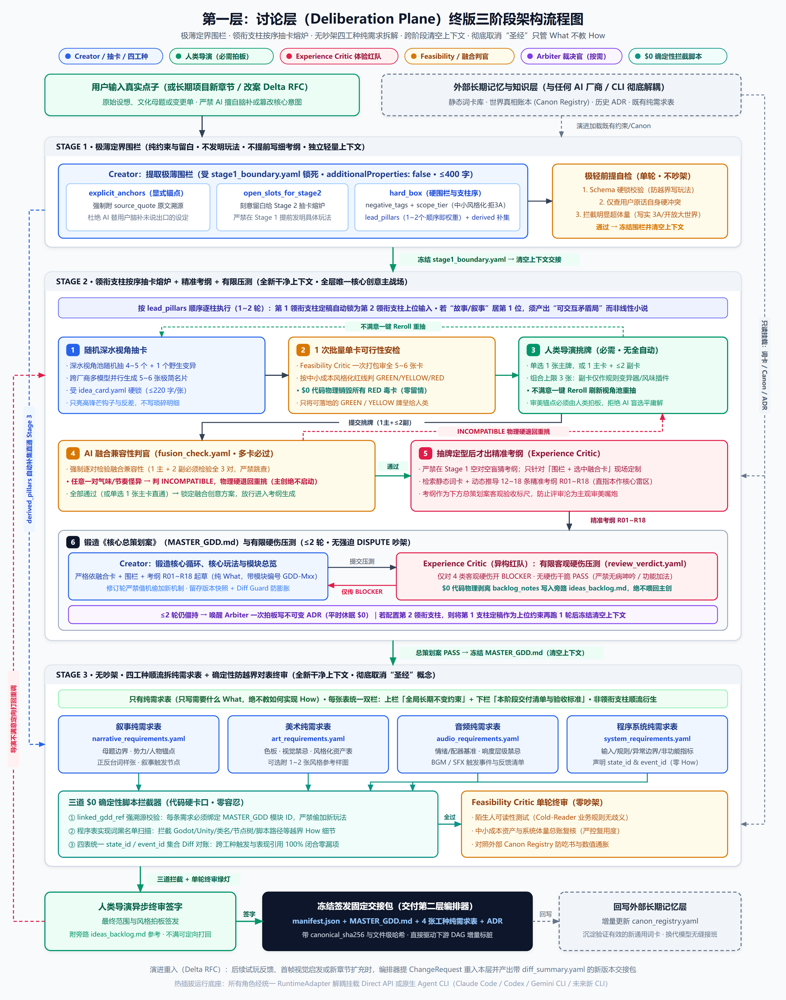
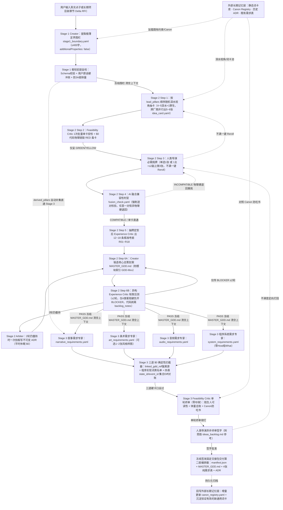

# 第一层：讨论层（Deliberation Plane）终版工程设计规范

> [!IMPORTANT]
> 本规范为 **2D / 轻 2.5D 风格化游戏多 Agent 工作流（v5.0 重构版）** 中 **第一层（讨论层）** 的终版工程规约。
>
> 核心定位：**极薄定界围栏 · 领衔支柱按序抽卡熔炉 · 无吵架四工种纯需求拆解 · 跨阶段清空上下文 · 彻底取消“圣经”统一为纯需求表 · 只管 What 不教 How**。
>
> 若你是第二层（编排器）开发者，请直接对接冻结接口文档：**[第一层 → 编排器固定输出契约（layer1_to_orchestrator_contract.md）](layer1_to_orchestrator_contract.md)**。

---

## 一、定位、边界与七条设计铁律

| 维度 | 工程铁律 |
| :--- | :--- |
| **作品体量与定位** | 面向**中小成本、风格化、高广度**的 2D / 轻 2.5D 游戏；明确拒绝写实 3A 画面军备竞赛，不预设底层 2D/轻 3D 技术路线，不写死单一游戏品类。 |
| **职责纯度（只管 What，不教 How）** | 讨论层只产出**「需要什么（纯业务/内容需求与客观验收标准）」**与**「可行性确认」**；**严禁编写任何引擎绑定、类名、节点树、脚本路径或实现教程**。 |
| **彻底取消“圣经”概念** | 不再产出动辄上万字且边界模糊的“世界观圣经 / 美术圣经”，全量收口为 **1 份《核心总策划案》 + 4 张工种纯需求表（叙事/美术/音频/程序系统）**；每张纯需求表严格分为 **上栏「全局长期不变约束」+ 下栏「本阶段交付清单与验收标准」**。 |
| **人类审美主权（必需挑牌，无全自动）** | Stage 2 抽卡熔炉必须由人类导演亲自挑牌（单选 1 张，或 `1 主 + ≤2 副` 上限 3 张），不满意一键 `Reroll`；拒绝让 AI 全自动盲选导致平庸均值化。 |
| **热插拔执行底座（`RuntimeAdapter`）** | 所有角色均通过统一 `RuntimeAdapter` 解耦挂载 **Direct API** 或 **原厂原生 Agent CLI**（Claude Code / Codex / Gemini CLI / 未来新 CLI），不手搓重型 Agent 循环。 |
| **跨阶段严格清空上下文** | **绝不让单一会话拖着全流程对话残渣跑到底！** Stage 1 → Stage 2 → Stage 3 之间**只交接冻结定稿产物**并彻底销毁前序会话上下文，杜绝废案锚定污染。 |
| **双层记忆解耦（厂商无关）** | 阶段内短期上下文即用即毁；**外部长期记忆层**（静态词卡库、世界真相账本 `Canon Registry`、不可变 `ADR`、既有纯需求表）全部以纯文本结构化文件沉淀，支持长周期大项目多章节演进与换代模型无缝接班。 |

---

## 二、完整三阶段执行流程图



<details>
<summary>展开可复制的扁平 Mermaid 源码（无嵌套子图，兼容全版本解析器）</summary>



</details>

---

## 三、角色体系与热插拔 `RuntimeAdapter` 配置

### 1. 分阶段角色职责矩阵

| 适用阶段 | 角色 / 组件 | 并发与实例 | 核心职责与选型原则 |
| :--- | :--- | :---: | :--- |
| Stage 1 / Stage 2 | **`Creator`（主创统筹）** | 1（跨阶段清空会话） | Stage 1 提取极薄围栏；Stage 2 依选中融合卡与精准考纲锻造《核心总策划案》。 |
| Stage 2 Step 1 | **`Card Generators`（跨厂商抽卡池）** | 5~6 并发 | 注入不同深水视角与野生变异，用**跨厂商异构模型并行抽卡**，最大化创意方差与锋芒。 |
| Stage 2 Step 5~6 | **`Experience Critic`（体验红队）** | 1（异构独立会话） | 抽牌定型后生成 12~18 条精准考纲 `R01~R18`，并对总策划案做 ≤2 轮有限客观硬伤压测；**强制与 Creator 异构跨厂商**破除自恋盲区。 |
| Stage 1 / Stage 2 Step 2 & 4 / Stage 3 | **`Feasibility Critic`（可行性与融合判官）** | 1（按步骤隔离会话） | 承担四处轻量精准把关：Stage 1 极轻前提自检、Stage 2 一次批量单卡安检、Stage 2 逐对融合兼容性判官、Stage 3 单轮陌生人可读性/体量/Canon 终审。 |
| Stage 2 Step 6（按需） | **`Arbiter`（裁决官）** | 0~1（平时休眠 $0） | 仅当总策划案压测 2 轮仍僵持时唤醒，按优先级宪法一次拍板并写入不可变 `ADR`。 |
| Stage 3 | **四工种纯需求专家**（叙事 / 美术 / 音频 / 程序系统） | 4 并行（全新会话） | 严守“无吵架、只顺流拆需求、只写 What 不写 How”，分别产出 4 张纯需求表（美术可选外挂生图插件出 1~2 张风格参考样图）。 |
| Stage 1 / 2 / 3 | **`Deterministic Guards`（$0 确定性脚本）** | 本地代码执行 | Schema 硬校验、物理销毁 `RED` 毒卡、物理剥离 `backlog_notes`、Stage 3 三道防越界对表拦截器与 SHA-256 冻结签名。 |

### 2. 热插拔底座配置示例（`deliberation_runtime.yaml`）

```yaml
runtime_adapters:
  # Stage 1 & 2 主创
  creator:
    adapter: cli                        # 支持 cli 或 api，随时零代码热替换
    runtime: claude-cli
    model: "strong-creative"
    context_policy: reset_per_stage     # 跨阶段强制清空上下文

  # Stage 2 Step 1 跨厂商抽卡池（并行产出 5~6 张 idea_card）
  card_draw_pool:
    - { adapter: api, provider: "anthropic", model: "creative-a" }
    - { adapter: api, provider: "openai",    model: "creative-b" }
    - { adapter: api, provider: "google",    model: "creative-c" }

  # Stage 2 体验红队（必须与 Creator 跨厂商异构）
  experience_critic:
    adapter: api
    model: "heterogeneous-reasoning"
    context_policy: reset_per_stage

  # 可行性安检 / 融合兼容性判官 / Stage 3 单轮终审
  feasibility_critic:
    adapter: cli                        # 便于原生检索外部 Canon Registry 与历史需求表
    runtime: codex-cli
    model: "strong-engineering"
    context_policy: reset_per_step

  # 裁决官（平时休眠 $0）
  arbiter:
    adapter: api
    model: "flagship-thinking"
    trigger: on_round2_deadlock

  # Stage 3 四工种并行拆表专家（全新上下文，零历史讨论噪声）
  stage3_specialists:
    narrative: { adapter: api, model: "strong-writing",     context_policy: fresh }
    art:       { adapter: api, model: "strong-visual-spec", context_policy: fresh }
    audio:     { adapter: api, model: "strong-audio-spec",  context_policy: fresh }
    system:    { adapter: cli, runtime: codex-cli, model: "strong-spec-analyst", context_policy: fresh }

tools:
  style_reference_image:
    enabled: true                       # 可一键关闭；仅限 Stage 3 美术纯需求表
    provider: "pluggable-image-api"
    max_images: 2
```

---

## 四、三阶段执行细则与防越界 Schema 规范

### Stage 1：极薄定界围栏（纯约束与留白 · 不发明玩法 · 不提前写细考纲）

**目标**：只把用户原话里真正拍板的边界抽取出来，刻意把创意空间留白给 Stage 2 抽卡熔炉。绝不允许在 Stage 1 空对空发明玩法或提前写十几条空泛考纲。

1. **Creator 提取围栏**：严格按 `stage1_boundary.yaml`（`additionalProperties: false`，全文有效文本 **≤ 400 字**）输出四块结构：
   * **`explicit_anchors`**：每一条锚点都必须携带 `source_quote`（逐字摘录用户原话），代码校验 `source_quote` 是否为输入原文子串，从物理层面杜绝 AI 脑补用户没说过的要求；
   * **`open_slots_for_stage2`**：显式声明哪些创意维度刻意留白交由 Stage 2 抽卡决定；
   * **`hard_box`**：
     * `negative_tags`（明确排斥的套路与重资产）；
     * `scope_tier`（锁定中小成本风格化 2D / 轻 2.5D 档位，明确拒写实 3A）；
     * `lead_pillars`（**1~2 个领衔支柱，数组顺序即权重**：如 `["narrative", "gameplay"]` 或 `["gameplay"]`）；
     * `derived_pillars`（代码自动按全集 `{gameplay, narrative, art, audio} \ lead_pillars` 计算补集，**直通 Stage 3 顺流衍生**，绝不在 Stage 2 喧宾夺主）。
2. **极轻前提自检（单轮，不吵架）**：
   * $0 Schema 校验 + `Feasibility Critic` 仅检查两件事：① 用户原话自身是否存在无法共存的硬冲突；② 是否明显突破中小体量硬红线（如要求写实 3A 开放大世界）。
   * 若命中冲突，直接以简短选项请用户确认取舍；无冲突即**冻结 `stage1_boundary.yaml` 并彻底清空 Stage 1 上下文**。

#### Anti-Boundary-Crossing Schema：`stage1_boundary.yaml`

```yaml
# JSON/YAML Schema 约束：additionalProperties: false, max_total_chars: 400
schema_version: "stage1_boundary/v1"
project_id: "xiyou-nverguo"
explicit_anchors:
  - anchor_id: "ANC-01"
    dimension: "theme"
    statement: "以西游记女儿国为母题，核心不是打怪而是抉择与试探"
    source_quote: "想做西游记女儿国题材，不想做成纯打怪，重点是抉择和试探"
  - anchor_id: "ANC-02"
    dimension: "art_style"
    statement: "水墨工笔风格化 2D 呈现"
    source_quote: "画面要水墨工笔的 2D 风格化"
open_slots_for_stage2:
  - "核心交互局与博弈循环形态"
  - "子母河异变机制与代价结构"
  - "关键矛盾人物关系与博弈反转"
hard_box:
  scope_tier: "indie_stylized_2d"       # 枚举: micro_2d | indie_stylized_2d | indie_light_25d (严禁 3a_realistic)
  negative_tags:
    - "写实3D PBR重资产"
    - "纯数值刷怪ARPG"
    - "开放大世界漫游"
  lead_pillars:                         # 硬限制 minItems: 1, maxItems: 2；顺序即绝对权重
    - "narrative"                       # 第1领衔支柱（故事居首位时 Stage 2 必须输出“可交互矛盾局”）
    - "gameplay"                        # 第2领衔支柱（以第1支柱定稿作为不可违背的上位输入）
  derived_pillars:                      # 自动补集，直通 Stage 3 顺流衍生
    - "art"
    - "audio"
```

---

### Stage 2：领衔支柱按序抽卡熔炉 + 精准考纲 + 有限压测（全新干净上下文）

**定位**：全层**唯一核心创意主战场**。按 `lead_pillars` 数组顺序执行 **1~2 轮**：
* 第 1 领衔支柱定稿后自动锁定，作为第 2 领衔支柱的不可违背上位输入；
* **故事领衔铁律**：当 `narrative` 排在 `lead_pillars[0]` 时，抽卡与定稿产出必须是**“玩家可操作、有明确代价与反馈的可交互矛盾局”**，严禁产出只能被动翻页的线性纯小说大纲。

#### 6 步标准化执行流

1. **Step 1 · 随机深水视角抽卡**
   * 代码从动态深水视角池随机抽取 **4~5 个结构化深水视角** + **1 个高反差野生变异视角**，分发给跨厂商多模型并行生成 **5~6 张极简名片**；
   * 每张名片严格受 `idea_card.yaml` 锁死（**≤ 220 字/张**，禁写琐碎数值与实现），只亮出最锋利的核心钩子、核心抉择/循环与反差张力。
2. **Step 2 · 1 次批量单卡可行性安检**
   * `Feasibility Critic` **一次性打包审全 5~6 张卡**（严禁逐卡展开多轮对话），按中小成本风格化红线逐张给出 `GREEN / YELLOW / RED` 分级与一句风险标注；
   * **$0 代码物理销毁所有 `RED` 毒卡**，只将 `GREEN / YELLOW` 牌呈递给人类导演。
3. **Step 3 · 人类导演挑牌（必需，无全自动模式）**
   * 人类导演亲自从过检手牌中做出选择：
     * **单选 1 张主卡**（直通 Step 5）；或
     * **组合挑牌：`1 主卡 + ≤2 副卡`（硬上限 3 张）**，明确声明副卡只作为**规则变异器（rule_mutator）**或**风味插件（flavor_plugin）**，严禁把 3 个完整主玩法硬揉成缝合怪；
   * 若手牌全部缺乏灵气，人类一键触发 **`Reroll`** 刷新视角池重抽。
4. **Step 4 · AI 融合兼容性判官（`fusion_check.yaml` · 多卡必过）**
   * 只要人类选中 ≥2 张卡，必须先由 `Feasibility Critic`（判官视角）执行**强制逐对检验（Pairwise Check）**：
     * `1 主 + 1 副` 检 1 对；`1 主 + 2 副` **强制检全 3 对**（主↔副1、主↔副2、副1↔副2）；
   * 只要**任意一对**出现核心节奏冲突、情绪气味割裂或体量乘法爆炸，代码立即判 **`INCOMPATIBLE` 并物理硬退回 Step 3 重挑**——**主创绝不启动，绝不允许 AI 硬着头皮强缝！**
5. **Step 5 · 抽牌定型后才出精准考纲（`Experience Critic`）**
   * 创意形态完全落袋后，`Experience Critic` 针对 `stage1_boundary.yaml` + 选中融合卡，查询外部静态词卡库并现场动态推导 **12~18 条精准考纲（`R01~R18`）**，直指本作真实体验雷区与必答设计题。
6. **Step 6 · 锻造《核心总策划案》与有限硬伤压测（≤ 2 轮，无强迫 DISPUTE 吵架）**
   * `Creator` 在围栏 + 融合卡 + 考纲 `R01~R18` 约束下锻造 **`MASTER_GDD.md`**（同步生成带模块编号 `GDD-M01..Mxx` 的 `gdd_index.yaml`，只写 What 与规则闭环）；
   * 异构 `Experience Critic` 输出 `review_verdict.yaml` 执行有限压测（硬上限 **2 轮**）：
     * 仅对 **4 类客观硬伤** 开 `BLOCKER`：① 规则/逻辑自相矛盾；② 漏写关键边界或使用未落地空话；③ 违背围栏/`Negative`/考纲必答项或与 `Canon` 吃书；④ 超出中小成本体量红线；
     * 无客观硬伤必须干脆签发 **`PASS`**（严禁凑数挑刺、严禁无休止 `DISPUTE` 吵架）；
     * 红队若顺带写了零星发散灵感（`backlog_notes`），**$0 代码将其物理剥离写入旁路 `ideas_backlog.md`**，绝不喂回 `Creator` 污染主线；
   * 若 2 轮修订后仍僵持，唤醒 **`Arbiter`** 按优先级宪法一次拍板并写入不可变 `ADR`；
   * 全部领衔支柱定稿后，**冻结 `MASTER_GDD.md` + `gdd_index.yaml` 并彻底清空 Stage 2 上下文**。

#### Anti-Boundary-Crossing Schemas（Stage 2）

**1. `idea_card.yaml`（≤ 220 字/张，`additionalProperties: false`）**

```yaml
schema_version: "idea_card/v1"
card_id: "CARD-NAR-03"
pillar: "narrative"                     # 必须匹配当前执行的 lead_pillar
lens_used: "不可逆社会契约与身份伪装（深水视角）"
is_wildcard: false
generator_model: "provider-b/creative-b"
title: "《子母河畔·问心局》"
core_hook: "取经人误饮子母河水后并非单纯求堕胎，而是每隐瞒一次真实意图，腹中因果印记便迫使朝堂宫廷规则发生一次镜像反转。"
interactive_conflict: "玩家在七日朝议内通过呈递证词、交换信物与藏匿体征与太师/国主周旋，每一步伪装都换取当前安全却推高终局暴露风险。"
anti_cliche_twist: "女儿国并非铁板一块，国主明知外来者身份却借此反制太师旧礼法。"
scope_footprint: "单宫廷5场景 + 6核心角色 + 2D立绘/对话/证物盘问系统"
feasibility_badge: "GREEN"              # Step 2 批量安检回填: GREEN | YELLOW | RED(物理销毁)
feasibility_note: "纯2D叙事盘问与状态机，无重资产风险。"
```

**2. `fusion_check.yaml`（强制逐对检验，`additionalProperties: false`）**

```yaml
schema_version: "fusion_check/v1"
primary_card_id: "CARD-NAR-03"
secondary_cards:
  - { card_id: "CARD-NAR-05", role: "rule_mutator" }    # 枚举: rule_mutator | flavor_plugin
  - { card_id: "CARD-NAR-02", role: "flavor_plugin" }
pairwise_checks:                        # 代码强制校验组合数 == C(N, 2)；1主+2副必须有3条
  - pair: ["CARD-NAR-03", "CARD-NAR-05"]
    verdict: "COMPATIBLE"               # 枚举: COMPATIBLE | INCOMPATIBLE
    reason: "昼夜宵禁时限（变异器）与七日朝议隐瞒张力节奏同频，未额外膨胀资产。"
  - pair: ["CARD-NAR-03", "CARD-NAR-02"]
    verdict: "COMPATIBLE"
    reason: "水墨印章盖印交互（风味插件）可直接承载朝议呈词确认反馈。"
  - pair: ["CARD-NAR-05", "CARD-NAR-02"]
    verdict: "COMPATIBLE"
    reason: "宵禁倒计时与朱砂印章耗损共享同一视觉隐喻，无冲突。"
overall_verdict: "COMPATIBLE"           # 代码断言：任意一条 pairwise != COMPATIBLE 则强制 INCOMPATIBLE 并物理打回重挑
```

**3. `review_verdict.yaml`（有限客观硬伤压测，`additionalProperties: false`）**

```yaml
schema_version: "review_verdict/v1"
round: 1                                # 硬上限: 2
target_artifact: "MASTER_GDD.md@v0.2"
decision: "REJECT"                      # 枚举: PASS | REJECT
blockers:                               # decision==PASS 时必须为空数组 []
  - blocker_id: "BLK-01"
    category: "MISSING_BOUNDARY"        # 仅限4类: LOGIC_CONTRADICTION | MISSING_BOUNDARY | RULE_OR_CANON_VIOLATION | SCOPE_OVERFLOW
    rubric_ref: "R07"
    location: "GDD-M02 朝议质询循环"
    objective_defect: "未定义当疑心值达到 100% 且玩家恰好处于宵禁过渡帧时的结算优先级。"
    required_fix_scope: "补充状态触发先后顺序与异常兜底结果，禁止新增额外子系统。"
backlog_notes:                          # $0 代码物理剥离写入 memory/ideas_backlog.md，绝不回传 Creator！
  - "未来 DLC 可考虑追加一个市井说书人旁观视角彩蛋。"
```

---

### Stage 3：无吵架 · 四工种顺流拆纯需求表 + 确定性防越界对表终审（全新干净上下文）

**核心原则**：
* **彻底取消“圣经”概念！** 本阶段只产出 4 张结构化纯需求表；
* **零吵架顺流拆解**：创意方向与核心玩法已在 Stage 2 彻底冻结，Stage 3 不再争论好不好玩，只做高精度、零歧义、零越界的工种需求映射；
* **非领衔支柱顺流衍生**：Stage 1 中自动划入 `derived_pillars` 的支柱在此严格服务于 `MASTER_GDD.md` 顺流展开；
* **统一双栏表结构**：4 张表全部遵循统一骨架——上栏 `global_constraints`（全局长期不变约束：色板/禁忌/叙事铁律/非功能硬指标）+ 下栏 `stage_deliverables`（本阶段/本章节交付清单、触发引用与客观验收标准）。

#### 1. 四工种并行产出
* **`requirements/narrative_requirements.yaml`**（叙事需求表）：世界观铁律、人物/势力关系锚点、正反台词样张、剧情触发节点清单；
* **`requirements/art_requirements.yaml`**（美术需求表）：风格化定位、主/辅/强调/UI 色板、图底分离与视觉禁忌、资产与复用组清单（**可选附 1~2 张外部生图参考样图**）；
* **`requirements/audio_requirements.yaml`**（音频需求表）：情绪/配器基准、听觉层级与禁忌、BGM 状态切换与 SFX 触发清单；
* **`requirements/system_requirements.yaml`**（程序系统需求表）：非功能硬指标、功能需求卡（输入/业务规则/异常边界/验收标准）及权威声明的 **`exposed_state_ids` / `emitted_event_ids`**（100% 纯 What，零引擎/代码绑定）。

#### 2. 三道 $0 确定性脚本拦截器（代码硬卡口，任意未过即打回对应单表重出）
1. **`linked_gdd_ref` 强溯源校验**：四张纯需求表中的每一条 `stage_deliverables` 条目必须携带有效的 `linked_gdd_ref`（精确命中 `gdd_index.yaml` 中的 `GDD-Mxx`），彻底封死 Stage 3 专家借拆表之名偷加新玩法；
2. **程序表实现词黑名单扫描**：对 `system_requirements.yaml` 执行确定性词表/正则扫描，凡出现引擎专有名词、类/组件实现、脚本/路径指导（如 `Godot`、`Unity`、`Unreal`、`GDScript`、`C#`、`MonoBehaviour`、`CharacterBody2D`、`SceneTree`、`.gd`、`.cs`、`Prefab`、`ShaderGraph`、`React` 等）立即零容忍阻断；
3. **四表统一 `state_id / event_id` 集合 Diff 对账**：提取 `system_requirements.yaml` 声明的全量 `ST_*` / `EVT_*` 集合，与叙事/美术/音频三表引用的 `linked_state_ids` / `trigger_event_ids` 做精确集合 Diff——任何悬空引用（消费了系统未声明的状态/事件）或孤立死事件（系统声称触发表现却无任何下游表承接）当场报错阻断，确保跨工种契约 100% 闭合。

#### 3. `Feasibility Critic` 单轮终审（零吵架）
三道脚本全绿后，进入全新会话执行单轮终审：
1. **陌生人可读性测试（Cold-Reader Check）**：以零背景工程师/画师视角核对每条需求是否存在形容词空话或遗漏边界条件；
2. **中小成本体量总账与复用核查**：汇总资产总数、动画帧档与系统复杂度，确保在 `scope_tier` 预算内；
3. **外部 `Canon Registry` 防吃书审计**：对照既有长期真相账本拦截设定自相矛盾与数值通胀。

#### 4. 人类导演异步终审签字与冻结回写
终审全绿后，打包提交**人类导演异步终审签字**（同步附上被剥离的旁路 `memory/ideas_backlog.md` 供顺眼阅览）。导演签字后：
* 代码生成带 `canonical_sha256` 与文件级哈希的固定交接包（详见 [layer1_to_orchestrator_contract.md](layer1_to_orchestrator_contract.md)），正式交付第二层编排器；
* 自动回写外部长期记忆层（增量更新 `canon_registry.yaml`，并将验证有效的新通用玩法/风格词卡沉淀入静态词卡库）。

---

## 五、协议级硬禁令清单（Hard Prohibitions）

> [!CAUTION]
> LLM 在面对“礼貌的优化建议”时极难主动拒绝，几乎必然越改越肿、锋芒尽失。讨论层**不依赖提示词呼吁 AI 自觉**，而是用代码硬卡口 + 明文禁令锁死以下 7 条红线：

1. **严禁 `SUGGESTION` / `backlog_notes` 回流主创**：代码物理剥离所有非 `BLOCKER` 灵感写入旁路 `ideas_backlog.md`，`Creator` 永远不可见；
2. **严禁强制挑刺与无休止 `DISPUTE` 吵架**：无 4 类客观硬伤时红队必须干脆签发 `PASS`；Stage 2 压测硬上限 2 轮，仍僵持直接交 `Arbiter` 拍板写 `ADR`，严禁陷入拉锯战；
3. **严禁 Stage 1 偷写具体玩法或细考纲**：`stage1_boundary.yaml` 以 `additionalProperties: false` 与 400 字上限物理封死越界；
4. **严禁全自动盲选创意牌**：Stage 2 Step 3 必须暂停等待人类导演挑牌或 `Reroll`，不设无人值守自动挑牌开关；
5. **严禁强缝不兼容卡牌**：`fusion_check.yaml` 只要任意一对为 `INCOMPATIBLE`，代码物理拦截退回重挑，严禁唤醒 `Creator` 强行圆场；
6. **严禁 Stage 3 偷加新玩法或复活“圣经”长文**：所有条目强制 `linked_gdd_ref` 溯源校验，彻底淘汰长篇大论无结构“圣经”；
7. **严禁在需求表中夹带任何 How 实现指导**：`system_requirements.yaml` 必须通过确定性实现词黑名单扫描，保持 100% 引擎无关的纯 What 纯度。

---

## 六、长期大项目增量演进重入机制（Delta RFC）

当项目进入长周期多章节研发，或下游编排器在**试玩反馈、视觉首帧验收、范围裁剪**中需要修改需求时，讨论层通过 **Delta RFC 模式** 轻量重入，绝不推翻既有资产重来：

1. **输入触发**：接收下游提交的 `change_request.yaml`（标明 `base_spec_version`、受影响模块/需求 ID 与变更诉求），同时挂载既有外部记忆层（`canon_registry.yaml`、历史 `ADR` 与当前版本交接包）；
2. **按变更级别自动路由**：
   * **Tier A · 局部口径/验收/数值补清**：直接跳过 Stage 1/2，在 Stage 3 定向修订受影响的纯需求表，重新跑通**三道 $0 确定性拦截器 + `Feasibility Critic` 单轮终审**；
   * **Tier B · 新章节内容扩充 / 局部机制微调**：进入轻量 Stage 1（核对既有 `hard_box` 与 `Canon`）→ Stage 2 针对新章节跑 1 轮抽卡/定稿 → Stage 3 仅增量追加对应表下栏 `stage_deliverables`（不动上栏 `global_constraints`）；
   * **Tier C · 顶层玩法/核心支柱变更**：全链路重跑 Stage 1~3，强制核查与历史 `ADR` 的冲突并追加新 `ADR` 声明废止旧决议；
3. **确定性升版交付**：签发新版本号交接包（如 `v1.0.0 → v1.1.0`，携带 `parent_version`）并自动生成 **`diff_summary.yaml`**（精确列出 `added_ids` / `modified_ids` / `deprecated_ids` / `unchanged_ids`），让第二层编排器直接执行 DAG 增量标脏重排，100% 保留未受影响的已完成下游任务。
