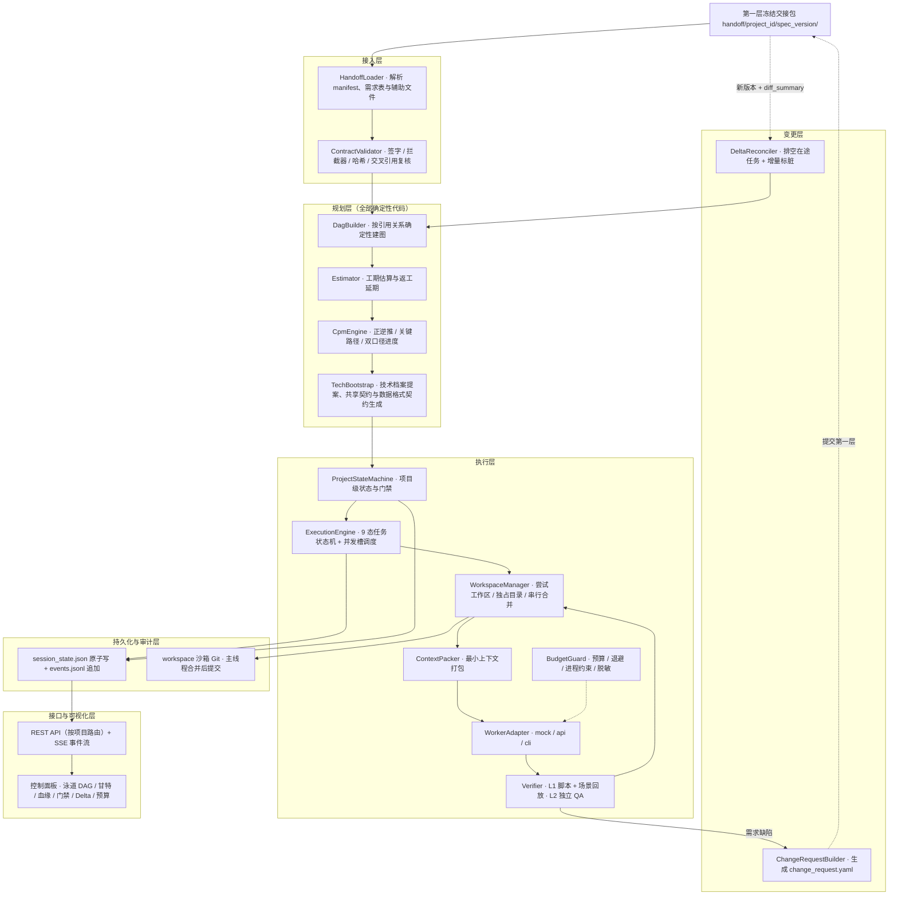
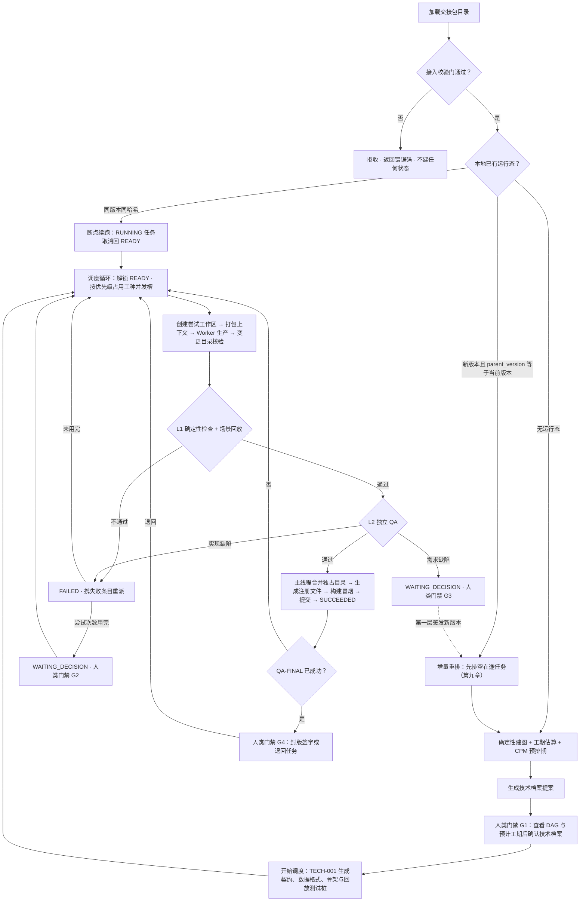
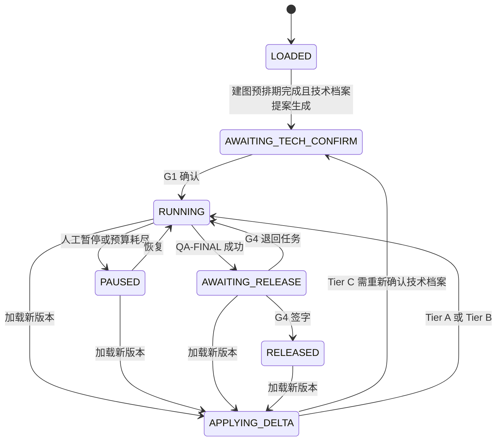
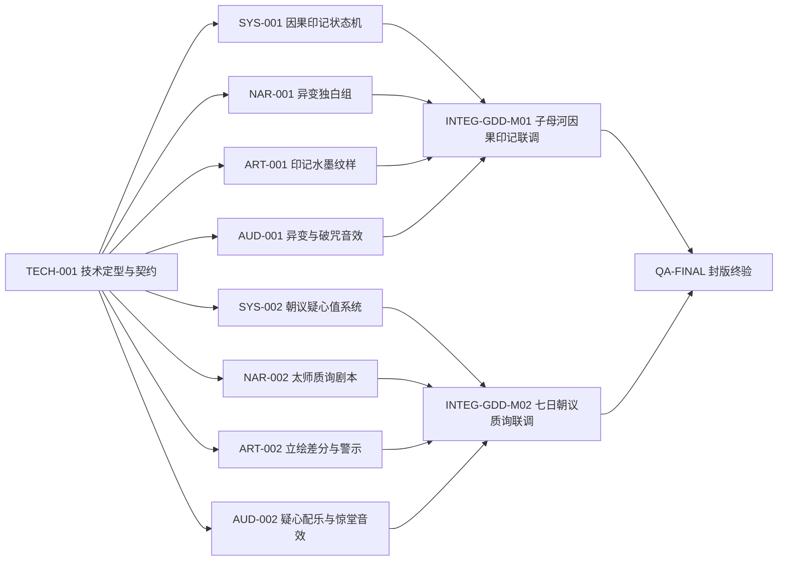
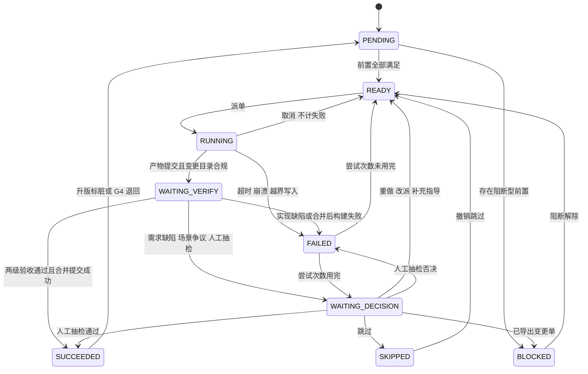

# 第二层：编排器（Orchestration Plane）工程设计方案

> [!IMPORTANT]
> 本方案是 **2D / 轻 2.5D 风格化游戏多 Agent 工作流（v5.0 重构版）** 中 **第二层（编排器）** 的工程设计规约。
>
> 核心定位：**只消费第一层冻结交接包 · 确定性建图与排期 · 隔离工作区并发生产 · 两级验收（脚本 + 独立 QA） · 变更只走 Delta RFC 回流 · 增量标脏、已完成产出原样复用**。
>
> 上游接口唯一依据：**[第一层 → 编排器固定输出契约（layer1_to_orchestrator_contract.md）](layer1_to_orchestrator_contract.md)**（Tag：`deliberation/v1.0-contract-locked`）。

| 文档属性 | 内容 |
| :--- | :--- |
| **文档版本** | v1.1（吸收第一轮评审与自查修订，待第二轮评审） |
| **适用契约** | `layer1-handoff/v1.0` |
| **默认运行环境** | 具备真实 LLM API Key；`mock` 模式只用于单测、CI 与离线演示 |
| **实现状态** | **仅为设计，尚未编码**。仓库历史 v3.0 编排引擎（Tag `archive/v4.3-pre-reset`）中的 CPM、调度循环、沙箱 Git 与 DAG 看板可按第十四章迁回复用 |
| **日期** | 2026-11-28 |

---

## 修订记录

| 版本 | 日期 | 说明 |
| :--- | :--- | :--- |
| v1.0 | 2026-11-28 | 初稿 |
| v1.1 | 2026-11-28 | 吸收第一轮评审（P0×5、P1×5、P2×3）中成立的部分，并补充 6 项自查问题；明细见下表 |

### v1.1 修订明细

| 编号 | 来源 | 修订内容 | 位置 |
| :--- | :--- | :--- | :--- |
| R1 | 评审 P0-1 | 每次尝试使用独立工作区（`git worktree`）；每个任务独占按 `req_id` 划分的子目录；验收通过后由主线程合并提交 | §5.6、§7.3 |
| R2 | 评审 P0-2 | 技术档案提案移出 DAG，作为项目级 G1 门；接入后先建图预排期再过 G1；`TECH-001` 只在 G1 之后生成契约与骨架；新增项目级状态机，人类门禁不再挤进任务状态机 | §3.2、§5.1 |
| R3 | 评审 P0-3 | 任务状态机补边：跳过分为“豁免放行 / 阻断下游”；升版先排空在途任务；G4 退回；取消不计失败次数；尝试次数改为 `max_attempts` 明确口径 | §7.1、§9.2 |
| R4 | 评审 P0-5 | 编排器内置叙事 / 美术 / 音频三类核心数据格式契约，由代码生成，`TECH-001` 只能扩展字段不能删改 | §5.4 |
| R5 | 评审 P0-4（第 4 点） | 系统任务的验收场景由独立 QA 编写、作者只读，经回放测试桩执行；作者自写测试不作为验收依据 | §5.5、§8.1 |
| R6 | 评审 P0-4（第 1~3 点） | L1 检查现实化：标识符扫描限定 `ST_` / `EVT_` / `IN_` 前缀；色板检查区分矢量源文件与位图；运行时指标依赖技术档案声明的测试桩命令，测不了标为人工项交 G4，不静默放行 | §8.2 |
| R7 | 评审 P1-2（升为 P0） | 官方样例 `manifest.files` 未列 ADR 与参考图；v1.0“未列入不读取”会丢掉 `SYS-001` 依赖的 `ADR-001`。改为兼容模式加载并告警，严格模式可拒收 | §4.1 |
| R8 | 评审 P1-3 | 增加预算上限、API 退避、CLI 进程与环境变量约束、日志脱敏；预算耗尽暂停项目，不降级为 mock | §7.5 |
| R9 | 评审 P1-4 | 补充 `session_state`、`Task`、`GateDecision`、`tech_profile` 关键字段；定义 `delay_hours` 来源 | §5.2、§6.4、§10.2 |
| R10 | 评审 P1-5 | 里程碑拆为 M1~M5 | §16 |
| R11 | 评审 P1-1、P2 | API 按 `project_id` 路由；定义 `pause` / `cancel_running` / `step` 语义 | §12 |
| R12 | 评审 P2 | 修正写路径注释冲突；补充升版时非成功态任务的处理 | §5.6、§9.2 |
| R13 | 自查 | v1.0“同复用组派给同一 Worker 实例”对无状态 API Worker 没有意义，改为同组串行派单并把先完成的产物作为参考传入 | §6.2、§7.2 |
| R14 | 自查 | v1.0“逐字节一致”承诺过宽，收窄为：建图与排期逐字节一致；mock 模式整次运行可复现；真实模式只保证同一调度周期内提交顺序确定 | §1.3 |
| R15 | 自查 | 升版时 ADR、Canon 变化也纳入标脏，不只依赖 `diff_summary.yaml` | §9.2 |
| R16 | 自查 | 美术 L2 需要视觉模型与渲染预览；音频主观质量模型难以判断。未配置相应能力时强制人工抽检 | §8.3 |
| R17 | 自查 | CPM 不含资源约束（并发槽、复用组串行），资源等待在甘特图单列，避免预计工期误导 | §6.5 |
| R18 | 自查 | 共享入口与注册文件改由编排器从各任务索引生成，联调任务不改共享文件，避免并发联调冲突 | §5.6 |
| R19 | 自查 | 契约只给出输入的自然语言描述，没有输入标识符，验收场景无法机读。`TECH-001` 为每条输入登记 `IN_*` 标识并由代码核对全覆盖；同时列为待对齐问题 | §5.3、§17 |

### 对第一轮评审意见的处理结论

| 评审条目 | 结论 | 说明 |
| :--- | :--- | :--- |
| P0-1 共享工作区并发 | **采纳** | 问题成立。除工作区隔离外，再加按需求独占子目录，两者叠加后合并不会产生冲突 |
| P0-2 `TECH-001` 顺序矛盾、门禁无状态 | **采纳，修法调整** | 矛盾成立。门禁不宜都塞进任务状态机，G1、G4 是项目级事件，改为单独的项目级状态机；任务级人工决策统一用 `WAITING_DECISION` + 决策类型 |
| P0-3 状态机断边 | **采纳** | 跳过导致封版死锁、升版未排空、G4 退回无边均成立。重试次数口径问题成立但只是表述歧义，按 P2 处理 |
| P0-4 L1 过度理想化 | **部分采纳** | 运行时测试桩缺失、作者自写测试两点成立。标识符扫描原文本就指状态/事件名，属措辞不清。色板“100% 误杀”只对位图成立：默认的程序化路线检查的是矢量源文件的填充/描边色，透明度单独表达，可以精确检查 |
| P0-4 修法“L2 审查作者测试” | **不采纳，换修法** | 让 QA 审查作者写的测试仍然依赖作者。改为验收场景由 QA 独立编写、作者只读 |
| P0-5 缺数据格式契约 | **采纳，修法调整** | 问题成立。核心格式与技术栈无关，由编排器代码固定生成，不交给 `TECH-001` 的 Worker 自由设计 |
| P1-1 API 缺 `project_id` | **采纳，降为 P2** | 单活跃项目也能用，但改动成本低 |
| P1-2 Q2 假设与官方样例矛盾 | **采纳，升为 P0** | 会直接导致 `SYS-001` 拿不到 `ADR-001`，是 v1.0 的自相矛盾 |
| P1-3 预算与 CLI 安全 | **采纳** | 补充时注明：事后文件核对不能阻止运行期副作用，强隔离需容器，文档不宣称已隔离 |
| P1-4 Schema 与延期来源 | **采纳** | — |
| P1-5 里程碑前轻后重 | **采纳** | — |
| P2 三项 | **采纳** | — |

---

## 一、定位、边界与设计铁律

### 1.1 一句话定位

第一层负责定下**做什么（What）**，第二层负责定下**怎么做、谁来做、按什么顺序做、做得对不对（How / Who / When / Verify）**。编排器把一份签字冻结的交接包，变成一个能运行的 2D 游戏工程，以及一份可审计的生产过程记录。

### 1.2 职责边界

| 编排器负责 | 编排器不负责（交还第一层或人类） |
| :--- | :--- |
| 校验并加载交接包，拒收未签字或被篡改的包 | 修改任何需求文本、新增玩法、改写 `MASTER_GDD.md` |
| 技术选型提案、共享契约、工程骨架（How） | 讨论“好不好玩”、重新抽卡或改创意方向 |
| 确定性建图、工期估算、CPM 排期、并发调度 | 把 `ideas_backlog.md` 中的灵感转成任务 |
| 给工种 Worker 打包最小上下文并派单 | 绕过人类签字门推进版本 |
| 两级验收、打回重试、异常升级 | 在下游私自修改冻结契约文件 |
| 生成 `change_request.yaml`，消费 `diff_summary.yaml` 做增量重排 | 决定 Delta RFC 的变更级别（Tier A/B/C 由第一层判定） |
| 状态持久化、事件审计、沙箱 Git 留痕、可视化控制面 | — |

### 1.3 九条设计铁律

| 编号 | 铁律 | 刚性要求 |
| :--- | :--- | :--- |
| **O-1** | **调度确定性，生产可插拔** | 建图、排期、解锁、派单、写权限、重试计数、标脏全部由确定性代码完成；LLM / CLI 只在 `WorkerAdapter` 后面产出内容和代码。**同一交接包 + 同一配置，建出的 DAG、工期与 CPM 结果逐字节一致；mock 模式下整次运行的事件序列可复现；真实模式下 Worker 完成时间不可控，只保证同一调度周期内的状态提交顺序确定。** |
| **O-2** | **只信冻结包** | 唯一输入是通过接入校验门的交接包；不读第一层内部的讨论记录、卡牌或会话。 |
| **O-3** | **最小上下文派单** | 每个任务只拿到“本条需求卡 + 本工种上栏约束 + 引用的状态/事件/输入定义 + 数据格式契约 + 引用的 Canon/ADR + 前置产物清单 + 可写路径”，严禁塞入全量历史。 |
| **O-4** | **隔离工作区，独占目录** | 每次尝试在独立工作区进行，只能改本任务独占的目录；验收通过后由主线程串行合并提交，失败尝试不在主工作区留下任何文件。 |
| **O-5** | **作者不验自己** | 任何产出先过 L1 确定性脚本检查，再交给独立 QA Worker 做 L2 审阅；系统任务的验收场景由 QA 独立编写；作者 Worker 无权把任务置为 `SUCCEEDED`。 |
| **O-6** | **需求缺陷不在下游消化** | 验收发现“需求本身矛盾/缺边界”时，任务挂起并生成 `change_request.yaml`；禁止 Worker 或 QA 自行改口径绕过。 |
| **O-7** | **增量优先** | 升版时只重跑受影响的任务闭包；未受影响且已 `SUCCEEDED` 的产出必须原样复用并保留原始哈希。 |
| **O-8** | **人类门禁零绕过** | 技术定型、任务裁决、变更提单、封版签字四处人类门禁不设自动跳过开关（见第十一章）。 |
| **O-9** | **真实执行有边界** | 有费用与调用次数上限、API 退避、CLI 进程与环境变量约束、日志脱敏；预算耗尽时暂停项目，**不静默降级为 mock 继续出产物**。 |

---

## 二、总体架构



| 模块 | 输入 | 输出 | 是否调用模型 |
| :--- | :--- | :--- | :---: |
| `HandoffLoader` | 交接包目录 | 强类型 `HandoffBundle` 对象 | 否 |
| `ContractValidator` | `HandoffBundle` | 校验报告 / 拒收错误码 / 告警 | 否 |
| `DagBuilder` | `HandoffBundle` | `TaskGraph` | 否 |
| `Estimator` | `TaskGraph` + 基线工时表 + 尝试记录 | `estimate_hours`、`delay_hours` | 可选（受限修正） |
| `CpmEngine` | 带工时的 `TaskGraph` | ES/EF/LS/LF/Slack、关键路径、进度 | 否 |
| `TechBootstrap` | 系统表上栏约束 + `scope_tier` + 技术栈模板 | 技术档案提案；G1 后生成 `contracts/` 下全部契约文件 | 提案与输入标识命名可调模型；契约核心内容由代码生成并校验 |
| `ProjectStateMachine` | 门禁决定、任务汇总状态 | 项目级状态迁移 | 否 |
| `ExecutionEngine` | 排好期的 `TaskGraph` | 任务状态迁移、派单 | 否 |
| `WorkspaceManager` | 主工作区、任务独占目录表 | 尝试工作区、变更清单、合并提交 | 否 |
| `ContextPacker` | 任务 + 交接包 + 契约 + 前置产物 | `task_context.json` | 否 |
| `WorkerAdapter` | `task_context.json` | 产物文件 + `artifact_manifest.json` | 是（`api` / `cli` 模式） |
| `BudgetGuard` | 配置、调用记录 | 放行 / 退避 / 暂停 | 否 |
| `Verifier` | 产物 + 验收条款 + 验收场景 | `verify_report.json` | L1 否；L2 与场景编写是 |
| `ChangeRequestBuilder` | 需求缺陷证据 | `change_request.yaml` | 否 |
| `DeltaReconciler` | 新旧交接包 + `diff_summary.yaml` | 标脏集合、复用集合、新 `TaskGraph` | 否 |

---

## 三、端到端运行流程与项目级状态机

### 3.1 端到端流程



### 3.2 项目级状态机

人类门禁 G1、G4、预算暂停与升版都是**整个项目**层面的事件，单独用项目级状态机表达；任务状态机只描述单个任务。只有项目处于 `RUNNING` 时调度器才会派单。



| 项目状态 | 含义 |
| :--- | :--- |
| `LOADED` | 交接包已通过校验，正在建图与生成技术档案提案 |
| `AWAITING_TECH_CONFIRM` | 等待 G1；用户可以查看完整 DAG、预计工期与技术档案提案 |
| `RUNNING` | 调度器正常派单 |
| `PAUSED` | 停止派新任务（在途任务按 §12.2 的暂停语义处理） |
| `AWAITING_RELEASE` | `QA-FINAL` 已成功，等待 G4 |
| `RELEASED` | 当前版本已封版并打标签 |
| `APPLYING_DELTA` | 正在排空在途任务并执行增量标脏，短暂状态 |

---

## 四、Phase A：接入校验门

### 4.1 校验项与错误码

接入校验全部由代码执行。拒收类错误不创建、不修改任何运行态；告警类写入事件流并显示在看板头部。

| 序号 | 校验项 | 规则 | 结果 |
| :---: | :--- | :--- | :--- |
| A-1 | 契约版本 | `manifest.contract_version == "layer1-handoff/v1.0"` | 拒收 `ERR_CONTRACT_VERSION_UNSUPPORTED` |
| A-2 | 签字状态 | `approval_signature.status == "APPROVED"`，且 `approved_by`、`approved_at` 非空 | 拒收 `ERR_HANDOFF_NOT_APPROVED` |
| A-3 | 上游拦截器 | `interceptors_passed` 四个字段全部为 `true` | 拒收 `ERR_UPSTREAM_INTERCEPTOR_FAILED` |
| A-4 | 文件完整性 | `files[]` 列出的每个文件存在，逐文件 `sha256` 一致 | 拒收 `ERR_FILE_HASH_MISMATCH` |
| A-5 | 包级哈希 | 按约定规则重算 `canonical_sha256` 并比对（规则见 4.2） | 拒收 `ERR_CANONICAL_HASH_MISMATCH` |
| A-6 | Schema | 4 张需求表、`gdd_index.yaml`、`canon_registry.yaml`、ADR 均通过严格 Schema 解析 | 拒收 `ERR_SCHEMA_INVALID` |
| A-7 | 体量档位 | `scope_tier` 属于 `micro_2d / indie_stylized_2d / indie_light_25d` | 拒收 `ERR_SCOPE_TIER_FORBIDDEN` |
| A-8 | 引用复核 | `linked_gdd_ref` 命中 `gdd_index`；三张表引用的 `ST_*` / `EVT_*` 都在系统表中声明；`req_id` 全包唯一；`canon_refs` 命中 `canon_registry` | 拒收 `ERR_CROSS_REF_BROKEN` |
| A-9 | 版本链 | `parent_version` 非空时，本地须有该父版本运行态，或用户显式选择“按全新项目加载” | 拒收 `ERR_PARENT_VERSION_MISSING` |
| A-10 | 辅助文件 | `memory/adr/*.yaml` 与 `references/*` 未列入 `files` | 兼容模式（默认）：加载并记录哈希，告警 `WARN_UNHASHED_AUXILIARY_FILE`；严格模式：拒收 `ERR_UNHASHED_AUXILIARY_FILE` |
| A-11 | ADR 引用 | ADR 的 `impacted_refs` 指向不存在的 `req_id` 或 `GDD-Mxx` | 告警 `WARN_ADR_DANGLING_REF` |

> [!NOTE]
> A-10 默认采用兼容模式，原因是契约官方样例的 `manifest.files` 本身就没有列出 `ADR-001.yaml` 与 `style_ref_01.png`，而 `SYS-001` 的同帧结算规则依赖 `ADR-001`。第一层修订契约、把辅助文件纳入 `files` 后，可把默认值切换为严格模式（见 §17 Q2）。

> [!NOTE]
> A-8 与第一层拦截器重复。复核成本几乎为零，并能防住“包被手工改过但哈希被一起重算”的情况。复核失败按拒收处理，不在下游修补。

**旁路文件隔离**：`memory/ideas_backlog.md` 只登记文件哈希用于审计，`HandoffLoader` 不把它解析进 `HandoffBundle`，`ContextPacker` 物理上无法引用它。

### 4.2 包级哈希规则（待与第一层确认）

契约只写了“对除 `manifest.json` 外的规范化排序文件哈希再次计算”，没有给出拼接格式。编排器建议采用以下规则（§17 Q1）：

```text
lines = sorted(f"{path}:{sha256}" for each file in manifest.files)   # path 使用 / 分隔，相对交接包根目录
canonical_sha256 = sha256("\n".join(lines).encode("utf-8"))
文件级 sha256 一律基于 LF 换行、UTF-8 无 BOM 的原始字节计算
```

### 4.3 会话判定

| 本地情况 | 判定 | 动作 |
| :--- | :--- | :--- |
| 不存在 `project_id` 的运行态 | 全新项目 | 建图预排期 → 技术档案提案 → G1 |
| 存在，且 `spec_version` 与 `canonical_sha256` 都相同 | 断点续跑 | 恢复状态；`RUNNING` 任务按“取消”处理回 `READY`（不计失败），残留尝试工作区删除 |
| 存在，`spec_version` 相同但哈希不同 | 冲突 | 拒收 `ERR_SAME_VERSION_DIFFERENT_CONTENT` |
| 存在，新包 `parent_version` 等于当前运行版本，且带 `diff_summary.yaml` | 升版 | 进入第九章（先排空在途任务） |
| 存在，但版本链对不上 | 冲突 | 拒收 `ERR_VERSION_CHAIN_BROKEN` |

---

## 五、Phase B：技术定型与契约生成

### 5.1 两步结构

| 步骤 | 是否 DAG 节点 | 执行者 | 产出 | 门禁 |
| :--- | :---: | :--- | :--- | :--- |
| **B-1 技术档案提案** | 否（项目级） | `ROLE_TECH_LEAD` Worker 按配置中的技术栈模板生成；也可由人类直接选模板 | `tech_profile.yaml` 草案 | **G1** |
| **B-2 `TECH-001`** | 是 | 代码 + `ROLE_TECH_LEAD` Worker | 共享契约、数据格式契约、输入动作表、工程骨架、回放测试桩、独占目录表 | 常规两级验收 |

设计要点：
- 建图与预排期在 `LOADED` 阶段就完成，人类在 G1 时能看到完整 DAG、预计工期和技术档案，一起做判断；
- B-1 只产出文档、不写代码，G1 修改技术栈不会浪费任何已写代码；
- `TECH-001` 是所有生产节点的唯一前置，运行时没有其他任务并发，可以独占整个工程目录。

### 5.2 技术档案 `tech_profile.yaml`

```yaml
schema_version: "tech_profile/v1"
platform: "web"
language: "typescript"
render: "canvas2d"
data_format: "yaml"                   # 叙事 / 美术 / 音频索引文件的序列化格式
directories:
  systems: "game/src/systems/"
  narrative: "game/data/narrative/"
  art: "game/assets/art/"
  audio: "game/assets/audio/"
  modules: "game/src/modules/"
  generated: "game/src/generated/"
runtime_harness:                      # L1 实际执行的命令；缺失的项在验收时标为人工项
  build: "npm run build"
  unit_test: "npm test"
  scenario_replay: "npm run replay -- {scenario_file}"
  perf_probe: "npm run perf -- --seconds 30"
  save_load_roundtrip: "npm run saveload-check"
  render_preview: "npm run preview -- {asset_file} --size 1280x720"
confirmed_by: null                    # G1 确认后回填
confirmed_at: null
```

### 5.3 共享契约 `contracts/state_events.json`

状态与事件部分**完全由代码从系统表生成**；输入动作部分的标识符由 `TECH-001` 的 Worker 命名，代码校验覆盖完整。

```json
{
  "schema_version": "state_events/v1",
  "source_sha256": "19581e27de7ced00ff1ce50b2047e7a567c76b1cbaebabe5ef03f7c3017bb5b7",
  "states": [
    { "id": "ST_WATER_CURSE_STAGE", "value_type": "enum_int(0..3)", "owner_req": "SYS-001",
      "referenced_by": ["SYS-001"], "meaning": "子母河因果印记阶段：0未染 / 1微澜 / 2显相 / 3满溢" },
    { "id": "ST_COURT_SUSPICION", "value_type": "int(0..100)", "owner_req": "SYS-002",
      "referenced_by": ["SYS-002"], "meaning": "朝堂对取经人一行身份的实时疑心值" }
  ],
  "events": [
    { "id": "EVT_DRINK_RIVER_WATER", "owner_req": "SYS-001", "referenced_by": ["SYS-001"] },
    { "id": "EVT_BREAK_CURSE",       "owner_req": "SYS-001", "referenced_by": ["SYS-001"] },
    { "id": "EVT_DEBATE_EXPOSED",    "owner_req": "SYS-002", "referenced_by": ["SYS-001", "SYS-002"] }
  ],
  "inputs": [
    { "id": "IN_CHOOSE_CONCEAL",     "req_id": "SYS-001", "source_text": "玩家在朝议中选择「隐瞒/伪装」对话选项" },
    { "id": "IN_USE_SPRING_SAMPLE",  "req_id": "SYS-001", "source_text": "玩家在宵禁阶段使用「落胎泉试样」道具" },
    { "id": "IN_SUBMIT_EVIDENCE",    "req_id": "SYS-002", "source_text": "玩家向案台呈递证物卡并盖下朱砂印确认" },
    { "id": "IN_ADVANCE_PHASE",      "req_id": "SYS-002", "source_text": "昼夜阶段切换指令（第 1 日至第 7 日）" }
  ],
  "contract_sha256": "<对 states、events、inputs 规范化后计算>"
}
```

| 字段 | 生成方式 | 代码校验 |
| :--- | :--- | :--- |
| `states` / `events` | 代码从 `exposed_state_ids` / `emitted_event_ids` 提取 | 与系统表集合完全相等 |
| `owner_req` | 声明该状态/事件的系统需求 | 唯一 |
| `referenced_by` | 代码用正则扫描系统需求卡 `business_rules` / `edge_cases` 中出现的 `ST_*` / `EVT_*` | — |
| `inputs[].id` | `TECH-001` Worker 命名 | `IN_` 前缀、全局唯一、大写下划线 |
| `inputs[].source_text` | 必须逐字等于系统需求卡 `inputs` 中的一条 | 每条 `inputs` 恰好被登记一次 |

> [!NOTE]
> `EVT_DEBATE_EXPOSED` 由 `SYS-002` 声明，但 `SYS-001` 的业务规则也会触发它。`referenced_by` 记录这一事实，供上下文打包与升版标脏使用；二者之间不加依赖边，因为共享契约已锁定事件定义。

### 5.4 核心数据格式契约 `contracts/asset_schemas.json`

四个工种并行生产时，必须事先约定叙事台词、美术资源、音频资源的数据格式，否则联调节点只能大量重写。这些格式与技术栈无关，**由编排器代码固定生成核心字段**；`TECH-001` 只能追加字段，不能删除或改名。

```yaml
narrative_line:                       # 每个叙事任务输出到 <独占目录>/index.<data_format>
  required: [line_id, req_id, speaker, text, when]
  when:                               # 二选一
    state_condition: { state_id: "ST_*", values: [int] }
    event_trigger:   { event_id: "EVT_*" }
  optional: [order, variant, note]

art_asset:
  required: [asset_id, req_id, file, kind, size_px]
  kind_enum: [sprite, vector, overlay, portrait, ui_frame]
  optional: [reuse_group, base_frame_id, binds, variant]
  binds: { state_id: "ST_*", value: int }        # 例如印记第 2 档纹样

audio_asset:
  required: [asset_id, req_id, file, kind, duration_sec]
  kind_enum: [sfx, bgm_layer, ambience]
  optional: [loop, binds, gain_db]
  binds:                              # 二选一
    event_trigger:   { event_id: "EVT_*" }
    state_range:     { state_id: "ST_*", min: int, max: int }
```

每个生产任务在独占目录下输出一份 `index` 文件，记录本任务产出的全部条目。编排器在合并时把所有任务的 `index` 汇总生成到 `game/src/generated/`（台词总表、资源总索引、音频映射表、模块注册表），工种任务与联调任务都不直接修改这些汇总文件。

### 5.5 回放测试桩与验收场景格式

系统表上栏要求“状态迁移与数值判定纯数据驱动且可脱离画面独立回放验证”。`TECH-001` 必须交付一个回放测试桩：读取场景文件 → 设置初始状态 → 按帧注入输入或事件 → 记录状态快照与发出的事件 → 与期望比对。场景格式由编排器固定：

```yaml
schema_version: "scenario/v1"
scenario_id: "SYS-001-S01"
req_id: "SYS-001"
covers: ["SYS-001-AC1"]
initial_state: { ST_WATER_CURSE_STAGE: 0 }
steps:
  - frame: 1
    actions: [{ inject_event: "EVT_DRINK_RIVER_WATER" }]
  - frame: 2
    actions: [{ input: "IN_CHOOSE_CONCEAL" }]
  - frame: 3
    actions: [{ input: "IN_CHOOSE_CONCEAL" }]
expect:
  final_state: { ST_WATER_CURSE_STAGE: 3 }
  events_include: ["EVT_DRINK_RIVER_WATER"]
  events_exclude: []
```

同帧并发用同一 `frame` 下的多个 `actions` 表达，例如 `SYS-001-AC2` 的“同帧破咒与暴露”。场景只能引用 `contracts/state_events.json` 中登记的状态、事件与输入。

### 5.6 独占目录表 `write_path_map.yaml`

```yaml
ownership:                                    # {req_id} / {gdd_id} 使用小写，例如 sys-001、gdd-m01
  TECH-001:  ["game/", "contracts/"]          # 仅 TECH-001 运行期间有效；它成功后这些目录对其他任务只读
  SYS:       ["game/src/systems/{req_id}/", "game/tests/systems/{req_id}/"]
  NAR:       ["game/data/narrative/{req_id}/"]
  ART:       ["game/assets/art/{req_id}/"]
  AUD:       ["game/assets/audio/{req_id}/"]
  SCENARIO:  ["game/tests/scenarios/{req_id}/"]     # 只有 QA 的场景编写步骤可写
  INTEG:     ["game/src/modules/{gdd_id}/", "game/tests/integration/{gdd_id}/"]
  QA_FINAL:  []                                     # 只读，报告由编排器写入运行态目录
generated_by_orchestrator:
  - "game/src/generated/"                           # 汇总索引与模块注册表，只有编排器能写
```

- 按 `req_id` 划分独占目录后，同工种并发任务（如 `SYS-001` 与 `SYS-002`）的写入范围互不重叠，越界写入可以精确归责；
- 游戏入口通过 `game/src/generated/` 中的模块注册表加载各模块，`INTEG-GDD-M01` 与 `INTEG-GDD-M02` 并发时不会争改同一个入口文件。

---

## 六、Phase C：确定性建图与排期

### 6.1 节点类型

| 节点类型 | ID 规则 | 来源 | 开发阶段 | 执行角色 |
| :--- | :--- | :--- | :--- | :--- |
| 技术定型 | `TECH-001` | 固定 1 个 | `DEV_STAGE_1` 集中 | `ROLE_TECH_LEAD` |
| 系统生产 | `SYS-xxx` | 系统表 `stage_deliverables` | `DEV_STAGE_2` 散开 | `ROLE_SYS_DEV` |
| 叙事生产 | `NAR-xxx` | 叙事表 `stage_deliverables` | `DEV_STAGE_2` 散开 | `ROLE_NARRATIVE` |
| 美术生产 | `ART-xxx` | 美术表 `stage_deliverables` | `DEV_STAGE_2` 散开 | `ROLE_ART_2D` |
| 音频生产 | `AUD-xxx` | 音频表 `stage_deliverables` | `DEV_STAGE_2` 散开 | `ROLE_AUDIO` |
| 模块联调 | `INTEG-GDD-Mxx` | `gdd_index.modules` 每个模块 1 个 | `DEV_STAGE_3` 联合 | `ROLE_TECH_LEAD` |
| 封版终验 | `QA-FINAL` | 固定 1 个 | `DEV_STAGE_4` 集中 | `ROLE_QA_INTEG` |

- **粒度规则**：一条需求卡对应一个生产任务，任务 ID 直接沿用 `req_id`，编排器不拆分、不合并需求卡，保证 `diff_summary.yaml` 的 ID 能直接命中任务。单卡估算超过阈值时只在看板标黄，由人类决定是否通过 `change_request.yaml` 请第一层拆卡。
- 系统任务的验收场景编写是该任务的**内部步骤**（§8.1），不是独立 DAG 节点。
- 第一层只交付一个里程碑（`milestone_scope`），默认 4 个开发阶段；多章节项目在 Tier B 升版时追加新的生产与联调节点。

### 6.2 依赖边与调度约束

| 规则 | 内容 | 依据 |
| :--- | :--- | :--- |
| E-1 | `TECH-001` → 所有生产节点 | 所有生产依赖骨架、共享契约与数据格式契约 |
| E-2 | 生产节点 → `INTEG-GDD-Mxx` | 生产节点的 `linked_gdd_ref == GDD-Mxx` |
| E-3 | 所有 `INTEG-GDD-Mxx` → `QA-FINAL` | 封版前全部模块联调完成 |
| E-4 | 生产节点之间默认**不加**跨工种依赖边 | 契约已在 `TECH-001` 锁定；真实运行时联动在联调节点验证 |
| C-1 | 同一 `reuse_group` 的美术任务**不加依赖边，但不同时运行**，按 `req_id` 字典序串行派单；后派的任务在上下文中拿到先完成的同组产物作为参考 | 无状态 API Worker 没有“同一实例”的记忆，复用与画风一致只能靠显式传入参考产物 |

建图完成后执行 Kahn 拓扑排序做环检测；出现环即 `ERR_DAG_CYCLE`（正常交接包不可能出现，出现即说明建图代码有缺陷）。

### 6.3 样例：`xiyou-nverguo v1.0.0` 建出的图



共 12 个节点、18 条边。样例中 `ART-001` 与 `ART-002` 分属不同复用组，C-1 不产生串行约束。

### 6.4 工期估算与延期

> [!WARNING]
> 契约中的需求卡**没有工时字段**。CPM 必须有工期，所以编排器需要自己估算。估算结果只用于排期与进度展示，不回写交接包。

**估算**：
1. **基线表（确定性，默认）**：按 `工种 × priority` 查配置表；`INTEG` 节点按“该模块下生产节点数 × 每节点联调系数”计算。
2. **受限修正（可选）**：由 `ROLE_TECH_LEAD` Worker 阅读需求卡给出修正值，代码钳位到基线的 `[0.5×, 2.0×]`，原始值、钳位值与理由写入事件流。

**延期 `delay_hours` 的来源**：
- 每次尝试以 `FAILED` 结束，自动追加 `rework_ratio × estimate_hours`（默认 `rework_ratio = 0.5`）；
- 人类在看板上手工录入的延期（记录 `HUMAN_DECISION` 事件）；
- 取消（暂停取消、升版排空、重启恢复）不追加延期。

```yaml
estimation:
  mode: baseline                      # baseline | baseline_plus_agent
  baseline_hours:
    TECH: 6
    SYS:  { P0: 6, P1: 4, P2: 2 }
    NAR:  { P0: 4, P1: 3, P2: 2 }
    ART:  { P0: 5, P1: 3, P2: 2 }
    AUD:  { P0: 3, P1: 2, P2: 1 }
    INTEG_per_child: 1
    QA_FINAL: 4
  agent_clamp: [0.5, 2.0]
  rework_ratio: 0.5
```

工时单位是“计划等效工时”；Worker 的真实运行耗时另记在 `actual_runtime_sec`，两者不混用。

### 6.5 CPM 与优先级

- **正推 / 逆推**：标准 ES/EF/LS/LF/Slack，任务工期 = `estimate_hours + delay_hours`。
- **关键路径长度**：`cp_length_hours = max(EF)`。存在并列关键路径时，按“工种序 → `req_id` 字典序”确定性地选出一条作为展示主路径，**分母只用这一条的长度，不对所有 `slack == 0` 的任务求和**（修正历史 v3.0 `cpm.py` 的重复求和问题）。
- **双口径进度**：主口径 = 主关键路径上已 `SUCCEEDED` 任务工期之和 ÷ `cp_length_hours`；辅口径 = 全部已 `SUCCEEDED` 任务工期之和 ÷ 全图工期总和。跳过（`SKIPPED`）的任务不计入分子，豁免放行的在进度旁单独标注。
- **资源约束说明**：CPM 按无资源约束计算。工种并发槽不足与复用组串行（C-1）造成的等待，在甘特图上以“资源等待”单独标出，不混入 `slack`。
- **派单优先级**（同一时刻多个 `READY` 任务争抢同一工种槽位时依次比较）：
  1. `slack` 小者优先；
  2. `priority`：`P0 > P1 > P2`；
  3. 所属支柱在 `lead_pillars` 中的位置（`SYS → gameplay`、`NAR → narrative`、`ART → art`、`AUD → audio`），靠前者优先；
  4. `req_id` 字典序。

---

## 七、Phase D：调度与执行

### 7.1 任务状态机（9 态）



| 状态 | 含义 |
| :--- | :--- |
| `PENDING` | 前置未全部满足 |
| `READY` | 可派单，等待工种空闲槽（及复用组串行约束） |
| `RUNNING` | Worker 在尝试工作区中生产 |
| `WAITING_VERIFY` | 产物已提交，等待场景编写完成与 L1/L2 验收 |
| `WAITING_DECISION` | 需要人类裁决，`decision_kind` 见下表 |
| `SUCCEEDED` | 两级验收通过，已合并进主工作区并提交 |
| `FAILED` | 本次尝试失败，尝试次数未用完时自动回 `READY` |
| `BLOCKED` | 前置被“阻断型跳过”，或已导出变更单等待第一层新版本 |
| `SKIPPED` | 人类明确跳过并留痕，带 `waiver` 标记 |

| `decision_kind` | 触发条件 | 可选裁决 |
| :--- | :--- | :--- |
| `RETRY_EXHAUSTED` | 尝试次数用完 | 重做（附补充指导）/ 改派其他 Worker 配置 / 跳过 |
| `REQUIREMENT_DEFECT` | L2 判定需求缺陷且附原文证据 | 导出变更单（→ `BLOCKED`）/ 驳回，改按实现缺陷重做 |
| `SCENARIO_DISPUTE` | 作者认为验收场景与需求不符 | 场景有误：重写场景，不计作者尝试次数 / 场景无误：按实现缺陷重做 |
| `SPOT_CHECK` | 开启人工抽检的工种通过 L2 | 通过 / 否决（附意见，按实现缺陷重做） |

**关键规则**：
- **尝试次数**：配置 `max_attempts`（默认 3，即首次 + 2 次重试），只统计以 `FAILED` 结束的尝试；取消与场景重写不计。升版标脏把计数归零，并递增 `attempt_epoch`。
- **前置满足**：前置为 `SUCCEEDED`，或为 `SKIPPED` 且 `waiver = true`。
- **跳过的两种方式**：
  - `skip_with_waiver`（豁免放行）：下游照常推进；`QA-FINAL` 报告与 G4 签字清单列出全部豁免项；
  - `skip_and_block`（阻断下游）：下游进入 `BLOCKED`，直到撤销跳过或新版本到达。
  - 避免 v1.0 中“跳过一个非核心任务就让 `QA-FINAL` 永远无法开始”的死锁。
- **G4 退回**：被退回的任务及其下游传递闭包（相关联调节点与 `QA-FINAL`）一起回到 `PENDING`，项目回到 `RUNNING`。

### 7.2 调度循环

```text
仅当项目状态为 RUNNING 时执行：
loop on each tick:
    1. 前置全部满足的 PENDING 任务置为 READY；存在阻断型前置的置为 BLOCKED
    2. 按工种分组 READY 任务，按 6.5 优先级排序
    3. 对每个工种：空闲槽 = 配置并发数 - RUNNING 数
       依次派单直到槽满；同一 reuse_group 已有任务在 RUNNING 时，该组其余任务本轮跳过
       派单前询问 BudgetGuard，预算不足则把项目置为 PAUSED
    4. 派单：WorkspaceManager 创建尝试工作区 → ContextPacker 打包 → 线程池中运行 Worker
       SYS 任务同时派出验收场景编写步骤（占用 QA 并发槽）
    5. 收集已完成的 Worker 结果 → 变更目录校验 → WAITING_VERIFY
    6. 场景就绪后运行 L1 → L2 → 迁移状态
    7. 验收通过的任务由主线程按 task_id 字典序逐个合并、生成汇总文件、构建冒烟、提交
    8. 原子落盘 → 推送 SSE 事件 → 有任务成功时重算 CPM
```

Worker 在线程池中并发运行，但**所有状态迁移与合并提交都由主循环单线程按 `task_id` 字典序完成**。

### 7.3 尝试工作区与合并

1. **创建**：派单时以主工作区当前提交为基线，创建 `git worktree` 到 `.orchestrator/<project_id>/attempts/<task_id>/<attempt>/`。`api` 与 `mock` 模式同样使用：Worker 返回的文件内容由编排器写入该工作区。
2. **生产**：Worker 只在该工作区内工作。
3. **变更目录校验**：计算相对基线的变更文件清单；任何文件不在本任务独占目录内，即判 `FAILED`，记录 `WRITE_VIOLATION`。
4. **验收**：L1、场景回放、L2 都在该工作区内进行。
5. **合并**：验收通过后，主线程把本任务独占目录的变更应用到主工作区 → 重新生成 `game/src/generated/` → 执行 `runtime_harness.build` 构建冒烟 → 提交。因为独占目录互不重叠，合并本身不会冲突；若构建冒烟失败，回退这次合并，任务判 `FAILED`（失败原因 `MERGE_BUILD_BROKEN`）。
6. **清理**：失败或取消的尝试保存补丁文件与验收报告用于审计，然后删除工作区。主工作区中不会残留任何失败尝试的文件，每次提交只包含一个任务的独占目录与重新生成的汇总文件。

### 7.4 `WorkerAdapter` 接口

```python
class WorkerAdapter(Protocol):
    role: str                                # ROLE_SYS_DEV / ROLE_NARRATIVE / ...
    mode: Literal["mock", "api", "cli"]

    def run(self, ctx: TaskContext, workdir: Path, timeout_sec: int) -> WorkerResult:
        """workdir 为尝试工作区；只允许在 ctx.writable_paths 内写文件；返回产物清单与自述摘要。"""
```

| 模式 | 用途 | 说明 |
| :--- | :--- | :--- |
| `mock` | 单测、CI、离线演示 | 按任务类型生成确定性占位产物，秒级完成；可配置“第 N 次尝试失败”“越界写入”“场景争议”等注入，用于演练各条状态边 |
| `api` | 默认生产模式（内容类） | 调 LLM API 产出结构化文本：叙事台词、美术与音频的程序化参数、规格说明 |
| `cli` | 默认生产模式（代码类） | 在尝试工作区中运行原厂 Agent CLI（如 Codex / Claude Code / Gemini CLI）编写代码并自行运行测试 |

**美术与音频的产出路线**（契约不限定资产来源）：
- `procedural`（默认）：Worker 产出矢量图或程序化绘制参数、程序化音效合成参数，编排器渲染为资源文件；适合水墨纹样、UI 套件、简单 SFX；
- `generative`：接入可插拔的图像/音频生成服务。未配置时退回 `procedural`，并在产物清单中注明来源。

### 7.5 执行安全与预算

| 类别 | 规则 |
| :--- | :--- |
| 预算 | 项目级费用上限与模型调用次数上限；单任务单次尝试的模型调用上限。任一上限触及即把项目置为 `PAUSED` 并记录 `BUDGET_EXHAUSTED`，**不降级为 mock 继续产出** |
| API 重试 | 对 429 / 5xx / 超时做指数退避，最多 3 次；退避重试不计入任务尝试次数 |
| CLI 进程 | 以独立子进程运行，工作目录固定为尝试工作区；超时后终止整个进程树 |
| 环境变量 | 白名单注入：只给该 CLI 自身运行所需的凭证，不注入其他服务凭证，不挂载仓库根目录的 `.env` |
| 网络 | 按配置声明允许访问的地址；在提供容器或代理的环境中强制执行，否则只记录为风险，**文档与看板不宣称已隔离** |
| 强隔离 | 可选 `isolation: container`。变更目录校验只是事后兜底，不能阻止运行期副作用（如删除工作区外文件、读取宿主环境），不可信场景应开启容器隔离 |
| 日志脱敏 | 事件流、验收报告、上下文快照写盘前，按密钥模式（`sk-`、`ghp_`、`AKIA` 等）脱敏 |

### 7.6 最小上下文包 `task_context.json`

```json
{
  "task_id": "NAR-001",
  "spec_version": "v1.0.0",
  "attempt": 1,
  "role": "ROLE_NARRATIVE",
  "requirement": { "...": "narrative_requirements.yaml 中 NAR-001 整条原文" },
  "discipline_global_constraints": { "...": "叙事表上栏 global_constraints 原文" },
  "gdd_module": { "gdd_id": "GDD-M01", "title": "子母河因果印记与体征隐瞒机制", "summary": "..." },
  "state_event_contract": {
    "states": ["ST_WATER_CURSE_STAGE 的完整定义"],
    "events": ["EVT_DRINK_RIVER_WATER 与 EVT_BREAK_CURSE 的完整定义"]
  },
  "asset_schema": { "...": "asset_schemas 中 narrative_line 的定义" },
  "canon_entries": ["CANON-LOC-01 与 CANON-RULE-01 的完整 immutable_facts"],
  "adr_entries": [],
  "reuse_references": [],
  "tech_profile_excerpt": { "data_format": "yaml" },
  "writable_paths": ["game/data/narrative/nar-001/"],
  "acceptance_criteria": [
    { "ac_id": "NAR-001-AC1", "text": "所有台词均符合全局克制古雅语调，无任何禁用样张风格词汇。" },
    { "ac_id": "NAR-001-AC2", "text": "覆盖 ST_WATER_CURSE_STAGE=1/2/3 与两个触发事件，无空文本分支。" }
  ],
  "previous_failures": []
}
```

**打包规则**：
- Canon 只取需求卡 `canon_refs` 命中的条目；
- ADR 只取 `impacted_refs` 命中本任务 `req_id`，或命中本任务 `linked_gdd_ref` 的条目（样例中 `ADR-001` 的 `impacted_refs` 为 `GDD-M01` 与 `SYS-001`，因此 `NAR-001` 也会拿到；上例为简洁省略）；
- 系统任务额外附带输入动作表中本需求的条目、回放测试桩说明与本任务的验收场景（只读）；
- 美术任务额外附带 `references/` 风格样图，以及同复用组已完成产物（C-1）；
- `INTEG` 节点的上下文是该模块下全部生产节点的 `index` 文件、系统需求卡验收条款与验收场景；
- `ac_id` 由编排器按条款顺序生成（`<req_id>-AC<n>`），仅在当前版本内有效（§17 Q5）。

### 7.7 Worker 产物清单 `artifact_manifest.json`

```json
{
  "task_id": "SYS-001",
  "attempt": 1,
  "files": [
    { "path": "game/src/systems/sys-001/water_curse.ts", "sha256": "..." },
    { "path": "game/tests/systems/sys-001/water_curse.test.ts", "sha256": "..." }
  ],
  "scenario_dispute": null,
  "summary": "实现印记 0..3 状态迁移；同帧破咒优先结算遵循 ADR-001。"
}
```

作者认为验收场景与需求不符时，在 `scenario_dispute` 中写明场景编号与需求原文依据。

---

## 八、Phase E：两级验收

### 8.1 系统任务的独立验收场景

1. 系统任务派单时，编排器同时派出一个**场景编写步骤**给 QA Worker（与作者不同实例、全新会话）。输入：需求卡、共享契约、输入动作表、场景格式、相关 ADR；不包含作者的任何产出。
2. 场景写入 `game/tests/scenarios/<req_id>/`，代码校验：Schema 合法；每个 `ac_id` 至少被一个场景的 `covers` 覆盖；只引用契约内的状态、事件与输入。
3. 作者对场景**只读**，可以据此开发；作者可以写自己的单元测试，但**不作为验收依据**。
4. 作者提出 `scenario_dispute` 时，任务进入 `WAITING_DECISION(SCENARIO_DISPUTE)`：L2 审阅者给出意见，人类裁决。场景有误则重写场景，不计作者尝试次数。
5. 同一批场景在 `INTEG` 节点中于集成构建下复跑，在 `QA-FINAL` 中全量复跑。

### 8.2 L1 确定性检查（零模型调用，必过）

| 适用节点 | 检查项 |
| :--- | :--- |
| 全部 | 产物清单中的文件存在且哈希一致；变更全部位于独占目录；`index` 文件符合数据格式契约 |
| `SYS` | 回放测试桩执行本任务全部验收场景并通过；代码中出现的 `ST_` / `EVT_` / `IN_` 前缀标识符全部在共享契约中登记（其他内部变量名不做限制） |
| `NAR` | 台词条目覆盖需求卡 `linked_state_ids` 的每个取值与 `trigger_event_ids` 的每个事件；`deliverable_spec` 中能用固定正则提取到的数字约束（如“每组 ≤60 字”）逐条检查，提取不到的交给 L2；不含叙事表 `forbidden_examples` 原句 |
| `ART`（矢量 / 程序化源文件） | 填充色与描边色属于美术表 `color_palette`，透明度与渐变端点单独表达且端点也须属于色板；尺寸与格式合法；同复用组资源的 `base_frame_id` 一致 |
| `ART`（位图 / 生成式） | 格式、尺寸合法。色板合规不在 L1 硬卡，改为生成主色占比报告作为 L2 证据，因为抗锯齿与笔触浓淡必然产生色板外像素 |
| `AUD` | 资源可解码；需求卡写明的时长与实际时长之差在容差内；峰值不削波；每个 `trigger_event_ids` 都有对应资源 |
| `INTEG` | 构建通过；本模块全部验收场景在集成构建下复跑通过；本模块涉及的每个 `EVT_*` 至少有一条从触发到表现的绑定记录 |
| `QA-FINAL` | 全量单元测试与场景通过；`runtime_harness` 中声明的 `perf_probe`、`save_load_roundtrip` 通过对应的非功能指标 |

> [!NOTE]
> 运行时指标依赖技术档案声明的测试桩命令。某项命令缺失或无法在当前环境可靠测量（例如无头环境下的帧率），该项标记为 `MANUAL_REQUIRED`，进入 G4 签字清单由人确认，**不得静默判为通过**。

### 8.3 L2 独立 QA 审阅

L1 全过后，由 `ROLE_QA_INTEG` Worker（与作者、场景编写者都不是同一会话）逐条审阅不能脚本化的验收条款。

| 工种 | L2 重点 | 能力前提 |
| :--- | :--- | :--- |
| `SYS` | 是否针对场景写死结果、边界与异常分支是否按需求实现、是否遵守相关 ADR | 文本模型即可 |
| `NAR` | 语调是否符合上栏约束、是否与 Canon 冲突、语气递进是否符合 `deliverable_spec` | 文本模型即可 |
| `ART` | 基于 `render_preview` 渲染的 1280×720 预览图判断可辨识度、图底分离、是否遮挡热区 | **需要视觉模型**；未配置时美术任务强制进入人工抽检 |
| `AUD` | 时长、层级、映射关系与规格是否一致 | 主观听感（如“情绪反差鲜明”）模型难以可靠判断，默认对音频开启人工抽检 |
| `INTEG` / `QA-FINAL` | 模块整体体验是否满足相关 GDD 模块描述，各工种产出是否互相矛盾 | 文本模型 + 预览截图 |

```yaml
schema_version: "verify_report/v1"
task_id: "ART-001"
attempt: 1
level1: { passed: true, failed_checks: [], manual_required: [] }
level2:
  decision: "FAIL"                       # PASS | FAIL
  findings:
    - ac_id: "ART-001-AC1"
      result: "FAIL"
      defect_type: "IMPLEMENTATION"      # IMPLEMENTATION | REQUIREMENT_DEFECT
      evidence: "1 档与 2 档在 1280x720 预览下仅水纹密度差异，色值相同，难以区分。"
      requirement_quote: null            # REQUIREMENT_DEFECT 时必填，逐字引用需求原文
      fix_hint: "拉开 1/2 档石青叠加透明度梯度，不新增色板外颜色。"
```

| `defect_type` | 含义 | 去向 |
| :--- | :--- | :--- |
| `IMPLEMENTATION` | 需求清楚，是产出没做到 | `FAILED` → 携 `findings` 重试 |
| `REQUIREMENT_DEFECT` | 需求本身矛盾、缺边界或在体量内无法满足 | `WAITING_DECISION(REQUIREMENT_DEFECT)` |

`REQUIREMENT_DEFECT` 的 `requirement_quote` 必须逐字出现在交接包原文中（代码校验）；校验不过一律按 `IMPLEMENTATION` 处理，防止 QA 把做不好的活推给上游。

### 8.4 人工抽检

配置 `human_spot_check` 中的工种，在 L2 通过后进入 `WAITING_DECISION(SPOT_CHECK)`，由人类在看板上通过或否决。默认值：`[AUD]`；未配置视觉模型时自动加入 `ART`。

---

## 九、Phase F：变更回流与增量重排

### 9.1 向上：生成 `change_request.yaml`

| 触发来源（契约枚举） | 编排器中的触发点 |
| :--- | :--- |
| `playtest_feedback` | 人类在看板录入试玩反馈并关联需求 ID |
| `visual_first_frame` | 美术首帧人工抽检被否决且判定为需求问题 |
| `scope_cut` | CPM 预计总工期超过项目截止线，人类选择裁剪 |
| `new_chapter` | 人类发起新章节立项 |
| （内部来源，映射到上述枚举之一） | L2 判定 `REQUIREMENT_DEFECT` 且人类在 G3 确认 |

`ChangeRequestBuilder` 按契约第四章 Schema 生成文件，自动填好 `request_id`、`project_id`、`base_spec_version`、`impacted_req_ids`，`problem_statement` 与 `requested_delta` 预填 QA 证据，由人类修改确认后导出。导出后，`impacted_req_ids` 对应的未完成任务置为 `BLOCKED`，其余任务照常推进。

### 9.2 向下：消费 `diff_summary.yaml`

```text
输入: 当前运行态(旧版本)、新交接包、diff_summary

0. 排空：项目进入 APPLYING_DELTA，停止派单；取消全部 RUNNING 尝试（删除尝试工作区，
   任务回 READY，不计失败）；已在 WAITING_VERIFY 的尝试也取消，避免按旧需求通过验收
1. 校验 diff.from_version == 当前 spec_version，diff.to_version == 新包 spec_version
2. 重新生成共享契约：
     states / events 由代码重新提取
     inputs 按 source_text 逐字匹配沿用旧标识；新增或改写的输入条目需要 TECH-001 增量补登
     changed_ids = 定义变化或被删除的 ST_* / EVT_* / IN_*
3. 用新包重新建图，得到新 TaskGraph（节点 ID 即 req_id，可与旧图逐一对应）
4. 计算种子脏集合 seeds：
     seeds = modified_ids ∪ added_ids
     若 changed_ids 非空或有输入需补登：seeds ∪= {TECH-001} ∪ 引用了 changed_ids 的任务
     逐工种比较需求表上栏 global_constraints 的哈希：变化的工种，其全部生产节点加入 seeds
       （global_constraints_changed 字段只作交叉核对，与哈希比较结果不一致时记录告警）
     新增或内容变化的 ADR：impacted_refs 命中的任务加入 seeds
     内容变化的 Canon 条目：canon_refs 引用它的任务加入 seeds
5. dirty = seeds 在新图中的下游传递闭包（必然包含相关 INTEG 节点与 QA-FINAL）
6. 逐节点处理：
     在 dirty 中                      -> PENDING，尝试计数归零，attempt_epoch + 1
     不在 dirty、旧状态 SUCCEEDED      -> 复用：保持 SUCCEEDED，产物与哈希原样继承
     不在 dirty、旧状态 SKIPPED        -> 保持，豁免标记不变
     不在 dirty、旧状态 BLOCKED（因变更单） -> 保持 BLOCKED，并告警“变更单未被本版本处理”
     不在 dirty、其他旧状态            -> 保持原状态（READY / PENDING / FAILED / WAITING_DECISION）
     新增节点                         -> PENDING
7. deprecated_ids：从新图移除，写入墓碑表（ID 永不复用）；
   主线程把其独占目录移入 workspace/archive/<spec_version>/ 并提交一次；所属 INTEG 节点加入 dirty
8. 一致性告警：unchanged_ids 中若有节点被第 4 步规则判脏，记录 CONSISTENCY_WARNING，
   以编排器判定为准（宁可多跑，不复用过期产物）
9. 重算工期与 CPM，原子落盘；Tier A/B 回到 RUNNING，Tier C 进入 AWAITING_TECH_CONFIRM
```

| Tier | 编排器动作 |
| :--- | :--- |
| `TIER_A_LOCAL_TUNING` | 按上面算法增量重排 |
| `TIER_B_CHAPTER_EXTEND` | 同上，新增需求与 `GDD-Mxx` 会产生新的生产节点和联调节点 |
| `TIER_C_CORE_PIVOT` | 同上，并要求重新过 G1；技术档案若变更，`TECH-001` 及全部下游判脏 |

### 9.3 样例：`v1.0.0 → v1.1.0`

契约样例中 `modified_ids = [SYS-002, AUD-002, NAR-002]`，`global_constraints_changed = false`。前提：样例中状态、事件、输入定义及 ADR、Canon 均未变化。

| 节点 | v1.1.0 中的处理 | 原因 |
| :--- | :--- | :--- |
| `TECH-001` | 复用 | 共享契约哈希未变，无输入需补登 |
| `SYS-001` `NAR-001` `ART-001` `AUD-001` | 复用 | 在 `unchanged_ids`，且不在任何脏闭包中 |
| `ART-002` | 复用 | 在 `unchanged_ids`；虽属 `GDD-M02`，但自身不在脏闭包上游 |
| `INTEG-GDD-M01` | 复用 | 子节点全部复用 |
| `SYS-002` `AUD-002` `NAR-002` | 重跑 | `modified_ids` |
| `INTEG-GDD-M02` | 重跑 | 下游闭包 |
| `QA-FINAL` | 重跑 | 下游闭包 |

结果：12 个节点中 **7 个复用、5 个重跑**。看板的 Delta 对比视图展示这一结果以及节省的计划工时。

---

## 十、持久化与审计

### 10.1 目录布局

```text
.orchestrator/<project_id>/
├── session_state.json            # 唯一事实源
├── events.jsonl                  # 只追加事件流
├── handoffs/<spec_version>/      # 已接入交接包的只读副本（含原始哈希）
├── attempts/<task_id>/<attempt>/ # 尝试工作区（git worktree），结束后删除
├── patches/<task_id>/<attempt>.patch   # 失败或取消尝试的补丁，用于审计
├── contexts/<task_id>/<attempt>/task_context.json
├── reports/<task_id>/<attempt>/verify_report.json
└── change_requests/CR-*.yaml
workspace/<project_id>/           # 真实游戏工程，独立 Git 仓库（沙箱）
└── archive/<spec_version>/       # 废弃需求的旧产物
```

- `session_state.json` 每次状态迁移后以“临时文件 → fsync → `os.replace`”原子写入，内含 `schema_version`；
- 运行态与事件流不一致时，以 `session_state.json` 为准，事件流用于审计和回放核对。

### 10.2 关键数据结构

```yaml
session_state:
  schema_version: "orchestrator_session/v1"
  project_id: "xiyou-nverguo"
  spec_version: "v1.0.0"
  canonical_sha256: "..."
  project_state: "RUNNING"            # 见 §3.2
  tech_profile_ref: "contracts/tech_profile.yaml"
  contract_sha256: { state_events: "...", asset_schemas: "..." }
  tasks: { "<task_id>": Task }
  tombstones: [{ req_id: "...", deprecated_in: "v1.1.0" }]
  budget: { cost_used: 0.0, cost_cap: 0.0, calls_used: 0, calls_cap: 0 }
  cpm: { cp_length_hours: 0.0, main_path: [], progress_cp: 0.0, progress_all: 0.0 }
  warnings: []
  last_event_seq: 0

Task:
  task_id: "SYS-001"
  kind: "SYS"                         # TECH | SYS | NAR | ART | AUD | INTEG | QA_FINAL
  req_id: "SYS-001"                   # TECH / INTEG / QA_FINAL 为空
  gdd_ref: "GDD-M01"
  depends_on: ["TECH-001"]
  state: "PENDING"
  decision_kind: null
  skip: { waiver: null }              # true = 豁免放行，false = 阻断下游
  attempts_failed: 0
  attempt_epoch: 1
  estimate_hours: 6.0
  delay_hours: 0.0
  es: 0.0
  ef: 0.0
  ls: 0.0
  lf: 0.0
  slack: 0.0
  artifacts: [{ path: "...", sha256: "..." }]
  produced_in_version: "v1.0.0"       # 复用时保持不变
  last_commit: null
  history: [{ attempt: 1, result: "FAILED", report: "reports/SYS-001/1/verify_report.json" }]

GateDecision:
  gate_id: "G2"                       # G1 | G2 | G3 | G4
  target: "SYS-001"                   # 项目级门禁为 project_id
  decision_kind: "RETRY_EXHAUSTED"
  option: "retry_with_guidance"
  note: "..."
  decided_by: "human_director"
  decided_at: "2026-11-28T10:00:00Z"
```

### 10.3 事件类型

`HANDOFF_ACCEPTED` · `HANDOFF_REJECTED` · `WARN_UNHASHED_AUXILIARY_FILE` · `PROJECT_STATE_CHANGED` · `TECH_PROFILE_PROPOSED` · `GRAPH_BUILT` · `ESTIMATE_ADJUSTED` · `TASK_STATE_CHANGED` · `WORKER_STARTED` · `WORKER_FINISHED` · `ATTEMPT_CANCELED` · `WRITE_VIOLATION` · `SCENARIO_AUTHORED` · `VERIFY_L1_DONE` · `VERIFY_L2_DONE` · `MERGE_APPLIED` · `HUMAN_DECISION` · `CHANGE_REQUEST_EXPORTED` · `DELTA_APPLIED` · `CONSISTENCY_WARNING` · `BUDGET_EXHAUSTED` · `RELEASE_SIGNED`

每行事件包含 `seq`、`event_type`、`project_id`、`task_id`、`spec_version`、`payload`、`occurred_at`。

### 10.4 沙箱 Git 规则

- `workspace/<project_id>/` 是独立 Git 仓库，与本工具仓库无关；
- 只有主线程在合并成功后提交，提交信息格式：`[<spec_version>] <task_id>: <标题> (attempt <n>)`；
- 废弃需求的归档单独提交：`[<spec_version>] deprecate <req_id>`；
- 每个版本经 G4 签字后打标签 `spec/<spec_version>`；
- Git 操作失败不影响运行态，置 `git_sync_pending` 并在下次成功时补提交。

---

## 十一、人类门禁

| 门禁 | 层级 | 触发时机 | 可选操作 | 不操作时 |
| :--- | :--- | :--- | :--- | :--- |
| **G1 技术定型确认** | 项目 | 首次加载完成建图与提案后；Tier C 升版时 | 确认 / 修改后确认 | 项目停在 `AWAITING_TECH_CONFIRM`，不派任何任务 |
| **G2 任务裁决** | 任务 | `decision_kind` 为 `RETRY_EXHAUSTED`、`SCENARIO_DISPUTE`、`SPOT_CHECK` | 见 §7.1 决策表；跳过须选择 `skip_with_waiver` 或 `skip_and_block` | 任务停在 `WAITING_DECISION`，不影响无关任务 |
| **G3 变更提单确认** | 任务 | `REQUIREMENT_DEFECT`，或人类主动发起变更 | 编辑并导出 `change_request.yaml` / 驳回（改按实现缺陷重做） | 相关任务保持挂起 |
| **G4 封版签字** | 项目 | `QA-FINAL` 成功后 | 签字打标签 / 退回指定任务（连同下游闭包重跑） | 版本不打标签 |

G4 签字清单必须展示：全部 `MANUAL_REQUIRED` 项、全部豁免跳过项、未处理的告警。所有门禁操作写入 `HUMAN_DECISION` 事件，并以 `GateDecision` 结构保存。

---

## 十二、接口与可视化

### 12.1 REST API 与事件流

| 方法 | 路径 | 用途 |
| :--- | :--- | :--- |
| `POST` | `/api/projects/load` | 指定交接包目录，执行接入校验并加载（含升版），返回 `project_id` |
| `GET` | `/api/projects` | 已加载项目列表 |
| `GET` | `/api/projects/{project_id}/session` | 项目状态、版本、哈希、双口径进度、预算 |
| `GET` | `/api/projects/{project_id}/graph` | 任务图、CPM 字段、关键路径、资源等待 |
| `GET` | `/api/projects/{project_id}/tasks/{task_id}` | 任务详情、上下文包、产物、验收报告、历次尝试 |
| `GET` | `/api/projects/{project_id}/trace/{task_id}` | 血缘：任务 → `req_id` → `GDD-Mxx` → `ST_*`/`EVT_*`/`IN_*` → `CANON-*`/`ADR-*` → Git 提交 |
| `POST` | `/api/projects/{project_id}/gates/{gate_id}/decision` | G1~G4 门禁操作 |
| `POST` | `/api/projects/{project_id}/change-requests` | 生成、编辑、导出 `change_request.yaml` |
| `POST` | `/api/projects/{project_id}/control/{action}` | 见 12.2 |
| `GET` | `/api/projects/{project_id}/events/stream` | SSE 事件流（带 `seq`，断线按 `Last-Event-ID` 续传） |

### 12.2 控制操作语义

| 操作 | 语义 |
| :--- | :--- |
| `pause` | 停止派发新任务；在途尝试继续运行并完成验收与合并（平滑暂停） |
| `cancel_running` | 仅在 `PAUSED` 下可用；立即取消全部在途尝试，任务回 `READY`，不计失败 |
| `resume` | 回到 `RUNNING` |
| `step` | 仅在 `PAUSED` 下可用；按优先级派发**一个** `READY` 任务，并推进到它进入稳定状态（`SUCCEEDED` / `FAILED` / `WAITING_DECISION`）后再次暂停 |

### 12.3 控制面板视图

1. **交接包头部**：`project_id`、`spec_version`、`parent_version`、`scope_tier`、`lead_pillars`、哈希校验与签字状态、未处理告警数。
2. **工种泳道 DAG**：横轴为开发阶段，泳道为 技术 / 系统 / 叙事 / 美术 / 音频 / QA，关键路径高亮，节点颜色对应 9 态，豁免跳过单独标识。
3. **CPM 甘特图**：计划工时轴，标出 slack、延期与资源等待。
4. **任务详情抽屉**：上下文包、产物与预览、验收场景、L1/L2 报告、历次尝试对比、血缘链。
5. **门禁待办栏**：G1~G4 待处理事项集中展示。
6. **Delta 对比视图**：升版后复用与重跑节点并排，显示节省的计划工时与一致性告警。
7. **编排器内部视图**：项目状态、调度队列、各工种并发槽占用、预算消耗、最近事件流。

---

## 十三、运行配置（`orchestrator_runtime.yaml`）

```yaml
handoff_root: "handoff/"
state_root: ".orchestrator/"
workspace_root: "workspace/"

ingest:
  auxiliary_files: compat             # compat | strict（见 A-10）

concurrency:                          # 每个工种同时运行的尝试数
  ROLE_TECH_LEAD: 1
  ROLE_SYS_DEV: 2
  ROLE_NARRATIVE: 1
  ROLE_ART_2D: 2
  ROLE_AUDIO: 1
  ROLE_QA_INTEG: 2                    # 场景编写与 L2 审阅共用

workers:
  ROLE_TECH_LEAD: { mode: cli, runtime: codex-cli, timeout_sec: 1800 }
  ROLE_SYS_DEV:   { mode: cli, runtime: codex-cli, timeout_sec: 1800 }
  ROLE_NARRATIVE: { mode: api, model: "strong-writing", timeout_sec: 300 }
  ROLE_ART_2D:    { mode: api, model: "strong-visual-spec", asset_route: procedural, timeout_sec: 600 }
  ROLE_AUDIO:     { mode: api, model: "strong-audio-spec", asset_route: procedural, timeout_sec: 600 }
  ROLE_QA_INTEG:  { mode: api, model: "heterogeneous-reasoning", vision: true, timeout_sec: 600 }

policy:
  max_attempts: 3                     # 首次 + 2 次重试
  human_spot_check: [AUD]             # 未配置视觉模型时自动加入 ART
  oversized_task_hours: 16

budget:
  project_cost_cap: 50.0              # 单位与计费方式由部署环境决定
  project_call_cap: 2000
  per_attempt_call_cap: 40
  api_backoff: { max_retries: 3, base_sec: 2 }

safety:
  isolation: process                  # process | container
  env_allowlist:
    codex-cli: ["OPENAI_API_KEY"]
  network_allowlist: []               # 仅在 container 或代理环境下强制
  redact_patterns: ["sk-[A-Za-z0-9_-]{16,}", "ghp_[A-Za-z0-9]{20,}", "AKIA[0-9A-Z]{16}"]

estimation:
  mode: baseline
  agent_clamp: [0.5, 2.0]
  rework_ratio: 0.5

test_mode:
  all_workers_mock: false             # 单测 / CI 设为 true
```

QA Worker 建议与生产 Worker 使用不同厂商模型，降低同源模型互相放水的风险。

---

## 十四、代码结构与历史资产复用

```text
orchestrator/
├── schemas.py              # Pydantic：Manifest、需求表、GddIndex、Canon、ADR、DiffSummary、ChangeRequest、
│                           #   TechProfile、StateEvents、AssetSchemas、Scenario、Task、GateDecision、VerifyReport
├── handoff_loader.py       # 解析交接包；辅助文件兼容加载；隔离 ideas_backlog.md
├── contract_validator.py   # A-1 ~ A-11
├── dag_builder.py          # E-1 ~ E-4 建图 + 环检测
├── estimator.py            # 基线表、受限修正、返工延期
├── cpm.py                  # 迁回并修正单关键路径分母
├── tech_bootstrap.py       # 技术档案提案；state_events / asset_schemas 生成与校验
├── project_fsm.py          # 项目级状态机
├── engine.py               # 9 态任务状态机 + 调度循环 + 断点续跑
├── workspace_manager.py    # 尝试工作区、独占目录校验、串行合并、汇总文件生成
├── context_packer.py       # 最小上下文打包
├── budget_guard.py         # 预算、退避、进程约束、脱敏
├── workers/
│   ├── base.py
│   ├── mock_worker.py
│   ├── api_worker.py
│   └── cli_worker.py
├── verifier/
│   ├── scenario_runner.py  # 调用回放测试桩执行场景
│   ├── level1/             # 按工种的确定性检查器
│   └── level2_qa.py        # 场景编写与 L2 审阅
├── change_request.py
├── delta_reconciler.py     # 第九章算法
├── state_store.py          # session_state.json + events.jsonl
├── git_sandbox.py          # 迁回复用
└── server.py               # REST + SSE
frontend/                   # 迁回 v3.0 看板并按第十二章改造
fixtures/handoff/xiyou-nverguo/
├── v1.0.0/                 # 按契约样例落盘
└── v1.1.0/                 # 含 diff_summary.yaml
tests/
```

| 历史文件（Tag `archive/v4.3-pre-reset`） | 处理方式 |
| :--- | :--- |
| `backend/cpm.py` | 迁回，改为单关键路径分母，补并列关键路径单测 |
| `backend/orchestrator.py` | 参考其调度循环与重试升级逻辑，状态迁移按第七章重写 |
| `backend/git_sandbox.py` | 迁回，路径改为 `workspace/<project_id>/`，增加 worktree 支持 |
| `backend/models.py` | 只参考 `TaskStatus` 9 态枚举，其余按新契约重写 |
| `backend/decomposer.py` / `listener.py` | 不迁回，分别由 `dag_builder.py` / `delta_reconciler.py` 取代 |
| `frontend/` | 迁回正交总线 DAG 与仪表盘，泳道改为按工种配置渲染 |

---

## 十五、验收判据

| 编号 | 判据 | 验证方式 |
| :--- | :--- | :--- |
| **O1** | 未签字、拦截器未全过、文件哈希不符、包级哈希不符、交叉引用断裂的交接包全部被拒收，且不产生运行态 | 对 fixture 逐项篡改的单测 |
| **O2** | 官方样例（`manifest.files` 未列 ADR）在兼容模式下加载成功并产生告警，`ADR-001` 出现在 `SYS-001` 的上下文中；严格模式下被拒收 | 单测 |
| **O3** | `ideas_backlog.md` 不出现在任何上下文包中 | 全量上下文扫描断言 |
| **O4** | `xiyou-nverguo v1.0.0` 建图结果为 12 节点 18 条边，两次建图与 CPM 结果逐字节相同 | 单测 |
| **O5** | 共享契约的状态与事件集合与系统表完全一致；每条系统输入恰好登记一个 `IN_*` | 单测 |
| **O6** | 两条并列关键路径时，`cp_length_hours == max(EF)`，不等于关键任务工期之和 | 构造 DAG 单测 |
| **O7** | 未经 G1 时不派任何任务；`QA-FINAL` 成功后未经 G4 不打标签；G4 退回使任务及下游闭包回到 `PENDING` | 状态机测试 |
| **O8** | 两个系统任务并发，其中一个越界写入或失败：主工作区无任何残留，另一个的提交只包含其独占目录与汇总文件 | mock 注入端到端测试 |
| **O9** | 作者无法写入验收场景目录；作者无法直接置 `SUCCEEDED`；L1 失败不会进入 L2 | 状态机与写路径测试 |
| **O10** | 失败 3 次进入 `WAITING_DECISION(RETRY_EXHAUSTED)`；取消与场景重写不计次数 | mock 注入 |
| **O11** | `skip_with_waiver` 后 `QA-FINAL` 可以开始且 G4 清单列出豁免项；`skip_and_block` 后下游进入 `BLOCKED` | 状态机测试 |
| **O12** | `REQUIREMENT_DEFECT` 的引用原文校验不过时按 `IMPLEMENTATION` 处理；校验通过时进入 G3 并能导出合规 `change_request.yaml` | 单测 + Schema 校验 |
| **O13** | 进程在任意任务 `RUNNING` 时被杀，重启后状态恢复，`RUNNING` 回 `READY`，已 `SUCCEEDED` 不重跑，残留尝试工作区被清理 | 端到端测试 |
| **O14** | 存在 `RUNNING` 任务时加载 `v1.1.0`：先排空，再得到恰好 7 个复用、5 个重跑，复用节点产物哈希不变 | 端到端测试 |
| **O15** | 升版时新增一条影响 `SYS-001` 的 ADR，即使 `SYS-001` 在 `unchanged_ids` 中也会被判脏并记录一致性告警 | 构造 fixture 单测 |
| **O16** | 预算耗尽时项目进入 `PAUSED`，不再产生任何新产物 | mock 计费注入 |
| **O17** | 测试桩缺少 `perf_probe` 时，对应指标在 G4 清单中显示为 `MANUAL_REQUIRED`，而不是通过 | 单测 |
| **O18** | 全流程在 `mock` 模式下零外部依赖跑通；在 `api` / `cli` 模式下对 `xiyou-nverguo v1.0.0` 产出可运行的 2D 切片，全部验收场景通过 | CI + 真实联调 |

---

## 十六、实施里程碑

| 里程碑 | 内容 | 完成标志 |
| :--- | :--- | :--- |
| **M1 接入、建图与契约** | `schemas`、`handoff_loader`、`contract_validator`、`dag_builder`、`estimator`、`cpm`、`tech_bootstrap`（契约生成与校验部分）；落盘 `xiyou-nverguo` 两个版本 fixture | O1 ~ O6 通过 |
| **M2 执行引擎（mock）** | `project_fsm`、`engine`、`workspace_manager`、`context_packer`、`mock_worker`、`verifier` 框架与场景运行器（mock 测试桩）、`state_store`、`git_sandbox` | O7 ~ O11、O13 通过 |
| **M3 变更闭环** | `change_request`、`delta_reconciler`、`budget_guard` | O12、O14 ~ O16 通过 |
| **M4 真实生产与验收** | `api_worker`、`cli_worker`、各工种 L1 检查器、`level2_qa`（场景编写与审阅）、真实回放测试桩对接 | O17、O18 通过 |
| **M5 接口与看板** | `server`（REST + SSE）、前端七个视图 | 看板可完成一次从加载到封版的完整操作 |

M1 与第一层的代码开发互不依赖，可以立即开始：fixture 直接取自契约文档中的完整样例。

---

## 十七、待与第一层对齐的问题

| 编号 | 问题 | 编排器当前假设 |
| :--- | :--- | :--- |
| Q1 | `canonical_sha256` 的确切拼接格式、换行与编码规则 | 采用 4.2 节规则 |
| Q2 | 契约样例 `manifest.files` 未列出 `memory/adr/*.yaml` 与 `references/*`，这两类文件是否受哈希保护 | 兼容模式加载并告警；建议第一层把它们列入 `files`，之后编排器默认切换为严格模式 |
| Q3 | `global_constraints_changed: true` 时，第一层是否会把受影响条目全部写进 `modified_ids` | 编排器逐工种比较上栏哈希自行判脏，该字段只作交叉核对 |
| Q4 | 需求卡没有工时或规模字段，是否愿意增加可选的 `size_hint`（S/M/L） | 先用基线表估算 |
| Q5 | `acceptance_criteria` 没有稳定 ID，跨版本无法精确对应 | 编排器按顺序生成版本内 `ac_id`；建议第一层增加 `ac_id` |
| Q6 | `deprecated_ids` 对应的已交付内容是否需要从游戏中移除 | 移入归档目录，所属联调节点重跑 |
| Q7 | 事件声明方与触发方不一致时（如 `EVT_DEBATE_EXPOSED`），是否在系统表补充触发方字段 | 代码扫描业务规则生成 `referenced_by` |
| Q8 | `TIER_C_CORE_PIVOT` 是否仍提供 `diff_summary.yaml` | 有则按 9.2 处理，无则要求人类选择“按全新项目加载” |
| Q9 | 系统需求卡的 `inputs` 只有自然语言，没有标识符，验收场景无法机读 | `TECH-001` 登记 `IN_*` 并由代码核对全覆盖；建议第一层直接提供 `input_id` |
| Q10 | ADR 的 `impacted_refs` 可以同时指向 `req_id` 与 `GDD-Mxx`，指向模块时是否意味着该模块下所有工种都受约束 | 指向模块时，该模块下全部任务的上下文都附带该 ADR |

---

## 十八、硬禁令

1. **严禁修改冻结交接包中的任何文件**，包括 `MASTER_GDD.md`、4 张需求表、Canon 与 ADR；
2. **严禁把 `ideas_backlog.md` 的内容转为任务或放进任何上下文**；
3. **严禁作者 Worker 自验自过**，所有 `SUCCEEDED` 必须来自 L1 + L2（及配置的人工抽检）；
4. **严禁 Worker 修改验收场景**，场景只能由 QA 场景编写步骤产生；
5. **严禁写出独占目录**，越界即失败；汇总文件只能由编排器生成；
6. **严禁在下游新增契约外的 `ST_*` / `EVT_*`**，需要新状态或事件只能走 `change_request.yaml`；
7. **严禁升版时整图重跑来图省事**，未受影响的已完成产出必须复用；
8. **严禁跳过 G1 ~ G4 人类门禁**，不提供任何自动通过开关；
9. **严禁把测不了的指标判为通过**，只能标为 `MANUAL_REQUIRED` 交人确认；
10. **严禁预算耗尽后降级为 mock 继续产出**；
11. **严禁用 LLM 决定依赖关系、优先级或任务状态**，这些只能由确定性代码给出。
