# 总体架构设计 · 面向 2D/2.5D 游戏大类的九阶段双编排器全链路多 Agent 软件工程平台（v4.3 统一架构蓝图）

| 文档属性 | 内容说明 |
| :--- | :--- |
| **文档版本** | **v4.3**（统一架构定稿蓝图 · LLM-First 默认真 API 环境） |
| **文档状态** | **架构蓝图已定稿，待按 M1~M4 里程碑落地编码**（当前仓库可运行主干为 **v3.0**） |
| **设计定位** | 全链路总体架构、分环节运行配置、双编排器边界、核心决策收口与四里程碑实施蓝图 |
| **默认运行假设** | **默认具备真实 LLM API Key 环境**（`UPSTREAM_MODE=llm` / `DECOMP_MODE=agent` / `EXEC_MODE=llm`）；确定性 `fixture` 仅用于离线单测、CI 与对照基线 |
| **门禁策略** | 严禁为“短时演示”绕过或跳过人工确认门禁（零绕过 `ConfirmationVoucher`） |
| **上游基线与输入** | `docs/multi-agent-discussion-workflow-design-v1.2.pdf`（作业 1）、`docs/group4-process-design.pdf`（作业 2）、`docs/详细设计方案-九阶段双编排器全链路架构-v4.0.md`（v4.2 归档稿）、`docs/设计评审意见-九阶段双编排器全链路架构-v4.2.md` |
| **日期** | 2026-11-26 |

---

## 版本演进历史与文档关系

| 版本 | 日期 | 来源与触发 | 核心变更摘要 | 文档留存策略 |
| :--- | :--- | :--- | :--- | :--- |
| **v4.0** | 2026-11-26 | 作业 1 与作业 2 全链路融合初稿 | 建立九阶段双编排器与 AutoGen 2 (AG2) 架构原语融合草案，衔接 v3.0 下游仿真引擎 | 历史迭代记录 |
| **v4.1** | 2026-11-26 | 第一轮红队架构自审 | 补齐盲评三态完备判定树、阶段短暂激活与 `planner_master` 跨段身份统一、结构化 `DesignWorkItem` 直通与 `SpecUpgradeReconciler` 雏形 | 历史迭代记录 |
| **v4.2** | 2026-11-26 | 第二轮高阶工程自审 + 大作业范围确认 | 取消课堂演示快进，增加 `ThreadPoolExecutor` 并发盲发/盲评、SSE 实时流、安全门、观测面板、一键导出包、A/B 对照基准与三视图规划 | **原样保留备查**：[详细设计方案-九阶段双编排器全链路架构-v4.0.md](详细设计方案-九阶段双编排器全链路架构-v4.0.md) |
| **v4.2 评审** | 2026-11-26 | 交叉核对 v3.0 代码契约 + 组内评审 | 识别出 P0×8、P1×18、P2×10、组内对齐项（D1~D7）及新引入隐患（N1~N4） | **评审档案留存**：[设计评审意见-九阶段双编排器全链路架构-v4.2.md](设计评审意见-九阶段双编排器全链路架构-v4.2.md) |
| **v4.3（本文档）** | 2026-11-26 | 拍板“默认真实 LLM API 环境” + 冲突全面收口 | 确立 LLM-First 三通道独立开关、`PHASE_1~9`/`DEV_STAGE_1~5` 双轨命名、`domain_packs/games_2d.json` 外置化、PM Agent 双通道（D1）、自由策划案适配（D3）、单文件 SSOT 持久化（D2+P0-3）、主策外部共享服务（P0-8）、9 态 FSM 与 CPM 单最长路径修正（P0-5）、并发确定性保序回收（N2）、语境豁免安全门（N3）、中立 A/B 指标（N4）与 M1~M4 实施计划 | **当前最新统一架构总纲** |

> **诚实边界声明（已实现代码 vs v4.3 待落地架构）**：
> - **当前仓库已实现并实测通过（v3.0，`python -m unittest discover -s tests -v` 共 9 项全绿）**：位于 `app.py`、`backend/`（`models.py` / `rules.py` / `cpm.py` / `presets.py` / `decomposer.py` / `planner_memory.py` / `listener.py` / `git_sandbox.py` / `orchestrator.py` / `server.py`）与 `frontend/`（`index.html` / `styles.css` / `app.js`）的**下游核心能力**（设计规格 2D/2.5D 白名单与 3D 零容忍拦截、五阶段 × 四角色泳道正交总线 DAG、CPM 正逆推与双口径进度仪表盘、Tick 调度与编排器内部原理图、主策 Tier-1 拍案与反束缚记忆、环境监听与脏节点增量热重排、`.sandbox_git` 演化树）。同时，仓库根部保留 v1.0 历史 CLI 基线（`main.py` / `src/` / `config/` / `examples/` / `memory/`）。
> - **本方案 v4.3 规划中、尚未编写代码落地的增量部分**：`domain_packs/games_2d.json`、统一 `.storage/sessions/<session_id>/` 单文件 SSOT 存储与 v1 迁移、真 LLM 网关、上游 `PHASE_1~5` 讨论与盲评引擎、`spec_adapter` 自由策划案适配、D1 PM Agent 双通道、`SpecUpgradeReconciler` 升版对账、SSE 实时流、安全门 S-1~S-4、多会话管理、双编排器原理对比弹窗与甘特图/清单视图、M1~M4 测试与 A/B 基准脚本。

---

## 第 1 章 总体分层架构（LLM-First 内容生产 × 100% 确定性流程内核）

核心原则保持**“流程确定性、内容概率性；双编排器物理隔离；评者与作者严格分离；产物驱动与哈希追溯；分歧显式保留与稀少确认门；2D/2.5D 领域纯粹性与反束缚记忆”**：
- 确定性代码负责阶段流转、发言序列、盲评裁决树、DAG 拓扑排序、CPM 正逆推、三维负载分配、安全门检验、脏节点传递闭包与持久化事务（0 Token）；
- 真实 LLM API 负责上游发散/反驳/盲评观点、建设方案执笔、PM Agent 任务拆解草案、环境信号语义提炼、下游交付摘要与 QA 审阅意见，并在离线单测与 CI 中支持切换到 `fixture` 确定性回放。

```mermaid
flowchart TB
    subgraph UI["表现与交互控制层 · Frontend（每阶段后端与可视化成对交付）"]
        NAV["顶部独立 PHASE_1~9 九阶段导航条 + 多会话切换器"]
        V_UP["上游共创工作台 PHASE_1~5 · 想法预检 / 黑板四象限 / 六轮状态图 / 盲评三视角卡 / 冻结门"]
        V_MID["阶段7 双通道对比视图 · PM Agent 草案 vs 规则通道并排 Diff + 拦截回落记录"]
        V_DOWN["下游三视图控制面 PHASE_6~9 · 1.动态泳道正交DAG / 2.双轴CPM甘特图 / 3.追溯清单与血缘抽屉"]
        V_KERNEL["双编排器内核原理对比弹窗 · Tab A 讨论编排器 vs Tab B 执行编排器"]
    end

    subgraph API["网关与实时流层 · backend/server.py（ThreadingHTTPServer）"]
        REST["REST API · 统一携带 session_id / 严格校验 ConfirmationVoucher / 变更 CAS 乐观锁"]
        SSE["SSE 实时事件流 /api/events/stream · daemon_threads + 15s 心跳 + 单源连接上限 <=5"]
        EXP["一键报告导出 /api/export/bundle 与效能观测指标 /api/observability"]
    end

    subgraph CORE["双编排器核心引擎层 · 物理隔离（唯一交接面 = 冻结产物 + canonical_sha256）"]
        subgraph ORCH_D["讨论编排器 DiscussionOrchestrator · 吸收 AG2 六大架构原语"]
            D_FSM["HostFSM + ProtocolTransitionGraph · 六轮完整与三轮简化协议 · 严格门禁零绕过"]
            D_BB["TypedBlackboard + ClerkEngine · 单写者与 seq · 并发请求按固定角色序确定性回收"]
            D_SUB["NestedSubflow 嵌套隔离子流 · 查证暂停 max=3 防死锁 / PHASE_4 三视角并发盲评"]
            D_GATE["需求冻结门 分流验收校验 + 设计规格 G-1~G-7 冻结门（含 G-4b 工作项无环）"]
        end

        subgraph ORCH_E["执行编排器 ExecutionOrchestrator · 确定性 DAG + CPM"]
            E_ADAPT["自由策划案适配层 spec_adapter (D3) · 条款抽取 / 阶段归类 / 低置信度人工确认"]
            E_DEC["PM Agent 双通道分解引擎 (D1) · Agent通道草稿 + 规则通道兜底 / 共用 V-1~V-7 校验门"]
            E_REC["SpecUpgradeReconciler 五分类对账器 · 升版 v1.1 时 100% 保留未变更 SUCCEEDED 任务"]
            E_RUN["9态任务 FSM + CPM 单最长路径修正 + 单 Bot 串行并发槽 + 执行安全门 S-1~S-4"]
            E_ENV["环境监听器 + 变更预演 CAS 乐观锁 + 脏节点传递闭包增量热重排"]
        end
    end

    subgraph SHARED["横切共享服务层 · 编排器之外（不持有流程控制权）"]
        PM["共享决策服务 planner_master (Tier-1 旗舰) · 唯一挂载受反束缚护栏保护的 PitfallMemoryHook · 严禁兼任红队与盲评"]
        LLM["统一 LLM 网关 ReplyPipeline · P0 防3D与防注入 -> P1 Schema校验限2次重写 -> P2 真LLM并发退避 -> P3 落板"]
        PACK["领域包与动态角色注册表 domain_packs/games_2d.json (D4+D5) · 外置黑白名单/阶段/角色卡/阈值"]
    end

    subgraph STORE["统一单一事实源与审计留痕层 · 终结多套记忆 (D2 + P0-3)"]
        SSOT["唯一事务事实源 SSOT · .storage/sessions/<session_id>/session_state.json 原子写 + events.jsonl 追加流"]
        ART["交付物隔离工作区 · workspace/<session_id>/artifacts/ 与导出包 exports/<session_id>/"]
        GIT["沙箱 Git 审计库 · .sandbox_git/<session_id>/ (派生不可篡改版本树 · 失败置 git_sync_pending 支持重放)"]
    end

    UI <--> API
    API --> ORCH_D
    API --> ORCH_E
    ORCH_D == "冻结产物交接 REQ / DS + canonical_sha256" ==> ORCH_E
    ORCH_E -. "大回退回路3 · 携失败证据重开 · 全会话限1次" .-> ORCH_D
    ORCH_D --> SHARED
    ORCH_E --> SHARED
    SHARED --> STORE
    ORCH_D --> STORE
    ORCH_E --> STORE
```



---

## 第 2 章 双轨阶段体系与分环节运行配置矩阵

### 2.1 彻底分轨的两套阶段命名（P0-2）

为彻底消除“全链路九阶段”与“下游开发五阶段 `STAGE_1~STAGE_5`”的命名碰撞，v4.3 强制实行双轨命名：
- **宏观全链路阶段 `PHASE_1 ~ PHASE_9`**：顶部导航栏固定展示 **9 个独立 Chip**（不再将 8 与 9 合并），所有流程状态机与跨段追溯统一绑定 `PHASE_x`。
- **下游游戏研发阶段 `DEV_STAGE_1 ~ DEV_STAGE_5`**：由 `domain_packs/games_2d.json` 加载定义；`DesignSpecModule` 使用 `dev_stage_id` 字段；v3.0 既有的 `GameDevTask.stage_id` 为保持 100% 向后兼容而保留原字段名（语义明确为 `DEV_STAGE`），并另增可选 `pipeline_phase: Optional[str]` 绑定全链路阶段。

| 宏观阶段 | 阶段名称 | 负责编排器 / 服务 | 冻结产物 / 核心输出 | 门禁 / 关键机制 | 前端成对可视化交付 |
| :--- | :--- | :--- | :--- | :--- | :--- |
| **`PHASE_1`** | 想法卡 | `DiscussionOrchestrator` + `planner_master` 预警 | `IdeaCard`（目标用户 / 痛点 / 价值假设） | 启发式与语义预检 + 3D 零容忍拦截 + 教训预警 | 想法卡录入与预检风险提示面板 |
| **`PHASE_2`** | 多体讨论 | `DiscussionOrchestrator`（2 代码组件 + 4 观点 Agent 含红队） | `SharedBlackboard`（结构化主张 / 反驳 / 共识与分歧） | 六轮完整 / 三轮简化协议、`GATE_A` / `GATE_B`、查证暂停 `max=3` | 四象限共享黑板 + 六轮状态流转图 + 红队异议标记 |
| **`PHASE_3`** | 建设方案 | 共享服务 `planner_master` 执笔（受 `DiscussionOrchestrator` 调度） | `ConstructionProposal`（带 `source_claim_id` 与继承分歧） | 未闭合红队风险强制随案继承 | 方案章节卡片 + 分歧树 + 源 `CLAIM-xx` 悬浮溯源 |
| **`PHASE_4`** | 独立多方盲评 | `NestedSubflow`（3 个独立盲评视角并发隔离，禁用执笔上下文） | `EvaluationReport`（`version` + `content_sha256`） | `int(0..10)` 完备互斥三态树（`PASS / CONDITIONAL_PASS / REJECTED`），打回累计上限 2 次 | 三视角并发评审卡片 + 分数/条件汇总 + 打回入口 |
| **`PHASE_5`** | 需求规格 | `DiscussionOrchestrator` + 人工冻结门 | `RequirementSpec`（`REQ-001..N`、`ConditionItem` 状态、`canonical_sha256`） | **主门 ①~③**：`GATE_A`、`GATE_B`、**需求冻结门**（分流式验收校验 + 必填 `ConfirmationVoucher`） | 需求条目编辑与分流校验状态 + 冻结签署弹窗 |
| **`PHASE_6`** | 设计规格 | `DiscussionOrchestrator` 收口 **或** D3 `spec_adapter` 外部接入 | `DesignSpecDocument`（`DesignWorkItem` / `InterfaceSpec` / `dev_stage_id`） | **主门 ④**：**G-1~G-7 冻结门**（含 G-4b 工作项级无环校验 + `ConfirmationVoucher`） | 结构化模块依赖表 / 自由策划案适配确认界面 / G 门面板 |
| **`PHASE_7`** | 开发任务分解 | `ExecutionOrchestrator`（**D1 PM Agent 双通道** + 确定性分配与 CPM） | `TaskGraph`（`GameDevTask` 列表 + CPM 基线 + 墓碑表） | **共用 V-1~V-7 校验门**（违例重产限 2 次，仍不过回落 `rule` 通道并留痕）+ 3D 黑名单复核 | **双通道并排 Diff 对比视图** + 泳道 DAG / 甘特图 / 清单预演 |
| **`PHASE_8`** | 开发任务编排 | `ExecutionOrchestrator` + 共享服务 `planner_master`（拍案） | 交付物落盘 `workspace/<session_id>/artifacts/` + QA 报告 + 拍案记录 | **9 态任务 FSM** + 执行安全门 **S-1~S-4** + 作者与 QA 严格分离 + 打回 `>= 2` 升级 Tier-1 拍案 | 实时任务状态流转、Bot 并发队列监控、QA 评审与主策拍案弹窗 |
| **`PHASE_9`** | 可视化与控制 | `ExecutionOrchestrator` + `Listener` + `.sandbox_git` | 增量热重排 DAG / 变更预演 Diff / 大回退 `reentry_epoch` / 一键导出包 | 变更 **CAS 乐观锁**（防过期预览提交）+ 脏节点传递闭包重排 + 大回退回路 ③（全会话限 1 次） | ① 泳道正交 DAG、② 双轴 CPM 甘特图、③ 全字段清单 + 血缘抽屉 + `.sandbox_git` 树 + 观测面板 |

> **下游五阶段拓扑（加载自 `domain_packs/games_2d.json`）**：
> `DEV_STAGE_1` 立项定调（`CONCENTRATED` 集中收口） → `DEV_STAGE_2` 基础资产与框架（`DISPERSED` 散开并行） → `DEV_STAGE_3` 首关垂直切片（`JOINT` 联合合流） → `DEV_STAGE_4` 多关扩展量产（`DISPERSED` 散开并行） → `DEV_STAGE_5` 全链路验收封版（`CONCENTRATED` 集中收口）。

### 2.2 分环节独立运行配置矩阵（LLM-First 默认态）

摒弃单一全局 `ENGINE_MODE`，拆分为三个按环节独立可配的运行开关，默认全部指向真实 LLM API 生产态，同时为自动化验收、离线单测与确定性对比保留 `fixture` / `rule` 通道：

| 环节开关 | 默认值（默认真 API 环境） | 备选值（离线 CI / 对照基线） | 模型档位与并发执行策略 | 确定性兜底与容错机制 |
| :--- | :--- | :--- | :--- | :--- |
| **`UPSTREAM_MODE`**<br>*(PHASE_2~4 讨论/执笔/盲评)* | **`llm`** | `fixture`（确定性剧本，零 API 依赖） | 讨论 4 观点 Agent 与 3 盲评视角使用 **Tier-2**（`ThreadPoolExecutor` 真并发 + **按固定角色字典序串行回收落板**）；`planner_master` 执笔方案使用 **Tier-1** | `ReplyPipeline` P0 拦截 3D 越界与 Prompt Injection → P1 Schema 校验最多重写 2 次（计入唯一预算 `LLMCallBudget`）→ 单次调用 30s 超时、HTTP 429/5xx 指数退避重试 2 次 |
| **`DECOMP_MODE`**<br>*(PHASE_7 D1 任务分解)* | **`agent`**（PM Agent 通道） | `rule`（确定性规则分解通道） | **PM Agent（Tier-1）**基于冻结 `DS` 与领域包产出结构化任务草案；**执行对象三维分配（`ROLE_PLANNER/ART_2D/DEV_2D/QA_INTEG` 及扩展角色）与 CPM 排期永远由确定性代码完成** | Agent 通道与 Rule 通道**共用 V-1~V-7 校验门**；Agent 草案违规打回重产上限 **2 次**，仍不通过则**自动回落 `rule` 通道并在审计流显式留痕**；界面支持两通道并排对比 |
| **`EXEC_MODE`**<br>*(PHASE_8 Bot 交付与 QA)* | **`llm`**（真实生成交付说明与独立 QA 评审报告） | `fixture`（确定性仿真输出） | 执行角色与独立 QA 使用 **Tier-2**；异常升级拍案由共享 `planner_master` 使用 **Tier-1** | 作者与评价者严格分离；QA 打回 `>= 2` 次自动挂起进入 `WAITING_DECISION`；写入交付区前强制经过安全门 S-1~S-4 校验 |

---

## 第 3 章 核心架构决策收口

本章汇总并闭环了《游戏 SE 工作流改造方案》（D1~D7）、《v4.2 设计评审意见》（P0×8 / P1×18 / P2×10）及多轮复审发现（M1~M7 / N1~N4）的全部关键冲突与隐患。

### 3.1 领域包与动态角色注册表（D4 + D5 彻底去硬编码）
- 新建领域包配置文件 `domain_packs/games_2d.json`，将以下内容全部从代码中解耦外置：
  1. 2D / 2.5D 能力标签白名单与 3D 零容忍黑名单（命中即抛 `ERR_3D_PIPELINE_FORBIDDEN`）；
  2. `DEV_STAGE_1 ~ DEV_STAGE_5` 阶段元数据与协作拓扑类型；
  3. **动态角色注册表**：默认保持 **4 类精简执行角色**（`ROLE_PLANNER`、`ROLE_ART_2D`、`ROLE_DEV_2D`、`ROLE_QA_INTEG`）作为瘦身基线，同时支持仅通过修改 JSON 增量注册扩展子角色（例如 `ROLE_AUDIO` / `ROLE_LEVEL` / `ROLE_BALANCE`），后端三维负载分配器与前端泳道 DAG 图**完全按注册表动态加载与渲染**；
  4. 全链路阈值常量外置（盲评打回上限 `2`、查证暂停上限 `3`、收敛分差 `1.0`、单会话预算上限 `16`、简化协议上限 `7`、环境监听高优触发阈值 `12`、CPM 单日等效工时等），消除代码中的魔法数字。

### 3.2 主策 `planner_master` 作为“编排器之外的共享决策服务”（P0-8）
- 为消解 P2“双编排器不共享运行态内存”与“主策唯一跨段身份”的张力，`planner_master` 在架构上**不归属于任何单个编排器**，而是独立横切服务：
  - **服务边界**：`DiscussionOrchestrator` 与 `ExecutionOrchestrator` 仅能以**冻结产物（或标准请求上下文）+ 唯一只读/受控写 `PitfallMemoryHook`** 调用 `planner_master`；编排器内部状态归各自所有，`planner_master` 不得反向操控流程状态机或跳过门禁。
  - **互斥隔离铁律**：`planner_master` 承担 `PHASE_1` 教训预警、`PHASE_3` 建设方案执笔、`PHASE_7` PM Agent 拆解草案、`PHASE_8` Tier-1 拍案裁决，**严禁同时兼任 `disc_red_team`（讨论红队）或 `PHASE_4` 盲评评委**。
  - **反束缚记忆护栏**：全系统唯一持久化“踩坑教训（Pitfall-Only Memory）”，任何教训在写入前必须通过反束缚护栏检测，禁止写入“固化所有关卡/禁止创新架构”等僵化模板条款。

### 3.3 AG2 精华讨论内核与并发确定性保序纪律（N2 + P1-9）
- `backend/discussion_core.py` 沉淀并复用 6 个轻量自研原语：`ReplyPipeline`、`VisibilityFilterHook`、`ProtocolTransitionGraph`、`NestedSubflow`、`TypedBlackboard`、`GateCondition`。
- **并发请求 + 按序落板纪律（修复 N2 与 P1-9）**：
  - `PHASE_2`（R2 四角色盲发）与 `PHASE_4`（三视角并发盲评）允许使用 `ThreadPoolExecutor` 并发发出真实 LLM 请求以压缩等待耗时；
  - **单写者与确定性回收**：各线程只返回局部候选结果；主线程**严格按照领域包预定义的固定角色字典序串行回收结果**，再由 `ClerkEngine` 单写者顺序递增 `blackboard_seq` 并发放 `CLAIM-xx` 编号与落板。即使网络响应顺序随机，同一确定性输入下的编号顺序与 `snapshot_sha256` 仍 100% 稳定可复现。
- **盲评完备互斥判定树与防死锁出口（P1-12 + P1-13）**：
  - `PHASE_4` 三位盲评分数强制 `Field(ge=0, le=10)` 的整数，三方算术均分比较采用定点精度容差（杜绝浮点边界抖动）；
  - 查证暂停 `VERIFY_PAUSE` 单会话上限为 `3` 次；若触发超限强制升级 `FORCE_ESCALATE -> GATE_B` 且仍存在未解决 blocking 项，必须由人工显式签发 `HUMAN_WAIVER` 豁免凭证并记录 `termination_type = VERIFY_UNRESOLVED`，禁止无凭证直接进入收敛门。

### 3.4 九态任务 FSM 与 CPM 单最长路径修正（P0-5 + 修复 FSM 文档脱节）
- **统一对齐 9 态任务 FSM**（与仓库 `backend/models.py` 已定义的 `TaskStatus` 枚举 100% 一致）：
  - `PENDING`（前置未就绪）
  - `READY`（依赖已满足，待单 Bot 并发槽调度）
  - `RUNNING`（Bot 执行中）
  - `WAITING_VERIFY`（产物已提交，待独立 QA Bot 验收）
  - `WAITING_DECISION`（QA 打回 `>= 2` 次或人工触发异常，待主策 Tier-1 拍案）
  - `SUCCEEDED`（QA 验收通过完成）
  - `FAILED`（可自动重试的瞬时或初审失败，未耗尽重试额度）
  - `BLOCKED`（前置任务被 `SKIPPED`/废止导致依赖断裂，或重试/拍案异常受阻，需人工介入改派、修改依赖或跳过接管）
  - `SKIPPED`（人工明确跳过并留痕）
- **CPM 四量解耦与单最长路径修正（P0-5）**：
  - 彻底修正旧实现 `backend/cpm.py:148` 对全部 `slack == 0` 任务简单求和的缺陷——当 DAG 存在两条及以上并行关键路径时，简单求和会使 `cp_total_hours > project_total_hours`。
  - v4.3 在全链路文档与实现中明确区分四个指标：
    1. `total_all_hours = sum(duration_hours + delay_hours)`（全图累计工作量）；
    2. `cp_length_hours = max(EF)`（**单条代表最长关键路径长度**，等于当前预计总工期，`critical_path_ids` 取一条决定性选出的最长链）；
    3. `baseline_cp_length`（无延期基线总工期）；
    4. `delay_impact_hours`（关键路径累计净延期影响）。
  - 主口径 **CP 进度完成比** 以单条最长关键路径为分母，严格保证任何一般 DAG 均满足 `cp_length_hours == project_total_hours <= total_all_hours`（纯线性链取等号）。

### 3.5 统一单一事实源持久化与双系统收口（D2 + P0-3 + P0-6 + N1）
- **主干收口（终结双系统并行）**：明确 `app.py` + `backend/` + `frontend/` 为**唯一演化主干**；原 `src/`、`main.py`、`config/`、`examples/` 定位为作业 1 v1.0 只读历史基线，并通过 `backend/migration.py` 提供一次性迁移工具将旧 `memory/*.json`（含 `.json` 到 `.jsonl` 转换）迁移到新存储结构下。
- **告别“多文件五库无跨文件事务”，收敛为“单文件 SSOT + 只追加审计流”**：
  - **唯一事务事实源（SSOT）**：`.storage/sessions/<session_id>/session_state.json`
    - 在一次原子写入（`临时文件 + fsync + os.replace`）内提交全部核心状态：上游会话与黑板、`REQ/DS` 冻结快照、任务图、执行运行态、主策记忆与拍案记录、墓碑编号表及观测指标，内含 `schema_version` 支持向后迁移。
  - **只追加审计事件流**：`.storage/sessions/<session_id>/events.jsonl`
    - 记录带 `event_id`、`seq`、`session_id`、`type`、`schema_version`、`occurred_at` 与 `payload` 的不可变审计事件，支持完整回放验证。
  - **交付物与派生视图彻底分目录（P0-6）**：
    - `workspace/<session_id>/artifacts/`：Bot 实际产出的交付物唯一根目录；
    - `exports/<session_id>/`：一键交付报告导出包专用目录；
    - `.sandbox_git/<session_id>/`：**派生 Git 审计视图**（映射 `main / req/<id> / spec/<id> / feature/<task> / verdict/<id> / cr/<id>` 分支提交留痕，不直接承接业务写盘；若本地 Git 异常仅置 `git_sync_pending=true` 等待补偿重放，绝不污染事实源）。

### 3.6 自由策划案适配（D3）、务实安全门（N3）与三条受控回退回路（P0-4）
- **外部/自由策划案无缝兼容与预设溯源诚实标注（D3 + D7 + 溯源规范）**：
  - `backend/spec_adapter.py` 负责将任意格式（Markdown / JSON）的非模板游戏策划案进行条款抽取、映射到 `DEV_STAGE_1~5` 与 `DesignWorkItem`；低置信度映射项交由人工快速确认后进入 `PHASE_6` G 门校验。
  - 预设演示案例 A/B/C（及扩展 D7 非模板自由案例 D）在全链血缘抽屉中显式标注起点类型 **`SPEC_IMPORT`**（说明其绕过上游立项而直接从既有冻结规格进入下游），与从 `PHASE_1` 一路产出的 **`FULL_UPSTREAM`** 会话严格区分，杜绝伪造上游血缘。
- **执行安全门 S-1~S-4（P0-6 + P1-10 + 修复 N3 误杀）**：
  - **S-1**：执行对象角色卡与注册表一致性二次复核；
  - **S-2**：任务 5 项必填门槛复核（`duration_hours / es / ef / ls / lf` 或相应规格字段）；
  - **S-3**：敏感凭据与注入防护扫描，覆盖 `sk-` / `sk-proj-` / `sk-ant-` / `ghp_` / `AKIA` 等模式及高危 Prompt Injection 特征，扫描范围扩展至 LLM 上下行摘要、日志、SSE 载荷与导出包；针对游戏登录/账号等合理需求规格中的文档描述字段（例如字面出现 `password=` 说明），**支持语境字段白名单与人工显式留痕豁免**，避免合法规格被正误杀；
  - **S-4**：基于 `Path.resolve()` + `is_relative_to()` 的严格路径白名单校验（仅放行 `workspace/<session_id>/artifacts/`、`.storage/sessions/<session_id>/`、`exports/<session_id>/`），拒绝路径穿越、跨盘符与符号链接逃逸。
- **三条跨阶段受控回退回路与无损对账（P0-4 + P1-1）**：
  1. **回路 ①（阶段 4 → 阶段 2 `R4_CLUSTER`）**：`EVAL_REJECT` 重新进入聚类收敛（受盲评累计打回上限 2 次限制）；
  2. **回路 ②（`PHASE_9` 变更/环境监听 → CAS 乐观锁预演 → 热重排）**：通过 `ChangeImpactPreview`（含过期时间戳与 `base_dag_version` 校验，取消仅记审计事件不改业务图）仅重排受影响传递闭包，100% 保护无关已完成任务；
  3. **回路 ③（`PHASE_9` → `PHASE_2` / `PHASE_5` 大回退）**：全会话硬限 **1 次** 且必须人工签发带失败证据的回退请求；开启新的 `reentry_epoch` 并保留全量历史版本与计数策略；升版后的 `DS-v1.1` 由 **`SpecUpgradeReconciler` 按任务级五分类（`UNCHANGED / PARTIALLY_CHANGED / FULLY_CHANGED / DELETED / NEW`）对账**，未变更 `SUCCEEDED` 任务 100% 保留，废弃任务编号永不复用并记入墓碑表。
- **中立 A/B 对照评估基准（修复 N4）**：
  - `tests/benchmark_ab_eval.py` 摒弃“带红队 vs 无红队比红队捕获数”的循环自证指标，改用中立工程指标：**下游 `PHASE_4` 盲评首次通过率与打回率**、**需求变更热重排受保护工时节省率**、**D1 Agent 通道一次通过率与规则通道回落率**、**平均端到端 Token 与 API 重试损耗**。

---

## 第 4 章 目标工程目录规划与四里程碑实施路线图

> 以下目录结构与里程碑为 **v4.3 待实施规划**；截至当前提交（v3.0），仓库实际运行文件请以 [README.md](../README.md) 中的“当前仓库目录结构”为准。

### 4.1 v4.3 规划目录结构

```text
RJGC-agent/
├── app.py                                # 统一 Web 入口 (ThreadingHTTPServer + SSE + 静态资源)
├── domain_packs/
│   └── games_2d.json                     # [D4+D5] 2D/2.5D 领域包 (黑白名单/5阶段/动态角色注册表/全阈值)
├── backend/
│   ├── domain_pack.py                    # 领域包加载器与 Schema 校验
│   ├── storage.py                        # [D2+P0-3] session_state.json 原子写 + events.jsonl + v1迁移
│   ├── migration.py                      # v1 memory/*.json -> .storage/sessions/legacy/ 迁移工具
│   ├── llm_client.py                     # 统一 OpenAI/DeepSeek 兼容真 LLM 客户端 (Tier1/Tier2/退避/预算)
│   ├── ideation_models.py                # PHASE_1~6 + ConfirmationVoucher + DesignWorkItem + 观测契约
│   ├── models.py                         # PHASE_7~9 任务契约 (9态 TaskStatus + 全链追溯字段 + 墓碑表)
│   ├── discussion_core.py                # AG2 原语内核 (ReplyPipeline/Hook/TransitionGraph/NestedSubflow/并发保序)
│   ├── discussion_orchestrator.py        # 讨论编排器 (PHASE_1~3) + 共享主策服务调用
│   ├── evaluator_and_gates.py            # 独立三视角并发盲评 (PHASE_4) + 需求冻结 (PHASE_5) + G门 (PHASE_6)
│   ├── spec_adapter.py                   # [D3] 非模板自由策划案归一化适配层
│   ├── decomposer.py                     # [D1] PM Agent 双通道 (Agent草稿+规则兜底+V1~V7校验+2次回落) + 直通
│   ├── cpm.py                            # [P0-5] CPM 单最长路径修正 + 变更预演 Diff + 工作日历换算
│   ├── orchestrator.py                   # 执行编排器 (9态FSM + 安全门 S1~S4 + CAS变更 + Reconciler + 大回退)
│   ├── listener.py                       # 环境监听信号提炼评分与脏节点闭包热重排
│   ├── planner_memory.py                 # 主策共享记忆服务 + 反束缚护栏
│   ├── git_sandbox.py                    # 多会话沙箱 Git 留痕 + 异常重放补齐
│   └── server.py                         # 多会话 REST API + SSE 实时流 + 一键导出 /api/export/bundle
├── frontend/
│   ├── index.html                        # 独立 9-Chip 导航 + 多会话切换 + 工作台外壳
│   ├── styles.css                        # 统一 Design Tokens 与三视图/共创台样式
│   ├── app.js                            # SSE 订阅 + 动态泳道正交 DAG + CAS 变更预演 + 全链血缘抽屉
│   ├── ideation.js                       # PHASE_1~5 共享黑板/六轮图/盲评卡/冻结门弹窗/双编排器原理对比
│   └── gantt.js                          # 双轴 CPM 甘特图 + 全字段筛选清单 + D1 双通道对比面板
└── tests/
    ├── test_acceptance_7_criteria.py     # v3.0 既有基线测试回归全绿
    ├── test_v43_full_pipeline.py         # v4.3 全链路自动化验收 (并发保序/双关键路径/安全门/D1回落/对账/回退)
    └── benchmark_ab_eval.py              # 中立指标 A/B 对比实验脚本 (盲评打回率 / 热重排工时节省率)
```

### 4.2 四里程碑并行推进计划（M1 ~ M4）

| 里程碑 | 目标主题 | 核心交付模块 | 阶段验收标准 |
| :--- | :--- | :--- | :--- |
| **M1** | **地基底座与契约冻结** | `domain_packs/games_2d.json`、`domain_pack.py`、`storage.py`、`llm_client.py`、`ideation_models.py`、`models.py`、`cpm.py`（P0-5 修正） | 领域包无硬编码加载通过；`session_state.json` 单文件崩溃一致性单测通过；双并行关键路径下 `cp_length_hours == project_total_hours` 单测全绿；`test_acceptance_7_criteria.py` 回归全绿 |
| **M2** | **上游全链路 + 前端共创台** | 后端：`discussion_core.py`、`discussion_orchestrator.py`、`evaluator_and_gates.py`；前端：`ideation.js` | `PHASE_1~5` 端到端在 `llm` 与 `fixture` 模式下均可运行；并发盲发/盲评按固定角色序回收保证哈希一致；盲评三态互斥树、查证 `max=3` 与冻结门 `ConfirmationVoucher` 校验全绿 |
| **M3** | **下游双通道、安全门、对账与三视图** | 后端：`spec_adapter.py`、`decomposer.py`、`orchestrator.py`、`server.py`；前端：`app.js`、`gantt.js` | D1 PM Agent 双通道违规 `>= 2` 次自动回落规则通道并在界面可并排对比；S-1~S-4 安全门拦截与白名单豁免实测通过；`SpecUpgradeReconciler` 升版对账与 3 条回退回路测试通过；三视图、SSE 实时流与一键导出包可用 |
| **M4** | **双系统收口与全量实测验收** | `migration.py`、`tests/test_v43_full_pipeline.py`、`tests/benchmark_ab_eval.py`、案例 D（自由策划案） | v1 `memory/*.json` 无损迁移并通过兼容核验；真实 LLM API 环境下全链路跑通预设与自由案例；输出中立指标 A/B 实验对照结果与完整验收报告 |
