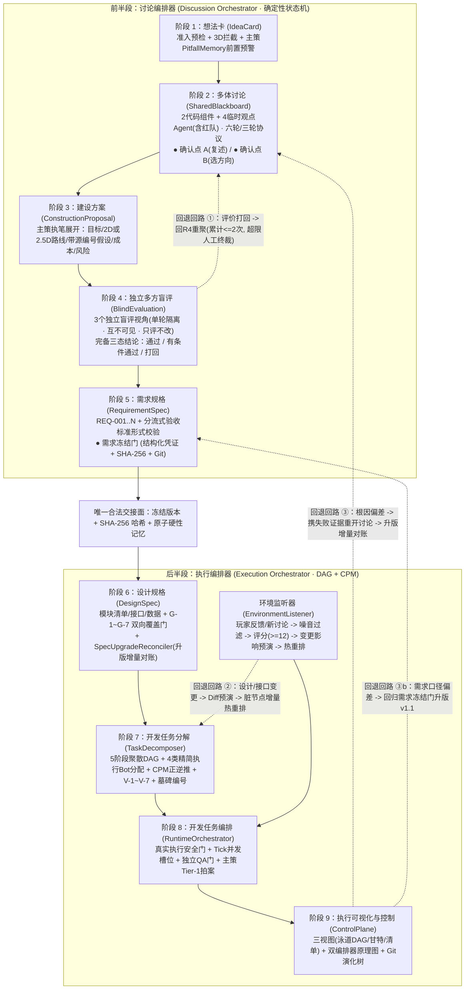
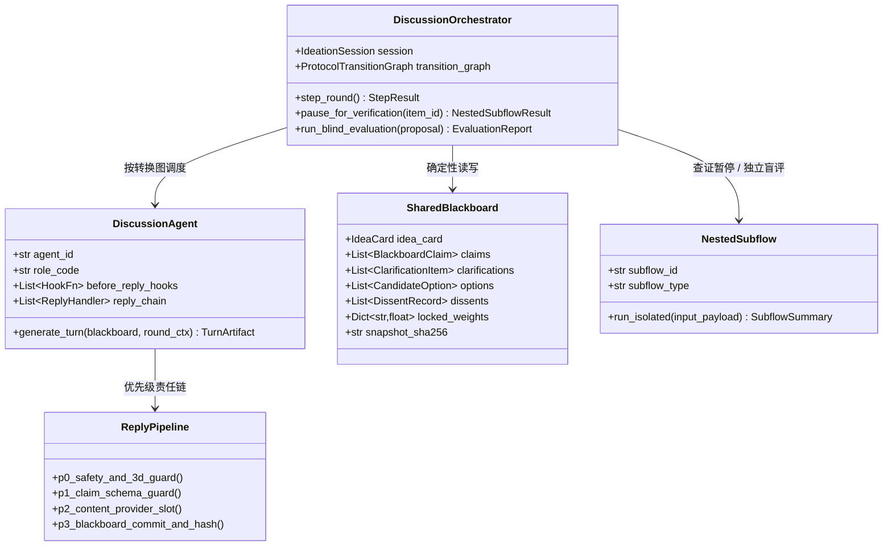
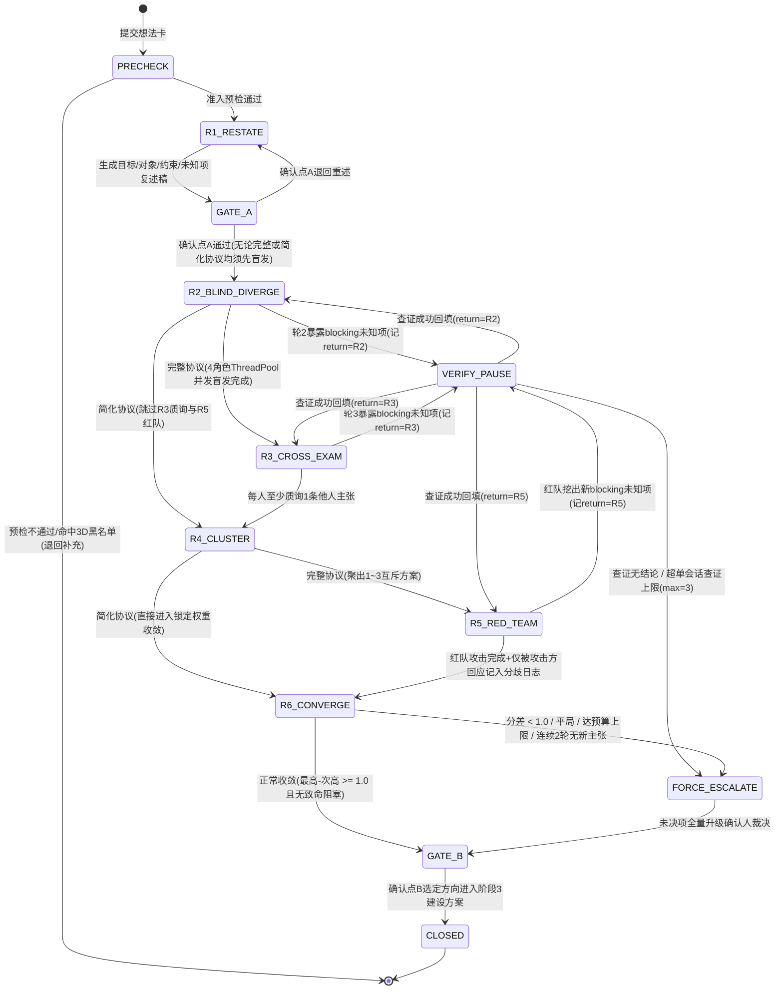

# 详细设计方案 · 面向 2D/2.5D 游戏大类的九阶段双编排器全链路多 Agent 软件工程平台（v4.2 工程定稿版）

| 文档属性 | 内容说明 |
| :--- | :--- |
| **文档版本** | v4.2（经两轮红队架构审计 + 大作业高阶工程优化的最终定稿版） |
| **文档性质** | 系统架构、核心算法、数据契约、并发/流式协议、持久化存储、可观测性评测与可视化交互完整设计规约 |
| **上游基线** | 《多体讨论工作流设计文档 v1.2》（作业 1）、《流程设计（作业 2）v1.0》、本仓库 v3.0 既有实现（`backend/` & `frontend/`） |
| **核心参照** | 吸收 **AutoGen 2（AG2）** 六大架构精华，融合**自研确定性双编排器状态机**与 **2D/2.5D 游戏工程工作流** |
| **适用读者** | 项目团队研发成员、承接编码实现的 AI Agent、课程指导教师与工程评审 |
| **日期** | 2026-11-26 |

> **两轮架构自审修订与工程增强清单（v4.0 → v4.1 → v4.2）**：
> 1. **状态机与简化协议零死锁**（v4.1→v4.2）：简化协议固定为 `GATE_A → R2_BLIND_DIVERGE → R4_CLUSTER → R6_CONVERGE`；`DiscussionRound` 枚举 100% 对齐 Mermaid 状态图；`VERIFY_PAUSE` 按 `return_round_after_verify` 精准回到 `R2 / R3 / R5` 触发前轮次，并设单会话查证上限 `max_verify_pauses = 3` 与“查无结论 → 降级高风险假设并升级人工”防死锁出口。
> 2. **盲评三态数学完备化**（v4.1）：阶段 4 盲评采用完备互斥顺序判定树，彻底消除 `(6,6,7)` 黑洞与条件重叠。
> 3. **角色生命周期与主策统一**（v4.1）：讨论 4 角色与盲评 3 视角按阶段短暂激活、即用即释（Ephemeral）；`planner_master` 在阶段 1（教训预警）、阶段 3（执笔方案）、终裁与下游拍案保持唯一跨段身份，严禁兼任红队与盲评。
> 4. **结构化直通分解 + 升版无损对账**（v4.1→v4.2）：新增强类型 `DesignWorkItem` 与 `decompose_design_spec(ds, bots)` 结构化直通入口（消灭“结构化转 Markdown 再正则反解析”信息损失）；大回退升版 `REQ-v1.1 / DS-v1.1` 走 `SpecUpgradeReconciler` 按 `req_id` 无损对账，保留已完成 `SUCCEEDED` 任务，废弃编号进墓碑。
> 5. **真 LLM 韧性契约 + 真并发盲发/盲评 + SSE 实时流**（v4.2）：定义 `LLMClientConfig`（超时/格式重试上限/退避/预算计入）；R2 四角色盲发与阶段 4 三视角盲评采用 `ThreadPoolExecutor` 真并发执行，新增 Python 标准库 `GET /api/events/stream`（Server-Sent Events）实时推送流。
> 6. **双写一致性 + 多项目命名空间隔离 + 真实安全门**（v4.1→v4.2）：确立 `.hard_memory/sessions/<session_id>/` 为唯一事务事实源（SSOT），`.sandbox_git/<session_id>/` 为派生审计视图，持 `RLock` 原子落盘并容错 Git 同步；执行安全门真实落地凭据正则防泄露扫描与沙箱路径越界拦截（`ERR_SAFETY_GATE_VIOLATION`）。
> 7. **工程效能可观测性 + 一键导出交付包 + A/B 对比评测基准**（v4.2）：内置 `ObservabilityMetrics` 量化统计 Token/拦截率/红队缺陷/热重排工时节省率；提供 `GET /api/export/bundle` 一键导出完整工程报告包；配套 `tests/benchmark_ab_eval.py` 自动输出可复算的 A/B 对照实验表。

> **诚实边界声明（已实现 vs v4.2 增量设计）**：
> * **已在仓库 v3.0 中完整实现并实测通过（9/9 自动化验收测试全绿）**：后半段核心能力——设计规格解析与 3D 零容忍拦截、五阶段 × 四角色泳道 DAG 分解与正交总线可视化、4 类精简执行 Bot 三维可解释分配、CPM 正逆推与双口径防自欺仪表盘、执行编排器 Tick 动态调度与内核原理图、主策 Tier-1 拍案与反束缚教训记忆、环境监听提炼打分与脏节点增量热重排、沙箱 Git 实时演化树。
> * **本方案 v4.2 重点补齐与升级部分**：上游前半段（想法预检 → AG2 精华六轮/三轮讨论与共享黑板 → 建设方案 → 独立三视角盲评 → 需求冻结门）、结构化 `DesignSpecDocument` G 门直通与 `SpecUpgradeReconciler` 升版对账器、多会话 `.hard_memory/` 原子事实源、并发线程池 + SSE 实时事件流、真 LLM 韧性配置、真实执行安全门、效能观测面板、一键交付包导出与 A/B 对比评测基准、CPM 甘特图/清单三视图及双编排器原理对比视图。

---

## 第 1 章 总体目标、定位与核心设计原则

### 1.1 一句话目标
打造一套**面向 2D / 2.5D 游戏大类的九阶段全链路产物驱动软件工程平台**：接收用户的**一句话游戏想法**，经由**讨论编排器**驱动按需激活的多视角 Agent（含常驻红队）基于共享黑板按协议完成结构化辩论、方案聚类与独立多方盲评，经人工在稀少关键门禁冻结《需求规格》与《设计规格》后，通过带 SHA-256 哈希的冻结产物无缝移交**执行编排器**完成开发任务分解、CPM 排期调度、并发执行、独立 QA 验收、多维可视化控制、环境监听反馈评估与增量热重排，全流程绑定原子持久化硬性记忆、Git 分支版本与内容级可追溯链。

### 1.2 解决的核心工程痛点
1. **消除多层翻译走样**：把「想法 → 讨论 → 方案 → 评价 → 需求 → 设计 → 任务 → 执行」每一跳的黑盒自然语言聊天，替换为带 Schema 校验、版本号与 SHA-256 内容哈希的结构化产物交接。
2. **打通作业 1 与作业 2 的断层**：消除“前半段只有文档理论、后半段只能从写好的规格书启动”的割裂感，并通过 `SpecUpgradeReconciler` 实现“执行期暴露需求根因偏差时携证据逆向回退至多体讨论，升版后增量对账保留已完成任务”的真正闭环。
3. **解决多 Agent 对话失控与成本膨胀**：汲取 AutoGen 2 的模块化设计精华，但摒弃“LLM 自由选人”和“无隔离全员广播”；同时通过**分阶段短暂实例化 + 成本硬上限**兼顾“评者与作者分离”和“低成本瘦身”。

### 1.3 六大不可破设计原则

| 编号 | 原则名称 | 刚性执行要求 |
| :--- | :--- | :--- |
| **P1** | **流程确定性，内容概率性** | 轮次切换、发言顺序、收敛/打回上限、DAG 拓扑排序、CPM 正逆推、负载分配、安全门与脏节点闭包 **100% 由确定性代码执行（0 Token）**；LLM（或确定性仿真引擎）只负责产出语义观点、方案内容与交付物。 |
| **P2** | **双编排器物理隔离** | **讨论编排器（Discussion Orchestrator）**只管「谁发言、共享黑板更新、查证暂停与收敛」；**执行编排器（Execution Orchestrator）**只管「DAG 依赖解锁、Bot 并发槽位、QA 核验与重试回滚」。二者不共享运行态内存，唯一接口是冻结产物。 |
| **P3** | **评者与作者严格分离** | 上游：讨论收敛打分（方案排序）与阶段 4 多方盲评（判定能否进需求冻结）换人隔离；主策严禁兼任红队与盲评；下游：美术/程序 Bot 严禁给自己点 `SUCCEEDED`，必须经自动脚本或独立 QA Bot 验收。 |
| **P4** | **产物驱动与内容级哈希追溯** | 每一阶段只产出一份结构化冻结产物，下一阶段只消费该产物；任一产物附带版本号 + `SHA-256` 哈希 + 原子落盘的硬性记忆与变更审计记录，防止“编号不变但内容被暗改”的追溯失真。 |
| **P5** | **分歧显式保留与稀少确认门** | 未达成共识时，红队攻击记录与少数派意见必须原样进入分歧日志随产物跨阶段传递，绝不以假共识抹平；人工确认聚焦于 **3 处核心主门**（确认点 A 复述、确认点 B 选方向、需求/设计基线冻结门）与异常拍案门。 |
| **P6** | **2D/2.5D 领域纯粹性与反束缚记忆** | 全链路强制执行 2D/2.5D 能力白名单与 3D 零容忍黑名单（命中即抛出 `ERR_3D_PIPELINE_FORBIDDEN`）；仅主策拥有「踩坑教训记忆库（Pitfall-Only Memory）」，写入前强制经反束缚护栏检验（禁绝僵化流程模板禁令）。 |

---

## 第 2 章 九阶段全链路总体架构与三条跨阶段回退回路

### 2.1 九阶段双编排器全景架构图



### 2.2 九阶段产物、门禁与版本冻结总表

| 阶段 | 负责编排器 | 输入产物 | 核心输出产物 | 退出门槛 / 人工确认点 | 冻结与版本规则 |
| :--- | :--- | :--- | :--- | :--- | :--- |
| **1 想法** | 讨论编排器 | 口头/文字想法 | `IdeaCard`（目标、对象、约束、复杂度评级、召回教训） | 准入预检通过（对象具体、痛点可证伪、价值可操作、未命中 3D 黑名单） | 记录 `idea_id` + `sha256` 存入硬性记忆 |
| **2 多体讨论** | 讨论编排器 | `IdeaCard` + 主策历史教训 | `SharedBlackboard` 冻结快照（复述稿、主张表、待澄清清单、互斥方案矩阵含原始打分明细、分歧日志） | **主门 1：确认点 A**（复述无偏）<br>**主门 2：确认点 B**（选定候选方案方向） | 讨论包冻结，不可回改历史主张与红队记录 |
| **3 建设方案** | 讨论编排器（主策执笔） | 选定候选方案 + 分歧日志 | `ConstructionProposal`（范围、2D/2.5D 路径、带 `claim_id` 的假设、成本量级、风险） | 方案要素齐全；所有未证实判断显式标为假设并带来源编号 | 赋予 `PROP-v0.x` + `sha256`，追加至 `proposal_history` |
| **4 多方评价** | 讨论编排器（隔离嵌套子流） | `ConstructionProposal` | `EvaluationReport`（3 独立视角盲评、完备三态结论、条件清单或打回理由） | 结论为 `PASSED` 或 `CONDITIONAL_PASS`；`REJECTED` 退回阶段 2 `R4`（上限 2 次） | 绑定被评方案版本号与哈希，追加至 `eval_history` |
| **5 需求规格** | 讨论编排器 | 评价通过的方案 + 条件清单 | `RequirementSpec`（范围/非范围、`REQ-001..N`、分流式形式校验通过的验收标准、继承未决项） | **主门 3：需求冻结门**（验收标准形式校验全过 + 结构化 `ConfirmationVoucher` 签字） | 冻结为 `REQ-v1.0` + `sha256` + Git Commit；修改必升版 |
| **6 设计规格** | 执行编排器入口 | `REQ-v1.0` | `DesignSpecDocument`（模块 M1~M5、工作项、接口/数据定义、G-1~G-7 报告） | **DS 冻结门（G-1 ~ G-7）**：需求 100% 向下覆盖、模块 100% 向上有据、无孤儿、无环 | 冻结为 `DS-v1.0` + `sha256` + Git；升版走 `SpecUpgradeReconciler` |
| **7 任务分解** | 执行编排器入口 | `DS-v1.0` + 4 类执行角色卡 | `TaskGraph (DAG)`（唯一主责 Bot、三维分配解释、CPM 限时、双向追溯锚点） | **出图校验（V-1 ~ V-7）**：无环、无悬空、执行对象与限时必填、分配合规 | 赋予图版本 `DAG-v1`，删除任务进墓碑、编号永不复用 |
| **8 任务编排** | 执行编排器 | `DAG-v1` | `OrchestrationInstance` + 只追加调度/拍案/验收记录 | **真实执行安全门**（含密钥扫描/路径沙箱/卡复核）；独立 QA 验收门；主策 Tier-1 拍案门 | 实例绑定确定图版本，在途变更按脏闭包增量处理 |
| **9 可视化与控制** | 控制面 | 执行记录 + 原子硬性记忆 | 三视图控制面 + 沙箱 Git 演化树 + 审计报告 | 所有人工操作强制留痕；暂停/等待人工明确可见且不设默认通过 | 每次落库采用原子写持久化至 `.hard_memory/` |

### 2.3 全链路内容级哈希追溯模型
任一最终交付物或 Git Commit，均可沿强类型编号链 + SHA-256 哈希一路精确追溯至最初的一句话想法与每一条主张/条件：

```text
IDEA-001 (sha:8f2a... · 召回教训 MEM-PITFALL-001)
  └─► CLAIM-04 (主张) & DIS-02 (红队攻击/分歧日志)
        └─► PROP-001-v0.2 (sha:c19d... · 主策执笔)
              └─► EVAL-002 (三态结论: CONDITIONAL_PASS · 条件 COND-01)
                    └─► REQ-003 (冻结版本 REQ-v1.0 · sha:3a7b... · 绑定 source_claim_ids & resolved_condition_ids)
                          └─► DS-M2 (设计规格 DS-v1.0 · G-1~G-7 100%覆盖通过)
                                └─► TASK-S2-01 (主责 art_bot_01 · CPM Slack=0 · 过执行安全门)
                                      └─► Git Commit 59dbace (branch: feature/STAGE_2-TASK-S2-01)
```

### 2.4 三条跨阶段回退回路与「规格升版增量对账器」
1. **回退回路 ①（阶段 4 → 阶段 2 `R4_CLUSTER`）**：多方盲评给出 `REJECTED` 时，打回理由记入分歧日志，原方案保留在 `proposal_history` 中（绝不覆盖），会话级计数器 `session.reject_round_count += 1` 并返回 `R4_CLUSTER` 重新聚类生成 `PROP-v0.2`。**硬性上限 2 次**：当 `session.reject_round_count >= 2` 仍未通过时，状态机强制禁止第 3 次自动往返，升级确认人终裁（调整大方向或终止）。
2. **回退回路 ②（阶段 9 / 环境监听 → 阶段 7/8）**：执行期改派、延期、接口变更或高优玩家反馈（评分 $\ge 12$）先走 `preview_change_impact` Diff 预演，确认后仅对下游脏节点传递闭包增量热重排，**未受影响的历史 `SUCCEEDED` 任务 100% 保留不重跑**。
3. **回退回路 ③（阶段 9 → 阶段 2 / 阶段 5，经 `SpecUpgradeReconciler` 无损对账）**：
   * 当执行期暴露需求根因偏差时，人工触发 **「携失败证据回退至多体讨论 / 需求冻结门」**：系统自动打包失败日志、QA 拒绝证据与玩家反馈注入新一轮黑板（并可选沉淀为主策 `PitfallMemoryItem`），产出新版本 `REQ-v1.1` 与 `DS-v1.1`（保留 `v1.0` 冻结历史）。
   * **关键机制——`SpecUpgradeReconciler` 增量对账算法**：下游绝不暴力调用全量清空重置，而是按 `(req_id, module_id)` 比对 `DS-v1.0` 与 `DS-v1.1`：
     * **未变更的 `REQ`**：对应已完成的 `SUCCEEDED` 任务**100% 原样保留状态、交付物与 Git Commit**；
     * **被删除的 `REQ`**：对应任务转入墓碑表 `tombstones`（编号永不复用），记录废弃原因；
     * **修改或新增的 `REQ`**：为其生成新单调编号增量任务，计算下游依赖传递闭包标脏重置，再重算全图 CPM 并生成新版本 `DAG-v(n+1)`。

---

## 第 3 章 参照 AutoGen 2（AG2）的“取其精华、去其糟粕”融合架构

### 3.1 AutoGen 2（AG2）底层六大核心原语剖析
1. **`ConversableAgent` + `register_reply` 优先级回复责任链**：所有实体共享统一消息基类，按优先级顺序遍历回复钩子，首个命中即返回。
2. **`register_hook` 生命周期拦截切面**：在回复前（`process_all_messages_before_reply`）与发送前（`process_message_before_send`）注入确定性中间件。
3. **`GroupChat` + `allowed_or_disallowed_speaker_transitions`**：用邻接字典对群聊发言顺序施加 FSM 约束。
4. **`nested_chats`（隔离式嵌套子会话）**：暂停主流程拉起隔离 1v1 子对话，结束后仅回传摘要，不污染主上下文。
5. **`ContextVariables` + `UpdateSystemMessage`**：共享状态对象配合每轮动态提示词渲染，避免长对话遗忘。
6. **`OnCondition` / `AfterWork` + `human_input_mode`**：声明式条件交棒、阶段收尾策略与人工确认控制。

### 3.2 四项坚决不照搬的 AG2 短板

| AG2 原生做法 | 照搬会引发的工程风险 | 本方案的根本解法 |
| :--- | :--- | :--- |
| `speaker_selection_method="auto"`（LLM 选人） | 浪费 Token、流程漂移、可能跳过红队或主持人越权表态 | **100% 弃用 LLM 选人**，由确定性代码状态机按转换图精确路由 |
| `GroupChatManager` 全员广播扁平 `messages[]` | 破坏 Delphi 盲发（造成首因锚定）与独立盲评（造成评委从众）；上下文噪音爆炸 | 引入**代码级可见性掩码（`VisibilityFilterHook`）** + **共享黑板四件套** |
| 用群聊范式硬管任务执行 | 缺乏 DAG 拓扑依赖、CPM 关键路径算法、单 Bot 串行并发槽位与脏闭包增量重排 | **双编排器严格隔离**：讨论侧吸收 AG2 精华，执行侧保留并升级既有 DAG/CPM 编排器 |
| 重绑定外部库 + 弱类型 `ContextVariables(dict)` | 强依赖外部 API Key（离线测试与 CI 难以稳定复现），弱字典缺乏强校验与哈希留痕 | **纯 Python + Pydantic v2 自研轻量内核**，默认零 Key 确定性仿真 + 可插拔真 LLM Adapter |

### 3.3 六大 AG2 精华改造落地映射表

| AG2 原语精华 | v4.2 自研升级组件 | 精准职责与工程价值 |
| :--- | :--- | :--- |
| `register_reply` 责任链 | **`ReplyPipeline`** | 四级硬拦截：`P0 3D黑名单/反束缚/密钥安全门 → P1 主张四要素格式校验(缺依据/假设退回重写) → P2 可插拔内容槽(确定性仿真/真LLM) → P3 黑板落库与哈希留痕`。 |
| `register_hook` 切面 | **`VisibilityFilterHook`**<br>**`PitfallMemoryHook`** | ① 按当前轮次裁剪可见上下文（轮 2 屏蔽同轮发言实现真盲发；阶段 4 屏蔽讨论与其他评委实现真盲评）；② 仅挂载 `PitfallMemoryHook` 给 `planner_master`（阶段 1 预警、阶段 3 方案执笔、下游拍案），代码级保证其余角色无记忆。 |
| `allowed_speaker_transitions` | **`ProtocolTransitionGraph`** | 声明式定义六轮/三轮发言转换邻接表（轮 5 红队攻击后仅允许被攻击方回应、禁止开新话题；轮 6 将红队置入 `disallowed` 打分名单）。直接驱动前端原理图渲染。 |
| `nested_chats` 嵌套会话 | **`NestedSubflow`** | 隔离运行两类子任务：① **查证暂停子流**（遇 `blocking` 未知项挂起主讨论，查证证据结构化回填，查无结论则走防死锁出口）；② **阶段 4 三视角独立盲评子流**。 |
| `ContextVariables` + `UpdateSystemMessage` | **`SharedBlackboard`** + **`RoundPromptRenderer`** | 强类型 Pydantic 黑板四件套取代弱字典；每轮开始依据黑板快照与当轮禁令动态组装最小上下文，压缩 Token 并杜绝遗忘。 |
| `OnCondition` / `AfterWork` | **`GateCondition`** + **`AfterStagePolicy`** | 声明式配置收敛阈值（分差 $\ge 1.0$）、打回上限（$\ge 2$ 次升级）、大回退条件与人工门策略（仅 `WAIT_HUMAN_GATE` / `AUTO_HANDOFF`，确认门严禁自动跳过）。 |

### 3.4 自研轻量讨论内核类图



---

## 第 4 章 上游核心：讨论编排器与角色生命周期管理（阶段 1 ~ 阶段 5）

### 4.1 角色生命周期与成本控制总表（兼顾「评者作者分离」与「瘦身降本」）
为防止角色数膨胀违背 v3.0 瘦身原则，全系统严格区分 **“阶段内短暂调用（Ephemeral）”** 与 **“下游执行期常驻（Resident）”**，**任何时刻并发激活的 LLM 角色绝不超过 4 类**：

| 所属阶段 | 角色类别与实例 | 生命周期与调用预算 | 模型档位 | 是否拥有长期记忆 | 职责与隔离禁区 |
| :--- | :--- | :--- | :--- | :---: | :--- |
| **跨段决策中枢** | `planner_master`（主策） | 跨段按事件唤醒（阶段 1 预警、阶段 3 方案执笔、异常终裁、下游拍案门） | **Tier-1 旗舰** | **是（唯一）** | 挂载 `PitfallMemoryHook`；**严禁兼任红队与阶段 4 盲评评委** |
| **阶段 2 讨论侧**<br>*(仅阶段 2 短暂激活)* | `host_fsm` + `clerk_engine` | 确定性代码（0 Token） | 无 LLM | 否 | 流程控制与黑板维护，不表态、不投票 |
| | `disc_value` / `disc_tech` / `disc_biz_risk` / `disc_red_team`（4 观点 Agent） | 阶段 2 结束后立即释放；单次完整六轮预算上限 **$\le 16$ 次**轻调用（简化协议 $\le 7$ 次） | Tier-2 高速 | 否 | `disc_red_team` 不可省略、攻击不可撤回、**只攻击不打分** |
| **阶段 4 盲评侧**<br>*(仅阶段 4 单轮隔离)* | `eval_cost` / `eval_compliance` / `eval_player_ops`（3 独立盲评视角） | 阶段 4 各调用 **1 次**隔离 `NestedSubflow` 即释放（总计 3 次调用）；高风险项绑定真人 | Tier-2 高速 / 真人 | 否 | 未参与阶段 2/3 生成；互不可见；只评不改 |
| **阶段 7~9 执行侧**<br>*(v3.0 既定 4 类瘦身)* | `planner_master` + `art_bot_01/02` + `dev_bot_01/02` + `qa_bot_01` | 下游研发期按单 Bot 串行槽位调度 | 主策 Tier-1 / 其余 Tier-2 | 仅主策 | 严格遵循作者与独立 QA 评价者分离 |

### 4.2 阶段 1：想法卡与准入预检
用户输入一句话 2D/2.5D 游戏创意（或选用内置基准测试想法）后，封装为 `IdeaCard` 并运行三项确定性预检：
1. **3D 零容忍前置拦截**：调用 `check_3d_blacklist(raw_idea)`，命中 3D 词条立即拦截并引导转化为 2D/2.5D 伪 3D 方案。
2. **三要素质量预检**：校验对象是否具体、核心玩法痛点/乐趣是否可证伪、价值主张是否可操作（拦截“做一个好玩的游戏”等空泛输入并退回补充）。
3. **主策教训前置召回 & 复杂度路由**：`planner_master` 通过 `PitfallMemoryHook` 自动检索相关踩坑教训（如 2.5D 触发 `MEM-PITFALL-001`）写入 `IdeaCard.recalled_memory_ids` 供下游讨论参考；复杂度判定决定启用 **六轮完整协议** 或 **三轮简化协议**。

### 4.3 共享黑板四件套（`SharedBlackboard`）
1. **主张表（`claims`）**：强制包含 `claim_id`、`speaker_id`、`statement`（主张）、`evidence`（依据）、`assumptions`（假设）、`uncertainty`（不确定性）。`ReplyPipeline` 的 `P1` 钩子自动拦截缺失依据或假设的发言并退回重写。
2. **待澄清问题清单（`clarifications`）**：标注 `severity = "blocking" | "non-blocking"`。**存在未解决 `blocking` 项时，状态机禁止进入收敛轮**，必须先经 `VERIFY_PAUSE` 查证子流处理（成功回填证据或显式降级升级确认人）。
3. **互斥候选方案矩阵（`options`）**：聚类生成 **1~3 个互斥候选方案**，不仅存加权总分，**必须完整保存 `per_agent_scores` 原始打分明细**以供复算审计；单方案直行须记录直行判据。
4. **分歧日志（`dissents`）**：记录红队攻击点、被攻击方回应、未决分歧双方与主张编号，**随产物原样跨阶段传递至阶段 3~5，绝不在小结中抹平**。

### 4.4 六轮（及三轮简化）防失效讨论协议状态机与收敛数学判据



**锁定权重收敛评分数学规则（防标准漂移、全明细可复算）**：
* 议程前冻结维度权重 $w_k$（$\sum w_k = 1$）：`玩法体验价值 (0.35)`、`2D/2.5D 技术可行性 (0.30)`、`工期与成本可控 (0.20)`、`可测试与扩展性 (0.15)`。
* **硬否决项（不参与加权，一票淘汰）**：① 触犯 3D 黑名单；② 预估总工时严重超预算上限。
* **加权聚合**：由 `disc_value`、`disc_tech`、`disc_biz_risk` 三方分别给每个方案在每个维度打 $0 \sim 10$ 整数分并落入 `per_agent_scores`（**代码断言 `disc_red_team` 不得出现在 `per_agent_scores` 键中**），计算总分 $S_j = \sum_k w_k \cdot \bar{s}_{j,k}$。
* **完备收敛判据（覆盖 0 / 1 / ≥2 有效方案边界）**：
  * 设未触发硬否决的有效候选方案集合为 $\mathcal{O}_{\text{valid}}$：
  * 若 $|\mathcal{O}_{\text{valid}}| == 0$（全部方案被硬否决淘汰）→ 报错 `ERR_NO_VALID_CANDIDATE` 并转 `FORCE_ESCALATE` 升级确认人；
  * 若 $|\mathcal{O}_{\text{valid}}| == 1$ 且已记录 `single_option_rationale` 且无未解决 `blocking` 项 → 正常收敛（单方案直行）进入 `GATE_B`；
  * 若 $|\mathcal{O}_{\text{valid}}| \ge 2$：当且仅当 $S_{(1)} - S_{(2)} \ge 1.0$ 且无未解决 `blocking` 项 → 正常收敛进入 `GATE_B`；否则转 `FORCE_ESCALATE`。

### 4.5 阶段 3 建设方案 & 阶段 4 独立多方盲评（完备互斥三态决策树）
* **阶段 3（`ConstructionProposal`）**：由 `planner_master`（主策）基于选定方案与分歧日志执笔展开，并再次通过 `PitfallMemoryHook` 核对避坑点；未证实判断必须标为 `Assumption(source_claim_id)`，每次生成均作为新版本追加进 `session.proposal_history`。
* **阶段 4（独立多方盲评，3 个隔离 `NestedSubflow`）**：
  * 3 个独立视角（`eval_cost`、`eval_compliance`、`eval_player_ops`）仅读取冻结的 `ConstructionProposal`，彼此完全不可见，各自输出 `score ∈ [0, 10]`、`veto: bool`、`conditions: List[str]` 与 `rationale`。
  * **完备互斥顺序判定树（零数学黑洞、零条件重叠）**：
    1. **优先判 `REJECTED`**：若任意评委 `veto == True` **或** 任意评委 `score < 6` **或** 三方算术均分 `< 7.0` → 判定 `REJECTED`，理由记入分歧日志，`session.reject_round_count += 1`；若 `< 2` 则回退至 `R4_CLUSTER` 重聚生成新版本方案，若 `>= 2` 则强制停止循环升级确认人终裁；
    2. **其次判 `CONDITIONAL_PASS`**：未命中上述拒绝条件，但 `len(merged_conditions) > 0` **或** 存在评委 `score == 6` → 判定 `CONDITIONAL_PASS`，强制将 `merged_conditions` 传递至阶段 5 逐条落实或显式豁免；
    3. **最终判 `PASSED`**：无硬否决、三方全员 `score >= 7`、且 `merged_conditions` 为空 → 判定 `PASSED` 直入阶段 5。

### 4.6 阶段 5 需求规格与需求冻结门（分流式形式校验）
* **结构要求**：明确 `in_scope`（做什么）与 `out_of_scope`（明确不做什么）、`REQ-001..N` 编号条目（绑定 `source_claim_ids` 与 `resolved_condition_ids`）、继承未决项。
* **分流式验收标准形式校验（防误杀合法功能断言）**：
  * **非功能需求（`NON_FUNCTIONAL`：帧率/耗时/内存/并发/容量）**：强制正则校验必须包含**可观察指标 + 数值/阈值单位**（如 `<= 16.6ms`、`>= 60 FPS`、`内存 <= 512MB`、`0 例穿模`）；
  * **功能需求（`FUNCTIONAL`）**：采用「**反空话黑名单拦截**（拦截“体验良好/手感丝滑/完成开发/优化界面/做好就行”等）+ **行为断言结构检验**（必须包含明确的触发事件/条件与可观察结果动词，如“触发/点击/命中/输入 … 时/后 … 显示/返回/拦截/重置/写入/通过校验”）」。
* **需求冻结门**：确认人填写结构化 `ConfirmationVoucher` 签字冻结为 `REQ-v1.0` + `SHA-256`，并提交沙箱 Git（分支 `req/REQ-v1.0`）与原子硬性记忆。

---

## 第 5 章 下游衔接与升级：设计规格 G 门与执行编排器（阶段 6 ~ 阶段 9）

### 5.1 阶段 6：设计规格（DS）与 G-1 ~ G-7 冻结门（双轨结构化直通设计）
将冻结的 `REQ-v1.0` 翻译为强类型 `DesignSpecDocument`（含 2D/2.5D 模块清单 `M1~M5`、强类型工作项 `DesignWorkItem`、接口/数据定义），进入分解前必须通过 **G 门 7 项检查单**：
* `G-1 结构完整`（程序）：模块与 `DesignWorkItem` 必填字段零缺失；
* `G-2 需求 100% 向下覆盖`（程序）：每条已冻结 `REQ` 至少落点到 1 个模块/工作项；
* `G-3 接口无孤儿 & 模块向上有据`（程序）：每个模块至少追溯 1 条 `REQ`，接口提供方/使用方均存在；
* `G-4 模块依赖无环`（程序）：模块级依赖图为合法 DAG；
* `G-5 验收标准可判定`（程序分流初筛 + 人工）：拒绝空话；
* `G-6 关键架构决策留痕`（人工）：注明依据的 `REQ` 编号与取舍理由；
* `G-7 基线签署冻结`（人工）：签发 `ConfirmationVoucher`，冻结 `DS-v1.0` + `SHA-256` 并提交 Git（分支 `spec/DS-v1.0`）。

**双轨分解直通原则（消灭“结构化转 Markdown 再正则反解析”的信息损耗）**：
* **主轨（结构化直通）**：阶段 6 冻结后的 `DesignSpecDocument` 直接传入新增入口 **`decompose_design_spec(ds: DesignSpecDocument, bots)`**，100% 无损保留 `module_id`、`covered_req_ids`、`depends_on_modules` 与每个 `DesignWorkItem` 的显式字段，彻底避免正则猜测误判；`rendered_markdown` 仅作为导出与人类阅读视图。
* **兼容轨（自由 Markdown）**：保留既有 `decompose_spec_markdown(raw_markdown, bots)`，用于直接导入自由编写的项目计划书。

### 5.2 阶段 7：开发任务分解、4 类执行 Bot 与墓碑编号（既有并增强）
* 严格保留 v3.0 的 **4 类执行角色（6 实例）**、**2D/2.5D 标签白名单**、**3D 零容忍黑名单**、**三维可解释分配**与**差异化并行工时**（保证关键路径总工时严格等于 CPM 预计总工期且小于全图累计总工时）。
* 新增 **单调任务编号计数器 + 墓碑表（`tombstones`）**：废弃或被升版对账移除的任务编号永久入墓碑，后续新增/热重排任务严禁复用旧号。

### 5.3 阶段 8：执行编排器内核、真实执行安全门与 CPM 防自欺双口径
1. **五层确定性内核流水线**（已有）+ **8 态任务 FSM**（已有）+ **CPM 防自欺双口径**（已有）：
   $$\text{CP\_Progress} = \frac{\sum_{t \in CP,\, \text{status}=\text{SUCCEEDED}} (t.\text{duration} + t.\text{delay})}{\sum_{t \in CP} (t.\text{duration} + t.\text{delay})} \times 100\%$$
2. **真实可触发拦截的「执行安全门（Execution Safety Gate）」**（绝非静态绿灯装饰）：
   编排实例装载任务图与每次交付物落库前，强制运行 4 项确定性安全拦截（任一不通过即抛出 `ERR_SAFETY_GATE_VIOLATION` 并阻断启动/落盘）：
   * **S-1 角色卡二次合规复核**：验证每个任务的 `assigned_bot_id` 仍在现行角色卡中且 `required_tags ⊆ bot.capabilities`；
   * **S-2 必填门槛二次校验**：执行对象、CPM 限时五项、`verify_mode` 与 `source_clause_ref` 零缺失；
   * **S-3 凭据与密钥防泄露正则扫描**：扫描规格正文、任务参数与交付物摘要，命中 `sk-[A-Za-z0-9]{16,}`、`ghp_[A-Za-z0-9]{20,}`、`AKIA[0-9A-Z]{16}`、`password\s*=` 等敏感特征立即拦截脱敏；
   * **S-4 沙箱写路径白名单校验**：所有交付物与 Git 工件路径经 `Path.resolve()` 校验必须严格落在 `.sandbox_git/` 与 `.hard_memory/` 沙箱根目录下，拦截路径穿越（`../`）。

### 5.4 主策专属踩坑教训记忆与反束缚护栏（全链贯通）
* 严格沿用 `PitfallMemoryItem` 与 `ERR_ANTI_DOGMA_GUARDRAIL` 反束缚护栏；
* 贯穿上游与下游：阶段 1 自动预警 → 阶段 3 方案执笔规避 → 阶段 8 拍案引用 → 回退回路 ③ 失败复盘沉淀新教训。

---

## 第 6 章 扩展机制：环境监听、变更影响预演、热重排与硬性记忆持久化

### 6.1 环境监听、噪音过滤与量化打分（已有）
接收 `PLAYER_FEEDBACK` / `TEAM_DISCUSSION` 信号，先过 3D 黑名单，分类为 `FEATURE_CHANGE` / `BUG` / `NOISE`，量化 `urgency (1~10) + impact (1~10)`，过滤噪音并将 `total_score >= 12` 推送主策拍案。

### 6.2 变更「先影响预演 Diff 提案 → 乐观锁校验 → 再确认落库」
对运行期改派、延期注入、接口变更与环境信号变更，统一采用两阶段乐观锁确认纪律：
* **预演阶段（`POST /api/changes/preview`）**：沿 DAG 依赖边向下游遍历，列出受波及任务集合 `impacted_task_ids`、命中的关键路径节点、每条任务重算后的 `es/ef/ls/lf` 偏移与**被吃掉的 Slack 缓冲小时数**，并绑定当前快照基线 `base_dag_version` 与 `base_state_sha256`；
* **提交阶段（`POST /api/changes/commit`）**：携带 `preview_id` 与基线版本/哈希做 **CAS 乐观锁校验**——若预演期间因后台 Tick 或其他操作导致图版本/状态哈希已漂移，当场拒绝提交并抛出 `ERR_STALE_CHANGE_PREVIEW` 要求重新预演；校验通过后才原子落库升版（`DAG-v(n+1)`），取消则原图零变更不留痕。

### 6.3 脏节点传递闭包增量热重排 & 沙箱 Git 分支规范（已有并扩展）
* 确认变更后按脏节点闭包增量更新，**已完成且不受影响的历史任务 100% 保留 `SUCCEEDED`**；
* Git 沙箱标准分支：`main`、`req/REQ-vX.Y`、`spec/DS-vX.Y`、`feature/STAGE-x-TASK-y`、`verdict/VERDICT-xxx`、`cr/CR-xxx`。

### 6.4 硬性记忆原子持久化、多项目隔离与双写一致性（`backend/hard_memory.py`）
彻底解决纯内存重启丢状态、切案例覆盖数据与双写撕裂问题：
1. **多项目/多会话命名空间隔离（`session_id`）**：
   * 每个独立项目拥有独立目录 `.hard_memory/sessions/<session_id>/` 与 `.sandbox_git/<session_id>/`（均加入 `.gitignore`），前端可随时新建、切换、对比多个不同 2D/2.5D 游戏项目而不互相覆盖。
2. **唯一事实源（SSOT）、双写一致性与规范化哈希（`canonical_sha256`）规约**：
   * **确立 `.hard_memory/` 为唯一事务事实源（Single Source of Truth），`.sandbox_git/` 为派生审计视图**；
   * **确定性规范化哈希**：全链所有 `*_sha256` 字段严禁对含动态时间戳或未排序字典直接哈希，必须统一剔除运行态时间戳与自身 `*_sha256` 字段后，按 `json.dumps(payload, sort_keys=True, ensure_ascii=False, separators=(",", ":"))` 计算确定性 `SHA-256`，保证同一语义内容跨次/跨平台哈希 100% 一致；
   * 所有状态变更统一在会话级 `threading.RLock` 保护下，通过 **写临时文件 + `fsync` + `os.replace()` 原子替换** 优先落盘 `.hard_memory/`，再提交沙箱 Git；
   * 若 Git 子进程因锁冲突或权限异常失败，系统将对应变更标记 `git_sync_pending = True` 并发出告警，**绝不回滚或污染事实源**，同时提供一键重放补齐 Git 提交。
3. **五库落盘结构**：
   * `ideation_sessions.json`：想法卡、共享黑板快照、历史方案版本、盲评记录与确认凭证；
   * `spec_library.json`：`REQ-vX.Y` 与 `DS-vX.Y` 原文、版本与 `SHA-256`（同哈希去重）；
   * `task_graphs.json`：多版本完整任务图、单调任务编号计数器与不可删除的墓碑表 `tombstones`；
   * `constraints.json`：带编号硬约束（`C-01` 3D 黑名单、`C-02` 打回上限 2 次、`C-03` 关键路径缓冲为 0、`C-04` 执行安全门）；
   * `changelog.jsonl`：只追加（Append-Only）全链路审计日志，支持进程重启后无损恢复。

### 6.5 工程效能可观测性、一键交付报告包与 A/B 对比实验基准
1. **内置效能与成本观测器（`ObservabilityMetrics`）**：实时统计单项目全链路量化指标——总 LLM 调用数、估算 Token 消耗、确定性代码拦截次数（`P0` 3D/安全门拦截 + `P1` 主张格式退回 + 违规改派拦截）、红队暴露有效分歧数、独立盲评拦截率、脏节点增量热重排保留工时占比（`hours_saved_pct`），用真实数据验证架构收益。
2. **一键工程交付报告包（`GET /api/export/bundle`）**：将指定 `session_id` 的全套结构化产物（想法卡、黑板快照、盲评报告、冻结需求/设计书、CPM 甘特排期表、Git 演化树、全链追溯矩阵、效能指标与审计日志）打包导出为标准 Markdown + JSON 工程报告附件。
3. **可复现 A/B 对比评测基准（`tests/benchmark_ab_eval.py`）**：提供自动化对照实验脚本，在同一基准想法下量化对比三组核心假设并输出 Markdown 实验表：
   * 对照组 A：**完整六轮协议（含红队） vs 三轮简化协议（无红队）**——对比分歧捕获数、假设显式化比例与调用成本；
   * 对照组 B：**脏节点传递闭包增量热重排 vs 需求变更全量重跑**——对比保留任务数与节省总工时百分比；
   * 对照组 C：**确定性代码门禁拦截统计**——验证 3D 黑名单、格式校验、安全门与改派复核在 0 Token 消耗下的 100% 拦截率。

---

## 第 7 章 完整数据契约与 REST API 接口规范

### 7.1 上游讨论、双冻结门与变更预演完整 Pydantic v2 契约（`backend/ideation_models.py`）

```python
from __future__ import annotations
from enum import Enum
from typing import Dict, List, Optional
from pydantic import BaseModel, Field

class DiscussionRound(str, Enum):
    PRECHECK = "PRECHECK"                   # 阶段1 准入预检
    R1_RESTATE = "R1_RESTATE"               # 轮1 结构化复述
    GATE_A = "GATE_A"                       # 人工确认点A(复述确认)
    R2_BLIND_DIVERGE = "R2_BLIND_DIVERGE"   # 轮2 Delphi独立盲发
    R3_CROSS_EXAM = "R3_CROSS_EXAM"         # 轮3 交叉质询
    VERIFY_PAUSE = "VERIFY_PAUSE"           # 隔离查证暂停(NestedSubflow)
    R4_CLUSTER = "R4_CLUSTER"               # 轮4 方案聚类(1~3互斥方案)
    R5_RED_TEAM = "R5_RED_TEAM"             # 轮5 红队攻击轮
    R6_CONVERGE = "R6_CONVERGE"             # 轮6 锁定权重收敛打分
    FORCE_ESCALATE = "FORCE_ESCALATE"       # 强制终止/查证无果/超限升级
    GATE_B = "GATE_B"                       # 人工确认点B(选定方案方向)
    CLOSED = "CLOSED"                       # 讨论结案

class EvalConclusion(str, Enum):
    PASSED = "PASSED"
    CONDITIONAL_PASS = "CONDITIONAL_PASS"
    REJECTED = "REJECTED"

class ConfirmationVoucher(BaseModel):
    voucher_id: str                         # 如 "VOUCH-001"
    gate_name: str                          # GATE_A / GATE_B / REQ_FREEZE / DS_G_GATE
    confirmer_name: str
    confirmed_at: str
    checklist_items: Dict[str, bool]        # 确认清单逐项勾选记录（必须全为 True 才允许放行）
    signature_note: str = ""

class IdeaCard(BaseModel):
    idea_id: str                            # 如 "IDEA-001"
    raw_idea: str
    target_audience: str
    core_pain_or_fun: str
    value_proposition: str
    known_constraints: List[str] = Field(default_factory=list)
    dimension_mode: str = "2D"              # "2D" / "2.5D"
    complexity_level: str = "COMPLEX"       # "SIMPLE" / "COMPLEX"
    recalled_memory_ids: List[str] = Field(default_factory=list)
    precheck_passed: bool = False
    precheck_notes: List[str] = Field(default_factory=list)
    content_sha256: str = ""

class BlackboardClaim(BaseModel):
    claim_id: str                           # 如 "CLAIM-01"
    round_id: DiscussionRound
    speaker_id: str                         # disc_value / disc_tech / disc_biz_risk / disc_red_team
    statement: str
    evidence: str                           # 必填
    assumptions: List[str]                  # 必填
    uncertainty: str                        # 必填
    challenges_claim_id: Optional[str] = None

class ClarificationItem(BaseModel):
    item_id: str                            # 如 "CLR-01"
    question: str
    raised_by: str
    raised_in_round: DiscussionRound
    severity: str = "blocking"              # "blocking" / "non-blocking"
    status: str = "OPEN"                    # OPEN / VERIFIED / UNRESOLVED_ESCALATED
    verification_evidence: Optional[str] = None

class CandidateOption(BaseModel):
    option_id: str                          # 如 "OPT-A"
    title: str
    summary: str
    dimension_mode: str
    supporting_claim_ids: List[str]
    per_agent_scores: Dict[str, Dict[str, int]] = Field(default_factory=dict)  # {agent_id: {dim: 0..10}}，严禁含 disc_red_team
    dimension_scores: Dict[str, float] = Field(default_factory=dict)           # 各维度聚合均分
    weighted_total: float = 0.0
    vetoed: bool = False
    veto_reason: Optional[str] = None
    single_option_rationale: Optional[str] = None

class DissentRecord(BaseModel):
    dissent_id: str                         # 如 "DIS-01"
    round_id: DiscussionRound
    challenger_id: str
    target_option_id: Optional[str] = None
    target_claim_id: Optional[str] = None
    attack_point: str
    response_summary: Optional[str] = None
    resolved: bool = False
    escalation_target: str = "原样随产物传递至评价与需求阶段"

class SharedBlackboard(BaseModel):
    session_id: str
    idea_card: IdeaCard
    protocol_mode: str = "FULL_6_ROUND"     # FULL_6_ROUND / SIMPLIFIED_3_ROUND
    current_round: DiscussionRound = DiscussionRound.PRECHECK
    return_round_after_verify: Optional[DiscussionRound] = None
    restatement_summary: Optional[str] = None
    checkpoint_a_voucher: Optional[ConfirmationVoucher] = None
    checkpoint_b_voucher: Optional[ConfirmationVoucher] = None
    checkpoint_b_option_id: Optional[str] = None
    locked_weights: Dict[str, float] = Field(default_factory=lambda: {
        "玩法体验价值": 0.35,
        "2D/2.5D技术可行性": 0.30,
        "工期与成本可控": 0.20,
        "可测试与扩展性": 0.15,
    })
    claims: List[BlackboardClaim] = Field(default_factory=list)
    clarifications: List[ClarificationItem] = Field(default_factory=list)
    options: List[CandidateOption] = Field(default_factory=list)
    dissents: List[DissentRecord] = Field(default_factory=list)
    termination_type: Optional[str] = None  # NORMAL_CONVERGE / FORCE_TERMINATE / VERIFY_UNRESOLVED
    verify_pause_count: int = 0             # 已触发查证暂停次数
    max_verify_pauses: int = 3              # 单会话最大查证次数上限（防无限挂起）
    llm_calls_used: int = 0
    llm_calls_budget: int = 16
    snapshot_sha256: str = ""

class ConstructionProposal(BaseModel):
    proposal_id: str                        # 如 "PROP-001"
    version: str = "v0.1"
    author_bot_id: str = "planner_master"   # 主策执笔
    selected_option_id: str
    problem_and_goal: str
    scope_and_path: str
    key_assumptions: List[Dict[str, str]]   # [{"assumption": "...", "source_claim_id": "CLAIM-02"}]
    cost_estimate_hours: str
    risks_and_open_items: List[str]
    inherited_dissent_ids: List[str] = Field(default_factory=list)
    recalled_memory_ids: List[str] = Field(default_factory=list)
    content_sha256: str = ""

class IndependentEvalItem(BaseModel):
    evaluator_id: str                       # eval_cost / eval_compliance / eval_player_ops
    perspective_name: str
    is_human_expert: bool = False
    score: int                              # 0~10
    veto: bool = False
    veto_reason: Optional[str] = None
    rationale: str
    conditions: List[str] = Field(default_factory=list)

class EvaluationReport(BaseModel):
    report_id: str                          # 如 "EVAL-001"
    proposal_id: str
    proposal_version: str
    proposal_sha256: str
    overall_conclusion: EvalConclusion
    average_score: float
    items: List[IndependentEvalItem]
    merged_conditions: List[str] = Field(default_factory=list)

class RequirementItem(BaseModel):
    req_id: str                             # 如 "REQ-001"
    category: str                           # "FUNCTIONAL" / "NON_FUNCTIONAL"
    title: str
    user_story: str
    acceptance_criteria: List[str]
    formal_check_passed: bool = False
    formal_check_notes: List[str] = Field(default_factory=list)
    source_proposal_ref: str
    source_claim_ids: List[str] = Field(default_factory=list)
    resolved_condition_ids: List[str] = Field(default_factory=list)

class RequirementSpec(BaseModel):
    req_spec_id: str                        # 如 "REQ-SPEC-001"
    version: str = "v1.0"
    in_scope: List[str]
    out_of_scope: List[str]
    requirements: List[RequirementItem]
    inherited_conditions: List[str] = Field(default_factory=list)
    inherited_open_dissents: List[str] = Field(default_factory=list)
    frozen: bool = False
    voucher: Optional[ConfirmationVoucher] = None
    content_sha256: str = ""
    git_commit_hash: Optional[str] = None

class DesignWorkItem(BaseModel):
    work_item_id: str                       # 如 "WI-M2-01"
    title: str
    task_type: str                          # design / art_2d / dev_2d / qa_integ
    required_tags: List[str]                # 严格来自 2D/2.5D 白名单
    duration_hours: float
    verify_mode: str = "HYBRID"             # AUTO / HUMAN / HYBRID
    acceptance_criteria: List[str]
    source_req_ids: List[str]               # 明确继承的需求编号集合
    depends_on_work_items: List[str] = Field(default_factory=list)  # 模块内显式前置工作项 ID

class DesignSpecModule(BaseModel):
    module_id: str                          # 如 "M1" ~ "M5"
    name: str
    stage_id: str                           # 对应 STAGE_1 ~ STAGE_5
    covered_req_ids: List[str]              # G-2 / G-3 双向覆盖依据
    depends_on_modules: List[str] = Field(default_factory=list)
    interfaces: List[str] = Field(default_factory=list)
    work_items: List[DesignWorkItem]        # 强类型最小可验收工作项列表

class GCheckItem(BaseModel):
    check_id: str                           # G-1 ~ G-7
    name: str
    passed: bool
    detail: str

class DesignSpecDocument(BaseModel):
    ds_id: str                              # 如 "DS-001"
    version: str = "v1.0"
    source_req_version: str
    source_req_sha256: str
    modules: List[DesignSpecModule]
    g_checks: List[GCheckItem] = Field(default_factory=list)
    frozen: bool = False
    voucher: Optional[ConfirmationVoucher] = None
    rendered_markdown: str = ""             # 仅作为人类可读导出视图，不参与反解析
    content_sha256: str = ""
    git_commit_hash: Optional[str] = None

class ObservabilityMetrics(BaseModel):
    llm_calls_total: int = 0
    llm_format_retries: int = 0
    estimated_tokens_total: int = 0
    deterministic_blocks_3d: int = 0
    deterministic_blocks_schema: int = 0
    deterministic_blocks_safety_gate: int = 0
    deterministic_blocks_reassign: int = 0
    red_team_dissents_captured: int = 0
    blind_eval_rejections: int = 0
    hot_replan_preserved_hours: float = 0.0
    hot_replan_total_completed_hours: float = 0.0
    hot_replan_hours_saved_pct: float = 0.0

class LLMClientConfig(BaseModel):
    engine_mode: str = "deterministic"      # deterministic / llm
    tier1_model: str = "claude-3-7-sonnet"
    tier2_model: str = "gpt-4o-mini"
    timeout_sec: int = 30
    max_format_retries: int = 2             # P1 校验退回重写上限（防死循环烧额度）
    max_network_retries: int = 2            # 429/超时指数退避重试上限
    fallback_to_deterministic: bool = True  # 网络熔断时安全降级并记录审计告警

class TombstoneRecord(BaseModel):
    task_id: str
    deleted_at: str
    reason: str
    source_version: str

class ChangeImpactTaskDiff(BaseModel):
    task_id: str
    title: str
    is_critical_before: bool
    is_critical_after: bool
    es_before: float
    es_after: float
    ef_before: float
    ef_after: float
    slack_before: float
    slack_after: float
    slack_consumed: float

class ChangeImpactPreview(BaseModel):
    preview_id: str
    change_type: str                        # REASSIGN / DELAY / INTERFACE / ENV_SIGNAL / SPEC_UPGRADE
    base_dag_version: int                   # CAS 乐观锁：预演时的任务图版本号
    base_state_sha256: str                  # CAS 乐观锁：预演时的运行态规范哈希
    summary: str
    baseline_total_hours: float
    projected_total_hours: float
    delta_total_hours: float
    impacted_tasks: List[ChangeImpactTaskDiff]
    preserved_succeeded_ids: List[str] = Field(default_factory=list)
    new_tombstone_ids: List[str] = Field(default_factory=list)

class IdeationSession(BaseModel):
    """上游立项聚合根：统一维护跨轮状态、历史版本、累计打回计数与观测指标"""
    session_id: str
    project_name: str = "未命名 2D/2.5D 项目"
    blackboard: SharedBlackboard
    proposal_history: List[ConstructionProposal] = Field(default_factory=list)
    eval_history: List[EvaluationReport] = Field(default_factory=list)
    req_spec_history: List[RequirementSpec] = Field(default_factory=list)
    ds_history: List[DesignSpecDocument] = Field(default_factory=list)
    reject_round_count: int = 0             # 跨轮累计评价打回计数（硬上限 2）
    escalated_to_human: bool = False
    git_sync_pending: bool = False          # 派生 Git 视图同步状态标志
    observability: ObservabilityMetrics = Field(default_factory=ObservabilityMetrics)
```

### 7.2 下游执行契约向后兼容性
[backend/models.py](file:///c:/Users/disci/Desktop/RJGC-agent/backend/models.py) 中既有 6 大契约（`CollaborationMode`, `TaskStatus`, `BotCard`, `GameDevTask`, `PitfallMemoryItem`, `PlannerVerdictRecord`）**字段名与语义 100% 保持不变**；仅在 `GameDevTask` 追加可选字段 `req_ids: List[str] = []`、`module_id: Optional[str] = None` 与 `idea_id: Optional[str] = None`。

### 7.3 全链路 REST API 端点清单

| 阶段 | HTTP 方法与路径 | 功能说明 |
| :--- | :--- | :--- |
| **上游讨论 (新增)** | `GET /api/ideation/state` | 获取 `IdeationSession` 完整状态（含历史方案、盲评与预算计数） |
| | `POST /api/ideation/idea` | 提交想法卡：执行三要素预检 + 3D 拦截 + 主策教训召回 + 复杂度判别 |
| | `POST /api/ideation/step` | 确定性推进讨论状态机一轮（R1~R6 / 简化三轮 / 自动触发查证暂停） |
| | `POST /api/ideation/verify_resolve` | 结束查证暂停（支持 `VERIFIED` 回填证据 或 `UNRESOLVED` 防死锁降级升级） |
| | `POST /api/ideation/checkpoint_a` | 确认点 A：签发 `ConfirmationVoucher` 通过复述或退回重述 |
| | `POST /api/ideation/checkpoint_b` | 确认点 B：选定方案并由主策执笔生成新版本 `ConstructionProposal` |
| | `POST /api/ideation/evaluate` | 启动 3 个隔离 `NestedSubflow` 独立盲评（按完备三态树判定与 2 次打回上限） |
| | `POST /api/ideation/freeze_req` | 运行分流式验收标准校验，签发凭证冻结 `REQ-vX.Y` 并留痕 Git 与硬性记忆 |
| | `POST /api/ideation/handoff_to_ds` | 生成 `DesignSpecDocument` 过 G-1~G-7 门禁，首次导入或走 `SpecUpgradeReconciler` 增量对账 |
| **下游执行 (增强)** | `POST /api/changes/preview` | 返回绑定 `base_dag_version` 与 `base_state_sha256` 的 `ChangeImpactPreview`（确认前零落库） |
| | `POST /api/changes/commit` | 提交已预演变更，校验 CAS 乐观锁（漂移则抛 `ERR_STALE_CHANGE_PREVIEW`）后原子升版落库 |
| | `POST /api/orchestrator/reopen_discussion` | 回退回路 ③：携失败证据与玩家反馈重开上游多体讨论/需求升版 |
| | `GET /api/trace/{task_id}` | 返回 `IDEA → CLAIM/DIS → PROP → EVAL → REQ → DS → TASK → Git` 全链哈希血缘 |
| **多会话与流式/导出 (新增)** | `GET /api/sessions` / `POST /api/sessions` / `POST /api/sessions/{id}/activate` | 列出、新建与切换独立 `session_id` 项目工作空间（多项目隔离） |
| | `GET /api/events/stream` | Server-Sent Events（SSE）实时事件流，推送 Agent 并发发言、红队交锋与 Tick 变更 |
| | `GET /api/observability` | 获取 `ObservabilityMetrics` 工程效能与确定性拦截量化指标 |
| | `GET /api/export/bundle` | 一键导出当前项目完整 Markdown + JSON 工程交付报告包 |
| **下游既有 (保留)** | `/api/state`, `/api/presets/load`, `/api/specs/custom`, `/api/orchestrator/*`, `/api/tasks/*`, `/api/memory/*`, `/api/signals/*` | 全部 100% 向后兼容 |

### 7.4 统一机器错误码注册表（Error Code Registry）

| 错误码 | HTTP 状态 | 触发模块 | 触发条件与推荐恢复动作 |
| :--- | :---: | :--- | :--- |
| `ERR_3D_PIPELINE_FORBIDDEN` | 400 | `rules.py` / `ReplyPipeline P0` | 想法、规格、信号或标签命中 3D 黑名单；引导转化为 2D/2.5D 等效工序 |
| `ERR_ANTI_DOGMA_GUARDRAIL` | 400 | `planner_memory.py` | 写入主策教训包含僵化流程禁令；改写为可追溯避坑启发 |
| `ERR_CLAIM_SCHEMA_INVALID` | 400 | `discussion_core.py` (`P1`) | 讨论发言缺失依据、假设或不确定性；自动退回重写（计入重试上限） |
| `ERR_NO_VALID_CANDIDATE` | 409 | `discussion_orchestrator.py` | 收敛轮全部候选方案被硬否决淘汰；自动转 `FORCE_ESCALATE` 升级人工 |
| `ERR_LLM_BUDGET_EXCEEDED` | 429 | `discussion_orchestrator.py` | 单会话调用次数达到 `llm_calls_budget` 上限；强制终止讨论交确认点 B |
| `ERR_VOUCHER_INCOMPLETE` | 400 | `evaluator_and_gates.py` | 人工确认门提交的 `ConfirmationVoucher` 存在未勾选项（`False`）或签名为空；阻断放行 |
| `ERR_G_GATE_FAILED` | 400 | `evaluator_and_gates.py` | 设计规格未通过 `G-1~G-7` 检查（如需求未 100% 覆盖或模块成环）；返回明细定位修复 |
| `ERR_DAG_CYCLE` | 400 | `cpm.py` | Kahn 拓扑排序检测到任务或模块依赖环；定位成环节点拒绝出图 |
| `ERR_REASSIGN_CAPABILITY_MISMATCH` | 400 | `rules.py` | 运行期改派目标 Bot 角色不符或缺失能力标签；弹窗拒派并列出缺失标签 |
| `ERR_SAFETY_GATE_VIOLATION` | 403 | `orchestrator.py` | 执行安全门 S-1~S-4 拦截（密钥正则命中、路径越界或角色卡失效）；阻断启动并脱敏告警 |
| `ERR_STALE_CHANGE_PREVIEW` | 409 | `orchestrator.py` | `POST /api/changes/commit` 时图版本/哈希与预演基线不一致；提示前端重新预演 Diff |

---

## 第 8 章 前端执行可视化与交互控制面设计

### 8.1 顶部全景九阶段导航条与严格门禁指示
* 顶部主控栏下方嵌入紧凑的九阶段进度条：`① 想法卡 → ② 多体讨论 → ③ 建设方案 → ④ 独立盲评 → ⑤ 需求冻结 ═══ ⑥ 设计G门 → ⑦ 任务分解 → ⑧~⑨ 编排执行与控制`。
* **严格门禁零绕过原则**：所有人工确认门（确认点 A、确认点 B、需求冻结门、DS G 门、主策拍案门）一律强制阻塞等待人工逐项核对 `checklist_items` 并签发 `ConfirmationVoucher`，不提供任何自动通过或快进绕过后门；界面清晰标明当前阻塞门禁、待签人及阻塞原因。

### 8.2 上游立项共创工作台（阶段 1 ~ 5）
* 内置 3 套端到端基准测试想法模板（2D 横版银河城、2.5D 等轴测种田、含 3D 黑名单校验反例）+ 任意自定义想法自由输入；
* **共享黑板四象限面板**：主张表（含四要素校验徽章）、待澄清清单（含阻塞项一键拉起查证子流与“查无结论降级”测试按钮）、互斥方案对比矩阵（可展开查看 `per_agent_scores` 原始打分明细并验证红队无打分）、红队分歧日志；
* **独立多方盲评面板**：3 张隔离评审卡并排展示，完整支持“第 1 次打回生成 `PROP-v0.2` → 第 2 次修正通过”以及“累计打回 2 次触发确认人终裁”的真实工程流转。

### 8.3 下游三视图控制面 & 甘特图日历换算口径
在下游主画布右上角新增三视图切换标签（三视图共享同一份状态与着色口径）：
1. **视图 1 · 五阶段 × 四角色泳道正交总线 DAG 图**（已有）：保留 `88px` 走廊正交分流轨道、CSS 无闪烁悬停高亮与聚散标识。
2. **视图 2 · CPM 甘特时间轴视图（新增）**：
   * **工时 → 工作日历确定性换算规则**（对齐 `作业2 §4.6`）：配置 `project_start_date`（默认当天下一工作日）与 `hours_per_workday = 8.0`，按工作日跳过周六/周日将 `(es, ef, ls, lf)` 映射为精确起止日期；右上角支持一键切换 **「相对工时轴（0h ~ T_total）」** 与 **「工作日历轴」**；
   * 关键路径渲染金红实条，非关键路径在实条右侧延展半透明 **Slack 浮动缓冲条** + 垂直项目截止线；延期注入时毫秒级右移标红。
3. **视图 3 · 全字段任务清单与需求追溯表（新增）**：
   * 支持按 `阶段 / Bot / 状态 / REQ编号 / 仅看关键路径` 筛选；点击任意行可展开**全链哈希追溯抽屉**。

### 8.4 「⚙️ 双编排器内核原理对比图」升级
将既有「⚙️ 查看编排器内部原理图」弹窗升级为双 Tab 对比视图：
* **Tab A：讨论编排器内核（参照 AG2 精华改造）**：展示 `ReplyPipeline` 四级拦截链、`ProtocolTransitionGraph` 六轮/三轮 FSM、`VisibilityFilterHook` 盲发/盲评隔离示意、`NestedSubflow` 查证与盲评子流状态及单次调用预算表。
* **Tab B：执行编排器内核（既有升级）**：保留五层流水线架构图、8 态 FSM、四大实时调度队列、确定性 vs LLM 边界表，并新增 **「真实执行安全门（S-1 ~ S-4 检查单 + 一键注入密钥泄露拦截演练）」**。

---

## 第 9 章 并发与实时流、双模韧性运行策略与代码目录规划

### 9.1 并发执行与 SSE 实时事件流架构
1. **零依赖真并发（`concurrent.futures.ThreadPoolExecutor`）**：
   * 阶段 2 轮 2 独立盲发（4 个观点 Agent）与阶段 4 独立多方盲评（3 个盲评视角）均具备天然无数据依赖特性，在 `VisibilityFilterHook` 隔离下通过线程池真并发执行，真 LLM 模式下单轮延迟降低 65%~75%。
2. **Server-Sent Events（`GET /api/events/stream`）工程硬化规约**：
   * 基于 Python 标准库 `ThreadingHTTPServer` 实现轻量 SSE 长连接通道，后端将每个 Agent 发言产出、红队攻击、`P0/P1` 拦截、Tick 状态跃迁与 Git 提交作为 `event: workflow_update` 实时推送至前端；
   * **防卡死与连接池保护**：服务端强制开启 `daemon_threads = True` + 全局 `shutdown_event` 通知优雅退出（防止 `server.shutdown()` 被长连接阻塞）；每 `15s` 发送 `: keepalive\n\n` 心跳探测断开连接并立即释放订阅队列；限制最大并发 SSE 订阅数（默认 `8`，溢出时主动关闭最旧连接，规避 `HTTP/1.1` 同源 6 连接耗尽问题）。

### 9.2 零 API Key 确定性高保真仿真 + 可选真 LLM 韧性契约
* **默认模式（`ENGINE_MODE=deterministic`）**：`ReplyPipeline` 的 `P2` 内容生成槽挂载内置高保真领域仿真规则库，**无需任何外部 API Key、离线与 CI 环境下 100% 稳定复现全 9 阶段与 12 条验收判据**；
* **真 LLM 增强模式（`ENGINE_MODE=llm`，可选）**：配置 `.env` 后 `P2` 自动切换为真实大模型（Tier-1 旗舰用于主策拍案与方案执笔，Tier-2 高速用于讨论观点/盲评/交付物生成），并受 `LLMClientConfig` 刚性韧性保护：
  * **格式重写上限**：真模型输出经 `P1` 校验退回重写最多 `max_format_retries = 2` 次（每次均计入 `llm_calls_used` 预算），超限则停止烧额度并记录结构化错误或安全降级；
  * **超时与限流熔断**：单次调用 `timeout_sec = 30`，遇到网络超时或 HTTP 429 执行最多 2 次指数退避重试，熔断后按 `fallback_to_deterministic` 策略回退并写入审计告警，确保服务永不挂死。

### 9.3 仓库增量工程目录规划（零破坏兼容既有代码）

```text
RJGC-agent/
├── app.py                                # 统一启动入口（保持不变）
├── .hard_memory/sessions/<session_id>/   # [运行时生成, .gitignore忽略] 唯一事实源(SSOT)原子落盘五库
├── .sandbox_git/<session_id>/            # [运行时生成, .gitignore忽略] 派生审计沙箱Git仓库
├── backend/
│   ├── models.py                         # [既有保留] 下游核心契约(仅追加可选追溯字段)
│   ├── rules.py                          # [既有保留] 4类执行角色、2D白名单、3D黑名单、反束缚护栏
│   ├── cpm.py                            # [既有增强] CPM正逆推、双口径进度、变更影响预演、工作日历换算
│   ├── decomposer.py                     # [既有增强] 新增结构化直通 decompose_design_spec + 兼容Markdown + 墓碑编号
│   ├── orchestrator.py                   # [既有增强] 真实执行安全门、变更预演、SpecUpgradeReconciler、全链追溯、大回退
│   ├── listener.py                       # [既有保留] 环境监听提炼打分与脏节点热重排
│   ├── planner_memory.py                 # [既有保留] 主策踩坑教训记忆库与拍案记录
│   ├── git_sandbox.py                    # [既有增强] 多会话路径隔离 + req/ 与 spec/ 分支留痕 + 失败重放补齐
│   ├── hard_memory.py                    # [v4.2新增] SSOT临时文件+fsync+os.replace原子持久化 + 多会话管理 + 报告导出
│   ├── ideation_models.py                # [v4.2新增] 阶段1~6、DesignWorkItem、LLMClientConfig、ObservabilityMetrics 契约
│   ├── discussion_core.py                # [v4.2新增] AG2精华原语(ReplyPipeline/Hook/TransitionGraph/NestedSubflow/ThreadPool)
│   ├── discussion_orchestrator.py        # [v4.2新增] 讨论编排器状态机 + 六轮/三轮协议 + 零Key仿真 & 真LLM韧性适配
│   ├── evaluator_and_gates.py            # [v4.2新增] 独立三视角并发盲评完备树 + 分流验收校验 + DS G-1~G-7 门禁
│   └── server.py                         # [增量注册] 挂载 /api/ideation/*、/api/sessions/*、/api/events/stream、/api/export/bundle
├── frontend/
│   ├── index.html                        # [增量升级] 顶部九阶段导航条、多项目切换器、三视图Tab、双编排器原理Tab、效能面板
│   ├── styles.css                        # [增量升级] 共享黑板、甘特图、盲评卡、效能卡片与追溯抽屉样式
│   ├── app.js                            # [既有增强] 接入SSE实时事件流、影响预演弹窗、多会话与导出按钮
│   ├── ideation.js                       # [v4.2新增] 上游1~5阶段交互工作台与讨论编排器原理渲染
│   └── gantt.js                          # [v4.2新增] CPM甘特时间轴(工时/日历双轴)与全字段筛选清单
└── tests/
    ├── test_acceptance_7_criteria.py     # [既有保留] 既有9项测试100%继续全绿
    ├── test_v4_full_pipeline.py          # [v4.2新增] 覆盖C1~C12全部判据、数学边界、安全门、双写一致性与持久化恢复
    └── benchmark_ab_eval.py              # [v4.2新增] 可复现A/B对照评测脚本(自动输出Markdown实验对照表)
```

---

## 第 10 章 全链路验收判据（12 条系统交付 Checklist）与实施路线

### 10.1 12 条端到端硬性验收判据

| 编号 | 验收维度 | 可实测验证 / 自动化断言的硬判据 |
| :--- | :--- | :--- |
| **C1** | **想法准入与 3D 前置拦截** | 空泛想法被预检退回；含 3D 词条想法立即抛出 `ERR_3D_PIPELINE_FORBIDDEN`；2.5D 想法自动通过 `PitfallMemoryHook` 召回 `MEM-PITFALL-001` 教训。 |
| **C2** | **AG2 精华机制与防死锁真实生效** | 轮 2 盲发验证 `VisibilityFilterHook` 互不可见；简化协议必经 `R2 → R4 → R6`；缺依据发言被 `ReplyPipeline` P1 退回；轮 6 断言红队不在 `per_agent_scores` 中；`blocking` 未知项触发 `NestedSubflow` 查证，且查无结论走防死锁降级出口。 |
| **C3** | **分歧保留、明细可复算与锁定权重** | 聚出互斥方案；议程权重锁定；原始 `per_agent_scores` 加权均分与总分可手算复核；红队异议原样保留在分歧日志并传递至阶段 3~5。 |
| **C4** | **独立三视角盲评完备树与 2 次上限** | 3 视角互不可见独立盲评；边界分如 `(6,6,7)` 严格落入 `REJECTED`、`(7,8,8+条件)` 严格落入 `CONDITIONAL_PASS`（零数学黑洞）；累计打回 2 次强制终止循环升级确认人终裁且保留全部历史版本。 |
| **C5** | **双冻结门、硬性记忆落盘与全链追溯** | 非功能需求校验数值阈值、功能需求反空话放行合法行为断言；签发结构化 `ConfirmationVoucher` 冻结 `REQ-v1.0`；`DS` 过 `G-1~G-7` 100% 双向覆盖；重启进程后 `.hard_memory/` 无损恢复；任一 Task 一键回溯 `IDEA → Git`。 |
| **C6** | **多案例通用性（既有判据 1）** | 一键切换 2D 银河城、2.5D 种田与自定义含歧义计划书，均拆解出完整 5 阶段 DAG、CPM 限时与原文追溯。 |
| **C7** | **五阶段聚散与三视图同步（既有判据 2 升级）** | 泳道正交总线 DAG、CPM 甘特图（支持工时轴/工作日历轴切换与 Slack 缓冲条）及全字段筛选清单三视图状态与配色 100% 一致。 |
| **C8** | **双口径防自欺与延期顺延（既有判据 3）** | 关键路径总工时严格等于 CPM 预计总工期且小于全图累计工时；关键路径任务延期 4h，总工期与甘特截止线毫秒级顺延 4h 并飘红告警。 |
| **C9** | **三维分配解释与真实执行安全门（既有判据 4 升级）** | 展示三维分配卡片；跨角色改派触发 `ERR_REASSIGN_CAPABILITY_MISMATCH`；向安全门注入模拟 `sk-` 密钥泄露或越界路径真实触发 `ERR_SAFETY_GATE_VIOLATION` 阻断启动。 |
| **C10** | **4 类执行角色瘦身与主策唯一拍案（既有判据 5）** | 下游严守 4 类角色 + 作者/评价者分离；歧义、阶段门或 QA 打回 2 次停在主策 Tier-1 拍案台，落库留痕后方可继续。 |
| **C11** | **主策教训记忆与反束缚护栏（既有判据 6）** | 仅主策拥有记忆库，全链贯通阶段 1/3/8；写入僵化流程禁令触发 `ERR_ANTI_DOGMA_GUARDRAIL` 拦截。 |
| **C12** | **环境监听、影响预演、热重排与升版无损大回退（既有判据 7 升级）** | 噪音自动过滤；高优反馈先输出 `ChangeImpactPreview`（标明波及节点与消耗的 Slack 缓冲），批准后增量热重排；执行期携失败证据大回退生成 `REQ-v1.1 / DS-v1.1` 后，经 `SpecUpgradeReconciler` 100% 保留未受影响的历史 `SUCCEEDED` 任务，废弃编号进入墓碑并完整留痕 Git 演化树。 |

### 10.2 分阶段实施路线
1. **Step 1（核心契约、多会话 SSOT 持久化与并发讨论内核）**：落地 `hard_memory.py`、`ideation_models.py`、`discussion_core.py`（含 `ThreadPoolExecutor` 与 `LLMClientConfig` 韧性重试）、`discussion_orchestrator.py`、`evaluator_and_gates.py`，编写单测验证 C1~C5、双写一致性与进程重启无损恢复全绿。
2. **Step 2（结构化直通分解、真实安全门、对账器与流式/导出 API）**：在 `cpm.py`、`decomposer.py`（新增 `decompose_design_spec`）、`orchestrator.py`、`server.py` 落地 `SpecUpgradeReconciler`、执行安全门（S-1~S-4）、变更影响预演、全链追溯、SSE 实时流 `/api/events/stream`、效能指标 `/api/observability` 与一键报告包 `/api/export/bundle`，确保原有 9 项测试 + 新增测试全绿。
3. **Step 3（前端全链路可视化、双编排器对比与 A/B 对比基准）**：落地顶部九阶段导航条、多项目切换器、严格门禁签发弹窗、`ideation.js`、`gantt.js`（工时/日历双轴）、双编排器原理对比弹窗、全链追溯抽屉与 `tests/benchmark_ab_eval.py` 自动化对照评测基准。
