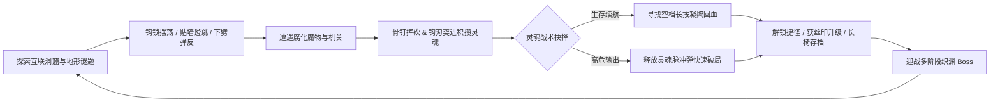
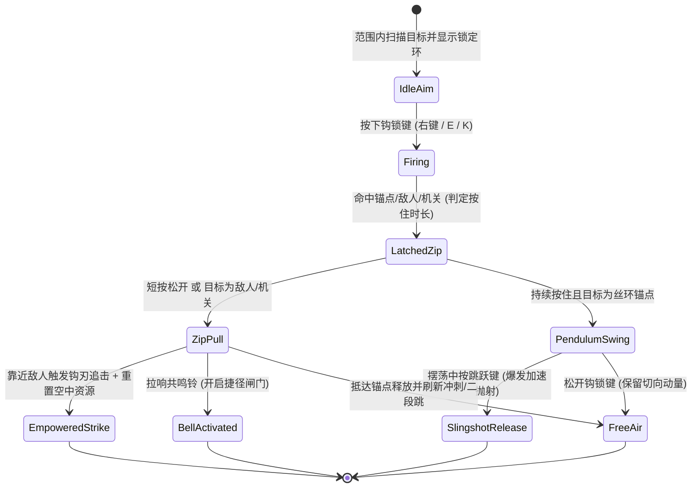
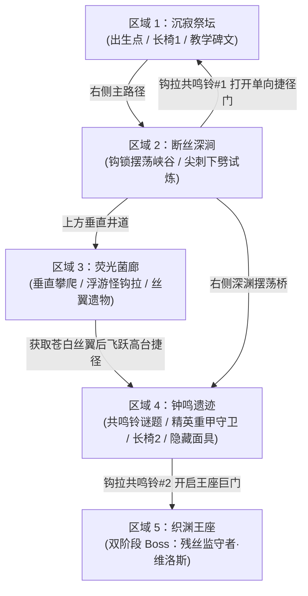

# 《丝烬幽窟》（SILKHOLLOW）游戏设计策划案（GDD）

> **文档版本**：v1.0（含可玩垂直切片实装规格）  
> **游戏类型**：2D 横版动作银河恶魔城（Metroidvania）× 物理动量钩锁  
> **核心标签**：类《空洞骑士》手感、渊丝双模钩锁、下劈弹反（Pogo）、互联洞窟探索、多阶段 Boss 战  
> **目标平台**：Web (HTML5 Canvas / 60FPS) / PC 端（键鼠 & 纯键盘双操控方案）

---

## 1. 项目概述与核心设计支柱

### 1.1 一句话概念（High Concept）
《丝烬幽窟》是一款暗黑奇幻手绘风格的 2D 横版动作银河城游戏。玩家扮演从沉寂茧室苏醒的「残丝容器」，手持骨钉与**「渊丝钩锁」**，在危机四伏的地下失落丝织遗迹中摆荡飞跃、下劈弹反、钩拉敌阵，揭开古窟沉沦的真相并击败失控的织渊监守者。

### 1.2 三大核心设计支柱（Design Pillars）

| 支柱 | 设计目标 | 玩家体验关键词 |
| :--- | :--- | :--- |
| **支柱一：极致的动作确定性（Crisp Controls）** | 继承《空洞骑士》的零惯性启停、土狼时间、跳跃缓冲、四向劈砍与下劈弹反，辅以顿帧与定向屏幕微震。 | 干脆、精准、零拖泥带水 |
| **支柱二：动量与战斗一体的「渊丝钩锁」** | 钩锁不仅是位移工具，更是战斗起手与空中续航核心——短按高速拉拽突进、长按物理钟摆荡跃、钩敌破防、钩铃开路。 | 丝滑、高速、空中不停歇 |
| **支柱三：环环相扣的地下探索（Interconnected World）** | 抛弃线性选关，用单向捷径、能力锁、隐藏收集、长椅存档与碎片化碑文构建“柳暗花明又一村”的立体连通地图。 | 神秘、压迫、豁然开朗 |

### 1.3 核心玩法循环（Core Loop）

---

## 2. 世界观、美术与听觉方向

### 2.1 世界观背景
在被遗忘的地表之下，曾矗立着以「苍白幽丝」编织梦境与秩序的**丝织古窟**。然而名为「琥珀腐潮」的侵蚀瘟疫自深渊蔓延，令守卫古窟的机巧虫族陷入狂乱，维系洞窟运转的共鸣丝铃也相继沉寂。玩家扮演最后的无言行者——**「残丝容器」**，在沉寂祭坛中苏醒，必须借由体内的苍白渊丝重连古窟、平息狂化的**残丝监守者 · 维洛斯**。

### 2.2 视觉与色彩规范（2D 多层视差氛围）
- **角色造型**：高对比度的象牙白面具双角容器 + 动态多节布料物理披风（Verlet 柔性解算），确保主角在暗色调洞窟高速移动时始终具备极高视觉辨识度。
- **五层视差纵深（Parallax Layers）**：
  1. **远景深渊层（0.10x）**：幽蓝深邃洞顶光柱、微弱呼吸式体积光晕。
  2. **远古遗迹层（0.25x）**：哥特式破败拱门、垂落古链与远景钟塔剪影。
  3. **中景岩壁层（0.50x）**：钟乳石、悬垂晶簇与荧光菌伞轮廓。
  4. **主交互层（1.00x）**：高可读性雕刻岩砖、发光边缘高光、清晰可辨的尖刺/丝环/机关/敌人。
  5. **前景与微粒层（1.18x）**：飘浮孢子、微尘光斑、受击/濒死暗角渐变（Vignette）。
- **核心情绪色板**：
  - **主基调（深渊岩层）**：`#070a14`、`#11182b`、`#1e2942`
  - **主角与苍白灵魂**：`#f4f7ff`、`#bae6fd`
  - **渊丝与安全锚点（高明度青蓝）**：`#5eead4`、`#38bdf8`、`#cffafe`
  - **琥珀腐化（敌人/危险尖刺/Boss 强攻击）**：`#fb923c`、`#f43f5e`、`#fde047`
  - **荧光菌廊点缀**：`#34d399`、`#a78bfa`

### 2.3 程序化听觉设计（Procedural Web Audio）
采用纯 Web Audio API 实时合成音效与环境音，兼顾零延迟响应与地下空灵质感：
- **环境音景**：低频洞窟共振基底（Lowpass Drone）+ 稀疏五声音阶空灵铃音（Pentatonic Glass Bells），营造孤独静谧感；进入 Boss 区域后自动切换为紧张脉动节拍。
- **核心动作反馈音**：骨钉凌厉高频斩风声、命中肉体低频闷响、命中护甲/尖刺清脆金属弹反音（Clang）、渊丝射出鞭鸣与钩锁扣环清脆谐音、凝聚灵魂低沉和声吟唱。

---

## 3. 核心系统一：角色操控与「渊丝钩锁」深度设计

### 3.1 基础移动参数与手感保障（60Hz 固定步长）

| 参数项 | 数值 / 机制 | 设计意图 |
| :--- | :--- | :--- |
| 水平极速 / 地面加速度 | `310 px/s` / `2800 px/s²`（制动 `3400 px/s²`） | 瞬间启停、指哪停哪，杜绝脚底打滑 |
| 跳跃初速 / 可变跳截断 | `-600 px/s`；松开跳跃键上升速度立即乘以 `0.48` | 轻松精准控制短跳与大跳高度 |
| 土狼时间（Coyote Time） | `110 ms` | 离开平台边缘瞬间仍可安全起跳 |
| 跳跃缓冲（Jump Buffer） | `120 ms` | 落地前提前按跳将在触地首帧自动起跳 |
| 贴墙滑行 / 蹬墙跳 | 贴墙最大下滑速度 `135 px/s`；蹬墙斜向弹出 `(±350, -560)` | 支撑垂直井道攀爬与钩锁接力 |
| 幽影冲刺（Dash） | `720 px/s` 持续 `155 ms`，冷却 `520 ms`（空中限 1 次） | 兼具闪避、跨缝与节奏衔接，附带白色残影 |
| 能力解锁：苍翼二段跳 | 获取「苍白丝翼」遗物后解锁空中额外一次跳跃 | 典型银河城纵深探索能力锁 |

### 3.2 招牌机制：渊丝钩锁（Abyssal Silk Grapple）

为同时满足**键鼠精确瞄准玩家**与**《空洞骑士》纯键盘玩家**，钩锁采用「**双模瞄准 + 双态操控**」设计：
- **智能混合锁定**：
  - 鼠标移动时，优先向准星方向锥形扇区内搜索最近的有效钩锁目标，并显示发光**渊丝锁定环**；
  - 纯键盘操作时，自动依据角色朝向与上下方向键在最大射程（`340 px`，强化后 `420 px`）内智能吸附最优目标。
- **双态操控（短按 vs 长按）**：
  - **短按钩锁（< 170ms 松开）→ 极速拉拽（Zip-Pull）**：以 `860 px/s` 直线弹射至目标处，在接近锚点时保留惯性并赋予轻微向上抛射力，适合快节奏连环穿刺与突进。
  - **长按钩锁（保持按住）→ 物理钟摆摆荡（Pendulum Swing）**：建立柔性弹性绳索约束，玩家按 `A/D` 施加切向摆荡推力、按 `W/S` 微调绳长；在摆荡弧线最高点按「跳跃」可触发**弹弓抛射（Slingshot Launch）**，获得超高斜向初速度飞跃宽阔毒刺深渊。

### 3.3 钩锁三重交互与「空中资源重置循环」

| 目标类型 | 视觉特征 | 交互效果 | 战术与关卡意义 |
| :--- | :--- | :--- | :--- |
| **渊丝环锚点（Silk Ring）** | 悬浮青白双环与星芒 | 支持短按拉拽与长按摆荡；释放后**立即重置空中冲刺与钩锁冷却** | 构建高空无落地跑酷与 Boss 战制空躲避 |
| **腐化敌怪 / Boss 弱点** | 命中时浮现橙青交叉锁环 | 极速钩拉突进至敌侧，期间附带 `180ms` 短暂避伤，触发下一次斩击伤害 `×1.5` 的**钩刃斩**；若 Boss 处于失衡核暴露期，钩拉直接造成巨额破防重击 | 将位移机制无缝融入高频进攻，实现“飞身追击 + 下劈弹跳”立体空战 |
| **共鸣丝铃（Resonance Bell）** | 悬挂青铜古铃与光纹连线 | 钩锁拉拽触发钟鸣声波，远程开启封闭石闸门或激活捷径 | 银河城式空间机关解谜，打通区域回环 |

---

## 4. 核心系统二：战斗、灵魂与成长构筑

### 4.1 骨钉四向劈砍与下劈弹反（Pogo）
- **四向挥砍**：默认水平挥砍；按住 `W/↑` 向上劈砍对空；空中按住 `S/↓` 向下劈砍。
- **经典下劈弹反（Pogo）**：下劈命中**敌人、尖刺地面、共鸣铃或 Boss 武器**时，主角立刻获得向上弹跳力（`-520 px/s`）并**重置空中冲刺与钩锁**。结合尖刺阵与丝环，可演绎极具操作上限的极限身法。
- **打击感参数（Game Feel）**：
  - 普攻命中顿帧：`48 ms`；钩刃强化斩/暴击顿帧：`75 ms`；受击顿帧：`90 ms` + `1.1s` 无敌闪烁。
  - 每次命中产生定向扇形粒子飞溅与反作用微击退。

### 4.2 灵魂容器（Soul Vessel）与风险博弈
- 灵魂上限 `99`，每次骨钉命中获得 `+12` 灵魂，钩刃强化命中获得 `+18` 灵魂。
- **凝聚回血（长按 `F / Q` 持续 0.9s，消耗 33 灵魂）**：需站在地面引导，引导中不可移动但伴随苍白灵魂粒子汇聚，完成后恢复 `1` 格面具血量——经典的“抓 Boss 硬直贪血”博弈。
- **灵魂脉冲弹（短按 `F / Q`，消耗 33 灵魂）**：向前发射穿透性苍白灵魂冲击波（伤害 `28`），可远程清理棘手飞行怪或补刀。

### 4.3 探索成长与收集（垂直切片实装 + 完整版规划）
- **当前版本实装**：
  - **遗物解锁「苍白丝翼（Silk Wings）」**：隐藏于荧光菌廊高台，解锁二段跳 + 钩锁最大射程提升（`340px → 420px`）。
  - **面具碎片（Mask Shard）**：隐藏于钟鸣遗迹暗格，拾取后最大生命值 `5 → 6` 并回满。
  - **苍白微尘（Pale Shards / 货币）**：击杀敌人与探索收集，统计探索完成度。
- **完整版扩展规划（丝印护符系统）**：设计 12 枚丝印（如「速丝印」缩短钩锁冷却、「重坠印」下劈附带冲击波、「回响印」摆荡释放后产生护体丝刃），在长椅处自由搭配槽位。

---

## 5. 关卡设计与银河城互联拓扑

游戏采用**单张无缝大型互联世界地图**（划分为 5 个无缝衔接的生态分区，支持实时小地图与 `Tab` 全景地图查看）：

### 各区域体验节奏设计
1. **沉寂祭坛（安全教学区）**：安静的初始长椅、石碑刻痕引导基础移动与挥砍、首个低风险丝环与基础爬虫，让玩家 30 秒内掌握手感。
2. **断丝深涧（核心钩锁试炼）**：宽阔尖刺峡谷串联 5 枚高低错落的渊丝环，玩家既可用短按连续弹射，也可长按钟摆帅气荡跃；右侧上方设有一枚「共鸣丝铃」，钩拉后开启通往祭坛的近道闸门。
3. **荧光菌廊（垂直探索与钩敌进阶）**：荧光菌伞与垂直通道构成上升路线，空中盘旋的「孢子幽灵」既是障碍也是活体跳板（通过钩锁钩敌+下劈借力登顶），顶端神龛存放关键遗物**「苍白丝翼」**。
4. **钟鸣遗迹（综合考验与战前休整）**：结合尖刺走廊、巡逻「腐甲卫士」与双层暗道（隐藏 `+1 面具碎片`），设有战前第二个存档长椅与通往王座的钟铃巨门。
5. **织渊王座（终局 Boss 校验）**：宽敞宏伟的拱顶竞技场，高空悬吊 3 枚战术丝环，全面检验玩家的骨钉走位、下劈弹反、钩锁制空与灵魂回血时机。

---

## 6. 敌人生态与多阶段 Boss 战设计

### 6.1 常规敌怪矩阵

| 敌人名称 | 分布区域 | HP | 行为模式 | 钩锁/骨钉克制策略 |
| :--- | :--- | :---: | :--- | :--- |
| **腐壳爬虫（Blight Crawler）** | 祭坛 / 深涧 | 30 | 沿平台往复巡逻，边缘自动折返 | 普攻收割灵魂 / 下劈练手 |
| **孢子幽灵（Spore Wisp）** | 菌廊 / 深涧 | 35 | 悬浮飘荡，发现玩家后蓄力发射缓慢追踪腐化孢子 | **最佳活体钩锁点**：钩刃突进贴脸一刀斩 + 下劈继续升空 |
| **苔跃虫（Moss Hopper）** | 菌廊 / 遗迹 | 50 | 发现玩家后蓄力高跳扑击，落地有短硬直 | 冲刺穿身反打，或起跳下劈弹头 |
| **腐甲卫士（Husk Knight）** | 钟鸣遗迹 | 95 | 正面举盾巡逻，近身发动长前摇大劈斩或短距冲刺 | 正面平砍易被弹开；推荐**钩锁越顶绕背**、下劈头顶或灵魂弹破防 |

### 6.2 Boss 设计：「残丝监守者 · 维洛斯」（Velos, the Broken Weaver）
- **总生命值**：`420 HP`（在屏幕底部显示专属哥特式 Boss 血条与失衡条）
- **第一阶段（100% ~ 55% HP）—— 剑术压迫**：
  1. **残影突刺（Lunge Slash）**：后撤亮起琥珀刀光（`0.55s` 清晰前摇）后高速水平穿刺，适合起跳**下劈弹反**或利用高空丝环躲避。
  2. **跃空震裂（Leap Slam）**：跃至玩家上方重砸地面，向左右释放低矮能量波，跳起或钩锁滞空规避。
  3. **三连丝矛（Silk Volley）**：滞空召唤 3 枚指向性光矛依次齐射，考验冲刺与掩护走位。
- **第二阶段（< 55% HP）—— 渊丝暴走**：
  - Boss 发出震屏嘶鸣并点亮竞技场顶端全部 **3 枚战术丝环**，攻击节奏加快 25%。
  - 新增 **「裂地腐潮」（Floor Sweep）**：蓄力引爆全屏地面火焰/腐潮，**强制要求玩家钩锁悬吊或连环摆荡滞空躲避**！
  - **专属高光机制「渊丝失衡处决」**：每累计承受约 `130` 伤害，Boss 会单膝跪地并暴露胸口青金色**「失衡丝核」**（持续 `3.5s`）。此时对其使用**渊丝钩锁拉扯**，将触发拉断腐化核心的**处决重击（造成 `55` 暴击伤害 + 大量灵魂 + 炫目顿帧爆炸）**！

---

## 7. UI / HUD 与双方案操控设计

### 7.1 HUD 界面布局
- **左上角（经典空洞骑士神韵）**：裂纹苍白灵魂球容器（液面随灵魂量动态波动，满 33 可用时泛起微光）+ 横排发光面具血条（破碎时播放碎裂粒子）+ 苍白微尘计数 + 当前已解锁能力徽章。
- **右上角**：半透明迷雾探索小地图（仅点亮玩家走过的区域，标注长椅、遗物与 Boss 位置）+ 区域标题淡入提示。
- **游戏内生态化提示（Diegetic UI）**：有效钩锁目标外围动态渲染旋转青色丝环与连线预瞄；地面长椅靠近时浮现 `[W / ↑] 歇息存档` 微光提示。

### 7.2 操控方案（无缝兼容键鼠与纯键盘）

| 动作 | 键鼠推荐方案（默认同步生效） | 纯键盘（类空洞骑士经典） |
| :--- | :--- | :--- |
| 左右移动 / 摆荡发力 | `A` / `D` | `←` / `→` |
| 向上 / 向下（决定上下劈 & 长椅互动） | `W` / `S` | `↑` / `↓` |
| 跳跃 / 蹬墙跳 / 摆荡弹射 | `Space` | `Z` / `Space` |
| 骨钉四向劈砍（配合上下键） | `鼠标左键` / `J` | `X` / `J` |
| **渊丝钩锁**（短按拉拽 / 长按摆荡） | **`鼠标右键`** / `E` | **`K` / `E`** |
| 幽影冲刺 | `Shift` / `L` | `C` / `Shift` |
| 灵魂（长按回血 / 短按灵魂弹） | `F` / `Q` | `F` / `V` |
| 暂停 / 键位说明 / 大地图 / 静音 | `Esc` / `Tab` / `M` | `Esc` / `Tab` / `M` |

---

## 8. 工程架构与研发里程碑规划

### 8.1 当前可玩垂直切片（Vertical Slice v1.0）架构与实装清单
本策划案配套交付位于 `hollow_grapple/` 的零依赖纯前端可玩版本（支持浏览器直接双击 `index.html` 流畅 60FPS 游玩）：
- `index.html` & `styles.css`：全屏响应视口、标题主界面、HUD、大地图与通关结算面板。
- `js/constants.js`：统一物理常数、手感调优参数、颜色主题与数值配置表。
- `js/audio.js`：程序化 Web Audio API 音效合成器与动态氛围音乐引擎。
- `js/level.js`：5 大互联分区瓦片地图、碰撞检测、尖刺、丝环锚点、共鸣铃与闸门联动、存档长椅、碑文与收集物。
- `js/player.js`：高响应状态机、土狼/缓冲跳跃、贴墙滑跳、冲刺残影、Verlet 柔性披风、四向挥砍+下劈弹反、灵魂系统及双模物理钩锁解算器。
- `js/enemies.js`：4 类常规敌怪 AI 与双阶段 Boss「残丝监守者 · 维洛斯」完整状态机。
- `js/renderer.js`：5 层视差洞窟场景、程序化建筑/晶体/发光孢子渲染、丝线波动动画、粒子系统与空洞骑士风 HUD 绘制。
- `js/main.js`：固定 60Hz 物理主循环、顿帧（Hitstop）、前瞻平滑相机、长椅存档复活与胜负流程控制。

### 8.2 完整商业版后续迭代路线图（M1 ~ M4）
- **M1 垂直切片定型（已完成原型）**：单一大地图 5 分区、双模钩锁手感验证、4 怪 + 1 多阶段 Boss 闭环。
- **M2 构筑与探索扩容**：新增 12 枚丝印护符与槽位系统、长椅切换构筑、NPC 旅者支线与商店经济循环。
- **M3 大世界生态扩展**：拓展至 6 个大型风格化地貌（结晶竖井、沉没钟楼、王庭废墟等）、3 项能力锁（酸泳/暗影冲刺/充能钩锁）与 5 场主题 Boss 战。
- **M4 视听打磨与商业化发布**：接入骨骼/逐帧高精美术资产、完整管弦/钢琴配乐、手柄（Gamepad API）震动支持、速通计时模式与 Boss Rush（神居）玩法。
